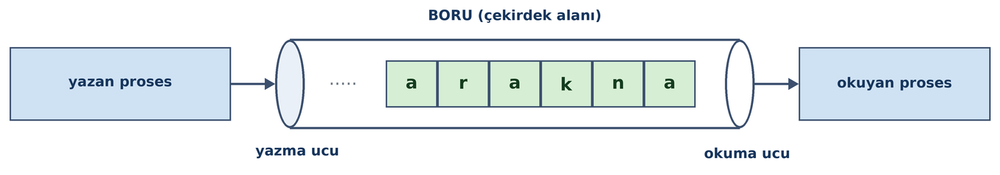
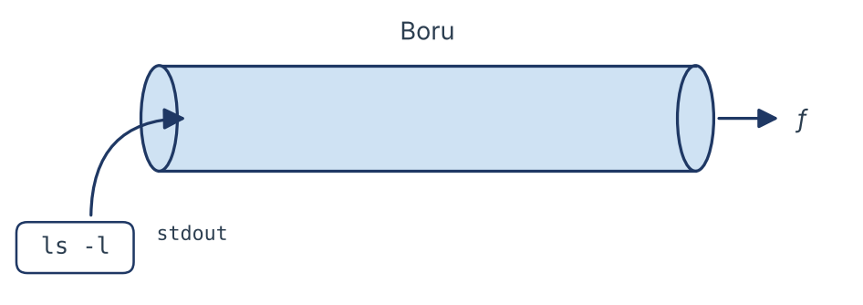

=========================
Proseslerarası Haberleşme
=========================

Bu bölümde UNIX/Linux sistemlerinde *proseslerarası haberleşme (interprocess communication)* konusunu ele
alacağız. Proseslerarası haberleşme oldukça önemli ve ayrıntılı bir konudur.

Proseslerarası Haberleşme Nedir?
================================

İşletim sistemleri dünyasında bir prosesin başka bir prosese bilgi göndermesi ve başka bir prosesten bilgi almasına
*proseslerarası haberleşme (interprocess communication (IPC))* denilmektedir. Burada bilgi gönderip almadan
kastettiğimiz şey bir grup byte'ın gönderilip alınmasıdır.

Proseslerarası haberleşmenin en bariz örneği *istemci-sunucu (client-server)* modelidir. Bu modelde istemci program
sunucu programa bir istek gönderir. Sunucu program da bu isteği yerine getirip sonuçları istemci programa iletir.
Benzer biçimde *dağıtık sistemlerde (de distributed systems)* esas olarak proseslerarası haberleşme mekanizmaları
kullanılmaktadır.

Proseslerarası haberleşme mekanizmaları iki bölümde ele alınıp incelenmektedir:

| **1.** Aynı makinenin prosesleri arasında haberleşme
| **2.** Farklı makinelerin prosesleri arasında haberleşme

Aynı makinenin prosesleri arasında haberleşme işletim sisteminin sağladığı özel yöntemlerle gerçekleştirilmektedir.
Farklı makinelerin prosesleri arasında haberleşme için ortak uyulması gereken bazı kuralların belirlenmiş olması
gerekir. Bu ortak kurallara *protokol (protocol)* denilmektedir. Farklı makinelerin prosesleri arasında haberleşme
için çeşitli protokol aileleri oluşturulmuştur. Ancak bunlardan en yaygın kullanılanı *IP (Internet Protocol)*
protokol ailesidir. Biz kitabımızda önce aynı makinenin prosesleri arasındaki haberleşme yöntemlerini inceleyeceğiz,
daha sonra başka bir bölümde farklı makinelerin prosesleri arasındaki haberleşme yöntemleri üzerinde duracağız. O
bölümde IP protokol ailesini ve TCP/UDP haberleşmelerini ayrıntılı bir biçimde ele alacağız.

Aynı makinenin prosesleri arasındaki haberleşmeler işletim sistemine bağlı bir biçimde yani işletim sistemine
özgü bir biçimde yürütülmektedir. Ancak aynı makinenin prosesleri arasındaki haberleşmeler için işletim
sistemlerinde birbirine benzer yöntemler kullanılmaktadır. Örneğin *boru (pipe)* haberleşmesi UNIX/Linux 
sistemleriyle Windows sistemleri arasında benzer biçimde yürütülmektedir. *Paylaşılan bellek
alanları (shared memory)* denilen haberleşme yöntemi de yine UNIX/Linux sistemleriyle Windows sistemlerinde
benzer biçimde uygulanmaktadır. Ancak bazı işletim sistemlerinde o sisteme özgü özel yöntemler de
bulunabilmektedir. Tabii biz kitabımızda UNIX/Linux sistemlerindeki proseslerarası haberleşme yöntemleri
üzerinde duracağız.

Proseslerarası haberleşme mekanizmasının iki yönü vardır. Birincisi iki prosesin haberleşeceği bir ortamın
oluşturulmasıdır. İkincisi ise bu ortamın senkronize bir biçimde kullanılmasıdır. Yani proseslerarası
haberleşme bir senkronizasyon sağlanarak gerçekleştirilmelidir. Biz bu bölümde sürecin senkronizasyon kısmı
üzerinde durmayacağız. Thread senkronizasyonu thread'lerin anlatıldığı kısımda ele alınacaktır.

Proseslerarası haberleşme için İngilizce yaygın biçimde *IPC* kısaltması kullanılmaktadır. Biz de kitabımızda 
bazen bu kısaltmayı kullanacağız. 

Boru Haberleşmesi
=================

En yaygın kullanılan proseslerarası haberleşme yöntemi *boru (pipe)* haberleşmesi denilen yöntemdir. Boru
haberleşmesi hem bir ortam sunarken hem de senkronizasyonu kendi içerisinde sağlamaktadır. Bu nedenle boru
haberleşmesi kolay kullanılabilen bir IPC yöntemidir. Boru haberleşmeleri *isimsiz boru haberleşmeleri* ve
*isimli boru haberleşmeleri* olmak üzere ikiye ayrılmaktadır. İsimsiz boru haberleşmelerine İngilizce *unnamed
pipe* ya da *anonymous pipe*, isimli boru haberleşmelerine ise *named pipe* ya da *fifo* denilmektedir. Biz
kitabımızda önce *isimsiz boru haberleşmesini*, sonra da *isimli boru haberleşmesini* anlatacağız.

Peki boru nedir? Boru aslında FIFO prensibiyle çalışan bir kuyruk sistemidir. Bu kuyruk sistemi çekirdek
tarafından çekirdek alanı içerisinde oluşturulmaktadır. Bir proses boruya yazar, diğeri de borudan
yazılanları okur. Boruya yazılan byte'lar FIFO prensibine göre yazılırlar, böylece borudan okuyan taraf
olanları yazıldığı sırada okur. Örneğin boruya yazan taraf ``ankara`` yazısının karakterlerini (byte'larını) 
boruya yazmış olsun. Şimdi okuyan taraf önce ``'a'`` byte'ını sonra da sırasıyla ``'n'``, ``'k'``, ``'a'``, 
``'r'`` ve ``'a'`` byte'larını borudan okur.



UNIX/Linux sistemlerinde borular birer dosya gibi ele alınmaktadır. Dolayısıyla boruya yazma işlemi ``write``
fonksiyonu ile borudan okuma işlemi ise ``read`` fonksiyonu ile yapılmaktadır.

Boruların belli bir uzunlukları vardır. Eskiden BSD ve Linux sistemlerinde boru uzunlukları 4096 byte (bir
sayfa) büyüklüğündeydi. Linux daha sonra varsayılan boru uzunluğunu 64K'ya (65536 byte'a (16 sayfaya))
yükseltmiştir.

UNIX/Linux sistemlerinde borular tek yönlüdür. Bu nedenle proseslerden biri boruya yazma yaparken diğeri borudan
okuma yapar. Borunun tek yönlü olması iki prosesin de yazdıklarının aynı boruya yazılması anlamına gelmektedir. Yani 
örneğin P prosesi boruya yazma yapıp yine P prosesi borudan okuma yaparsa kendi yazdığını okur. Bunun da bir anlamı olmaz.
Halbuki çift yönlü borularda borudan hem okuma hem yazma yapılabilmektedir. Borudan okuma yapıldığında karşı
tarafın yazdığı okunmaktadır. Ancak UNIX/Linux sistemlerinde yukarıda da belirttiğimiz gibi borular tek yönlüdür.
Dolayısıyla haberleşmede bir taraf yazma yaparken diğer taraf okuma yapmalıdır. Eğer borularla karşılıklı okuma
yazma yapılmak isteniyorsa iki boru kullanılmalıdır.

Borular dosyalar gibi kullanılmaktadır. Borulardan okuma ``read`` fonksiyonu ile borulara yazma da ``write``
fonksiyonu ile yapılmaktadır. Borulara ``write`` fonksiyonu ile yazma yapılırken yazılmak istenen byte kadar
boruda boş yer yoksa ``write`` işlemi blokeye yol açar ve boruda yazılmak istenen miktar kadar boş alan oluşana
kadar ``write`` çağrısını yapan thread blokede bekletilir. Örneğin biz boruya ``50`` byte yazmak isteyelim. Eğer 
boruda en az ``50`` byte'lık boş yer varsa biz bloke olmadan bu işlemi yaparız ve ``write`` fonksiyonu ``50`` değeri 
ile geri döner. Ancak boruda örneğin ``40`` byte boş yer varsa bu durumda ``write`` fonksiyonu boruda ``50`` byte'lık 
yer açılana kadar blokede bekler. Boruda ``50`` byte'lık yer açıldığında bu ``50`` byte'ı boruya yazar ve ``50``
değeri ile geri döner. Böylece bir proses sürekli boruya yazma yapar ancak karşı taraf borudan okuma yapmazsa boru 
dolar en sonunda ``write`` fonksiyonu blokede bekler. Karşı taraf borudan okuma yaptığında boruda yer açılacaktır.

Borulara yazma işlemi atomik düzeyde yapılmaktadır. Atomik yazma demekle "sanki yazma işleminin tek hamlede
araya hiçbir akış girmeden yapılması" kastedilmektedir. Örneğin ``write`` fonksiyonu ile boruya ``50`` byte yazılmak
istendiğinde bu ``50`` byte tek hamlede araya kimse girmeden yazılmaktadır. Atomik işlemlerde dıştaki gözlemci bir
olayı ya olmuş görür ya da olmamış görür. Olayı bir süreç içerisinde gerçekleşiyormuş gibi görmez. Bu
atomiklikten dolayı farklı prosesler aynı boruya aynı anda yazma yapsalar bile bu yazılanlar iç içe
geçmemektedir. Ancak borularda ``PIPE_BUF`` denilen bir sembolik sabit değeri vardır. Eğer iki prosesten en az
biri bu ``PIPE_BUF`` değerinden daha yüksek miktarda byte'ı boruya yazmak isterse bu durumda iç içe geçme
oluşabilir. Yani ``PIPE_BUF`` değerinden daha fazla bir değerin boruya yazılması atomik değildir. Birden fazla
prosesin aynı boruya aynı zamanda yazma yapması durumunda iç içe geçmenin olmaması için yazılanların ``PIPE_BUF``
değerinden daha küçük ya da ona eşit olması gerekir. ``PIPE_BUF`` pek çok sistemde (Linux'ta da böyle)
``4096`` değerindedir. Burada önemli bir nokta şudur: Biz ``PIPE_BUF`` değerinden daha fazla byte'ı boruya yazmak
istediğimizde yine tüm bilgi boruya yazılana kadar bloke oluşmaktadır. Ancak bu durumda iç içe geçmeme garanti
edilememektedir. ``PIPE_BUF`` değerinin borunun uzunluğunu belirtmediğine, atomik yazma için bir sınır değer
belirttiğine dikkat ediniz. Yazan taraf borunun uzunluğundan fazla bilgiyi boruya yazmaya çalışabilir. Bu
durum geçerlidir, yine tüm bilgi boruya yazılana kadar bloke oluşmaktadır.

Normal olarak borulara yazma yaparken ``write`` fonksiyonu tüm byte'lar yazılana kadar bloke oluşturduğuna göre
``write`` fonksiyonunun yazılmak istenen byte sayısı ile geri dönmesi beklenir. Gerçekten de hemen her zaman böyle
olmaktadır. Ancak ``write`` fonksiyonu ile boruya yazma yapılırken bir sinyal oluşursa bu durumda POSIX
standartları kısmi yazma yapılabileceğini söylemektedir. Ancak Linux sistemlerinde kısmi yazma yapılmamaktadır.
Bu durumda ``write`` fonksiyonu boruya hiçbir şey yazmadan başarısız olur ve ``-1`` değeri ile geri döner. ``errno``
değişkeni de ``EINTR`` değeriyle set edilir. Linux sistemlerinde yine ``write`` fonksiyonu boruda yeterince yer yoksa
ve blokeye yol açmışsa sinyal oluştuğunda boruya bir şey yazmadan ``-1`` ile geri dönmektedir. (Yani blokeli boru
yazımlarında POSIX standartlarına göre kısmi yazım söz konusu olabilirse de Linux sistemlerinde *kısmi yazım
(partial write)* işlemi yapılmamaktadır.)

Boruya ``0`` byte yazılmak istenirse bu durum POSIX standartlarında *belirsiz (unspecified)* bırakılmıştır. Ancak
pek çok UNIX türevi sistem (Linux'ta da böyle) ``0`` byte yazma durumunda boruya bir şey yazmamakta basit bazı
kontroller yapıp ``write`` fonksiyonunu sonlandırmaktadır. Eğer bu kontrollerde bir sorun yoksa ``write`` fonksiyonu ``0``
ile geri dönmektedir.

``read`` fonksiyonu ile borudan okuma yapılırken ``read``` fonksiyonu eğer boru tamamen boşsa en az ``1`` byte boruda olana
kadar blokeye yol açar. Ancak boruda en az ``1`` byte bilgi varsa ``read`` fonksiyonu okuyabildiği kadar byte'ı okur,
blokeye yol açmadan hemen okuyabildiği byte sayısı ile geri döner. Yani ``read`` fonksiyonu tüm byte'lar okunana kadar değil,
en az ``1`` byte okunana kadar beklemeye yol açmaktadır. Bu bakımdan ``write`` fonksiyonu gibi davranmamaktadır.
Örneğin biz borudan ``50`` byte okumak isteyelim. Ancak boruda ``10`` byte bulunuyor olsun. ``read`` fonksiyonu ``50`` byte
okunana kadar beklemez. O ``10`` byte'ı okur, ``10`` değeri ile geri döner. Ancak boru tamamen boşsa ``read`` fonksiyonu
en az ``1`` byte boruya yazılana kadar blokede bekleyecektir. Örneğin biz borudan ``50`` byte okumak isteyelim. Ancak
boruda hiç byte olmasın. Bu durumda ``read`` fonksiyonu blokede bekler. O sırada bir proses boruya ``10`` byte yazmış
olsun. Şimdi ``read`` fonksiyonu bu ``10`` byte'ı alarak işlemini sonlandırır ve ``10`` değeri ile geri döner. ``read``
fonksiyonu ile borudan okuma yapılırken sinyal oluştuğunda POSIX standartları boruda okunmak istenen byte
kadar bilgi olsa bile POSIX standartları kısmi okuma (partial ``read``) yapılabileceğini belirtmektedir. Ancak
Linux gibi pek çok UNIX türevi sistemde bu tür durumlarda kısmi okuma yapılmamaktadır. (Yani çekirdek sinyali
okuma işleminden sonra devreye sokmaktadır.)

Peki boru haberleşmesi nasıl sonlandırılmaktadır? Boruyu kesinlikle önce yazan tarafın kapatması gerekir. Bu
durumda okuyan taraf boruda kalanları okur. Artık boruda okunacak bir şey kalmamışsa ve yazan taraf da
boruyu kapatmışsa ``read`` fonksiyonu ``0`` değeri ile geri döner. Yukarıda da belirttiğimiz gibi normalde ``read``
fonksiyonu boruda hiç bilgi yoksa blokede beklemektedir. Ancak eğer boruya yazma potansiyelinde olan hiçbir
betimleyici kalmadıysa bu durumda ``read`` fonksiyonu bloke olmadan ``0`` ile geri döner. O halde sonlandırma şöyle
yapılmalıdır: Önce yazan taraf boruyu kapatır. Sonra okuyan taraf boruda kalanları okur ve ``read`` fonksiyonu ``0``
ile geri döndüğünde okuyan taraf da boruyu kapatır.

Boru haberleşmesinde eğer boruyu yanlış bir biçimde önce okuyan taraf kapatırsa yazan taraf boruya yazma
yaptığında ``SIGPIPE`` isimli bir sinyal oluşmaktadır. Bu sinyal de eğer ele alınmadıysa prosesin sonlanmasına yol 
açacaktır. Yani okuma tarafı kapatılmış bir boruya yazma yapmak normal bir durum değildir. Ancak yazma tarafı kapatılmış bir
borudan okuma yapmaya çalışmak normal bir durumdur. Yukarıda da belirttiğimiz gibi bu durumda ``read`` fonksiyonu
boruda bir şey kalmadıysa ``0``, ile geri dönecektir.

İsimsiz Boru Haberleşmesi
-------------------------

İsimsiz boru haberleşmesi yalnızca üst ve alt prosesler arasında yapılabilen bir haberleşmedir. İsimsiz boru
haberleşmesi tipik olarak şu aşamalardan geçilerek gerçekleştirilir:

| **1.** Üst proses henüz ``fork`` ile alt prosesi yaratmadan önce ``pipe`` isimli POSIX fonksiyonu ile isimsiz boruyu
   yaratmalıdır. ``pipe`` fonksiyonunun prototipi şöyledir:

   .. code-block:: c

      #include <unistd.h>

      int pipe(int pipefd[2]);

   ``pipe`` fonksiyonu ``int`` türden bir dizinin başlangıç adresini parametre olarak alır. (Prototipteki dekleratör
   bir gösterici dekleratörüdür. Bunun bu biçimde belirtilmesinin nedeni fonksiyonun iki elemanlı ``int`` türden bir
   dizinin başlangıç adresini aldığını vurgulamak içindir.) ``pipe`` fonksiyonu boruyu yaratır. Borudan okuma yapmak
   ve boruya yazma yapmak için iki dosya betimleyicisi oluşturur. O betimleyicilerin numaralarını da bizim fonksiyona
   geçirdiğimiz iki elemanlı ``int`` diziye yerleştirir. Dizinin ilk elemanına borudan okuma yapmak için kullanılacak
   betimleyiciyi, ikinci elemanına ise boruya yazma yapmak için kullanılacak betimleyiciyi yerleştirmektedir. Tabii bu
   betimleyiciler dosya betimleyici tablosunda tahsis edilmiş durumdadır. Bu betimleyicilerin gösterdiği dosya
   nesneleri boruya erişmek için gereken bilgileri tutmaktadır. Bize verilen dizinin ilk elemanına yerleştirilen
   betimleyici read-only, dizinin ikinci elemanına yerleştirilen betimleyici ise write-only bir betimleyicidir. Yani
   biz ilk betimleyici ile yalnızca ``read`` işlemi, ikinci betimleyici ile yalnızca ``write`` işlemi yapabiliriz.
   ``pipe`` fonksiyonunun dosya betimleyici tablosundaki en düşük numaralı boş betimleyicileri vereceği POSIX
   standartlarında garanti edilmiştir. Ancak ``pipe`` fonksiyonunun verdiği iki betimleyicinin hangisinin düşük
   numaralı betimleyici olacağı hakkında kesin bir belirlemede bulunulmamıştır. . Örneğin:

   .. code-block:: c

      int pipefds[2];
      /* ... */

      if (pipe(pipefds) == -1)
          exit_sys("pipe");

   Oluşan durumu aşağıdaki şekille betimleyebiliriz:

   .. image:: _static/pipe-fd-table.png
      :alt: pipe fonksiyonu çağrıldıktan sonra dosya betimleyici tablosu, dosya nesneleri ve boru
      :align: center
      :width: 50%

| **2.** Boru yaratıldıktan sonra üst prosesin fork işlemi ile alt prosesi yaratması gerekir. Anımsanacağı gibi ``fork``
   işlemiyle birlikte üst prosesteki tüm betimleyiciler alt proseste de aynı değerlerle aynı dosya nesnelerini
   gösterir biçimde oluşturulmaktadır. Yani artık üst ve alt prosesler aynı numaralı betimleyicilerle boruya
   erişebilir durumda olur. Örneğin:

   .. code-block:: c

      int pipefds[2];
      pid_t pid;
      /* ... */

      if (pipe(pipefds) == -1)
          exit_sys("pipe");

      if ((pid = fork()) == -1)
          exit_sys("fork");

      if (pid != 0) {         /* parent process */
          /* ... */
      }
      else  {                 /* child process */
          /* ... */
      }

   Oluşan durumu aşağıdaki şekille betimleyebiliriz:

   .. image:: _static/pipe-fd-tables-fork.png
      :alt: fork işleminden sonra üst ve alt prosesin betimleyicilerinin aynı dosya nesnelerini göstermesi
      :align: center
      :width: 70%

| **3.** Artık üst ve alt prosesler arasında haberleşme için bir karar verilmelidir. Kim yazacak kim okuyacaktır?
   Bundan sonra boruya yazma ve borudan okuma potansiyelinde olan birer betimleyici bırakılmalıdır. Yani yazan taraf
   okuma betimleyicisini, okuyan taraf yazma betimleyicisini kapatmalıdır. Örneğin üst proses boruya yazma
   yapacak olsun, alt proses borudan okuma yapacak olsun:

   .. code-block:: c

      int pipefds[2];
      pid_t pid;
      /* ... */

      if (pipe(pipefds) == -1)
          exit_sys("pipe");

      if ((pid = fork()) == -1)
          exit_sys("fork");

      if (pid != 0) {         /* parent process */
          close(pipefds[0]);
          /* ... */
      }
      else  {                 /* child process */
          close(pipefds[1]);
          /* ... */*/
      }

   Görüldüğü gibi üst proses okuma betimleyicisini, alt proses de yazma betimleyicisini kapatmıştır. Artık
   borudan okuma yapma potansiyelinde ve boruya yazma potansiyelinde tek bir betimleyici vardır. Oluşan durumu
   aşağıdaki şekille betimleyebiliriz:

   .. image:: _static/pipe-fd-tables-closed.png
      :alt: Üst proses okuma, alt proses yazma betimleyicisini kapattıktan sonraki durum
      :align: center
      :width: 75%

| **4.** Artık okuma ve yazma işlemleri read ve write fonksiyonlarıyla gerçekleştirilebilir. Örneğin:

.. code-block:: c

    int pipefds[2];
    pid_t pid;
    /* ... */

    if (pipe(pipefds) == -1)
        exit_sys("pipe");

    if ((pid = fork()) == -1)
        exit_sys("fork");

    if (pid != 0) {         /* parent process */
        close(pipefds[0]);

        for (int i = 0; i < 100000; ++i)
            if (write(pipefds[1], &i, sizeof(int)) == -1)
                exit_sys("write");
        /* ... */
    }
    else {                  /* child process */
        int val;

        close(pipefds[1]);
        for (int i = 0; i < 100000; ++i) {
            if (read(pipefds[0], &val, sizeof(int)) == -1)
                exit_sys("read");
            printf("%d\n", val);
        }
        /* ... */
    }

| **5.** Haberleşmeyi sonlandırmak için yazan taraf boruyu kapatır. Okuyan taraf önce boruda kalanları okur, sonra
   ``read`` fonksiyonu ``0`` ile geri döner. Böylece okuyan taraf da boruyu kapatır. Örneğin:

   .. code-block:: c

      int pipefds[2];
      pid_t pid;
      /* ... */

      if (pipe(pipefds) == -1)
          exit_sys("pipe");

      if ((pid = fork()) == -1)
          exit_sys("fork");

      if (pid != 0) {         /* parent process */
          close(pipefds[0]);

          for (int i = 0; i < 100000; ++i)
              if (write(pipefds[1], &i, sizeof(int)) == -1)
                  exit_sys("write");
          close(pipefds[1]);
          if (wait(NULL) == -1)
              exit_sys("wait");
      }
      else {                 /* child process */
          int val;

          close(pipefds[1]);
          for (int i = 0; i < 100000; ++i) {
              if (read(pipefds[0], &val, sizeof(int)) == -1)
                  exit_sys("read");
              printf("%d\n", val);
          }
          close(pipefds[0]);
      }

   Program bir bütün olarak aşağıda verilmiştir.

.. code-block:: c

   #include <stdio.h>
   #include <stdlib.h>
   #include <unistd.h>
   #include <sys/wait.h>

   void exit_sys(const char *msg);

   int main(void)
   {
       int pipefds[2];
       pid_t pid;

       if (pipe(pipefds) == -1)
           exit_sys("pipe");

       if ((pid = fork()) == -1)
           exit_sys("fork");

       if (pid != 0) {         /* parent process */
           close(pipefds[0]);

           for (int i = 0; i < 100000; ++i)
               if (write(pipefds[1], &i, sizeof(int)) == -1)
                   exit_sys("write");
           close(pipefds[1]);
           if (wait(NULL) == -1)
               exit_sys("wait");
       }
       else  {                 /* child process */
           int val;

           close(pipefds[1]);
           for (int i = 0; i < 100000; ++i) {
               if (read(pipefds[0], &val, sizeof(int)) == -1)
                   exit_sys("read");
               printf("%d\n", val);
           }
           close(pipefds[0]);
       }

       return 0;
   }

   void exit_sys(const char *msg)
   {
       perror(msg);
       exit(EXIT_FAILURE);
   }

Peki isimsiz boru haberleşmesinde neden okuyan taraf yazma betimleyicisini, yazan taraf da okuma
betimleyicisini kapatmaktadır? İşte ``read`` fonksiyonunun ``0`` ile geri dönmesi için boruya yazma potansiyelinde
olan tek bir betimleyicinin bulunuyor olması gerekir. Eğer okuyan taraf yazma betimleyicisini kapatmazsa yazan
taraf yazma betimleyicisini kapatsa bile boruya hala yazma potansiyelinde olan bir betimleyici kaldığı için
``read`` fonksiyonu ``0`` ile geri dönmeyecektir. Bu durumda haberleşmenin sonlandırılması sorunlu hale gelecektir.
Yazan tarafın okuma betimleyicisini kapatmasının diğer durumdaki gibi kritik bir önemi yoktur. Ancak
kullanılmayan betimleyicilerin kapatılması her zaman iyi bir tekniktir.

Üst ve alt prosesler arasında haberleşme yapmak kişilere biraz tuhaf gelebilmektedir. Çünkü ``fork`` işleminden
sonra zaten her iki kod da programı yazan kişi tarafından yazılmıştır. Ancak üst ve alt prosesler arasında
boru haberleşmelerinin gerektiği önemli durumlar vardır. İzleyen paragraflarda bunun gerekliliğini siz de 
anlayacaksınız.

Eskiden thread'ler yokken bir işi daha hızlı yapmak için prosesler kullanılıyordu. Üst proses ``fork`` yapıp alt
prosesle koordineli bir biçimde işleri paylaşıyordu. O günlerde bu koordinasyonun sağlanması için üst ve alt
prosesler arasında haberleşme de gerekiyordu. Thread'lerden sonra artık bu tür işlemler prosesler yerine
thread'lerle yapılmaya başlanmıştır.

Üst ve alt prosesler arasında ``exec`` sonrasında da haberleşmeler yapılabilmektedir. Tabii bu durumda ``exec``
yapılan alt prosesin ``exec`` sonrasında boru betimleyicilerinin numaralarını biliyor olması gerekir. Ancak ``stdin``,
``stdout`` ve ``stderr`` dosyalarının betimleyicileri sabit olduğuna göre ``exec`` sonrasında haberleşme bu betimleyiciler
yoluyla yapılabilmektedir.

Kabuğun Boru İşleminin Örnek Gerçekleştirimi 
~~~~~~~~~~~~~~~~~~~~~~~~~~~~~~~~~~~~~~~~~~~~

Artık kabuk programının boru işlemini nasıl yaptığını anlayabiliriz. Örneğin aşağıdaki gibi bir kabuk komutu
verilmiş olsun:

.. code-block:: console

   $ ls -l | wc

Burada *ls* programının ``stdout`` dosyasına yazdıklarını *wc* programı ``stdin`` dosyasından okumaktadır. Kabuk bu
işlemi tipik olarak şöyle yapmaktadır:

| **1.** Kabuk önce ``pipe`` fonksiyonuyla isimsiz boruyu yaratır.

| **2.**  Kabuk *ls* programını çalıştırmak için ``fork`` yapar. Böylece isimsiz boru betimleyicileri alt prosese
   geçirilmiştir. Bundan sonra kabuk alt prosesin ``1`` numaralı betimleyicisini yazma amaçlı boruya
   yönlendirmektedir. Bundan sonra kabuk *ls* programını çalıştırmak için ``exec`` uygular. Artık *ls* programının
   ``stdout`` dosyasına yazdıkları aslında boruya yazılacaktır.

| **3.** Kabuk bu kez *wc* programı için ``fork`` uygular. Benzer biçimde alt prosesin bu kez ``0`` numaralı
   betimleyicisini boruya yönlendirir. Bundan sonra kabuk *wc* programı için ``exec`` uygular. Artık *wc*
   programının ``stdin`` dosyasından okudukları aslında borudan okunacaktır.

| **4.**  Bu süreç içerisinde kullanılmayan betimleyiciler kapatılır. Yalnızca boruya yazma ve borudan okuma
   potansiyeline sahip olan tek bir betimleyici bırakılır.

| **5.**  Boru haberleşmesinde önce yazan tarafın boruyu kapatması gerektiğini söylemiştik. Zaten *wc* programı
   sürekli ``stdin`` dosyasından okuma yaptığına göre karşı taraf boruyu kapatınca okuma döngüsünden
   çıkacaktır.

| **6.**  Kabuk ``wait`` fonksiyonlarıyla alt proseslerin sonlanmasını bekler.

Şimdi kabuğun yaptığı bu yönlendirmeyi yapan bir programı biz yazalım. Programımızın ismi *mypipe* olsun.
Program şöyle kullanılacaktır:

.. code-block:: console

   $ ./mypipe "prog1 arg1 arg2 ... | prog2 arg1 arg2 ..."

Program buradaki ``|'`` karakterinin yerini bulur. Sonra bunun iki tarafını ``strtok`` ile parse ederek iki ayrı
gösterici dizisine yerleştirir. Sonra üst proses ``pipe`` fonksiyonuyla boruyu yaratır. Soldaki ve sağdaki
programlar için ``fork`` işlemi yapar. Soldaki programı henüz ``exec`` ile çalıştırmadan o alt prosesin ``1``
numaralı betimleyicisini boruya yönlendirir. Benzer biçimde sağdaki programı henüz çalıştırmadan o prosesin de
``0`` numaralı betimleyicisini boruya yönlendirir. Sonra da ``exec`` işlemlerini uygular. Bu süreç içerisinde
kullanılmayan betimleyicileri de kapatmaktadır.

Biz aşağıdaki örneğimizde önce komut satırı argümanını ``parse_args`` fonksiyonuyla  ``|`` karakterinden parse ettik:

.. code-block:: c

   struct pipe_args {
       char *left_args[MAX_PROG_ARGS];
       char *right_args[MAX_PROG_ARGS];
   };

   int parse_args(char *args, struct pipe_args *pargs)
   {
       char *str, *arg;
       int count;

       if ((str = strchr(args, '|')) == NULL || strchr(str + 1, '|') != NULL)
           return -1;
       *str = '\0';

       count = 0;
       for (arg = strtok(args, " \t"); arg != NULL; arg = strtok(NULL, " \t")) {
           if (count == MAX_PROG_ARGS - 1)
               return -1;
           pargs->left_args[count++] = arg;
       }
       if (count == 0)
           return -1;
       pargs->left_args[count] = NULL;

       count = 0;
       for (arg = strtok(str + 1, " \t"); arg != NULL; arg = strtok(NULL, " \t")) {
           if (count == MAX_PROG_ARGS - 1)
               return -1;
           pargs->right_args[count++] = arg;
       }
       if (count == 0)
           return -1;
       pargs->right_args[count] = NULL;

       return 0;
   }

Burada fonksiyon komut satırı argümanını ``'|'`` karakterinden parse edip onun bileşenlerini ``pipe_args`` isimli bir
yapı nesnesine yerleştirdik. Programda bundan sonra isimsiz boruyu yaratıp yukarıdaki işlemleri uyguladık:

.. code-block:: c

   struct pipe_args pargs;
   int pipefds[2];
   pid_t pid_left, pid_right;
   /* ... */

   if (pipe(pipefds) == -1)
       exit_sys("pipe");

   if ((pid_left = fork()) == -1)
       exit_sys("fork");

   if (pid_left == 0) {
       close(pipefds[0]);

       if (dup2(pipefds[1], 1) == -1)
           _exit(EXIT_FAILURE);
       close(pipefds[1]);

       if (execvp(pargs.left_args[0], &pargs.left_args[0]) == -1)
           exit_sys(pargs.right_args[1]);

       /* unreachable code */
   }

   if ((pid_right = fork()) == -1)
       exit_sys("fork");

   if (pid_right == 0) {
       close(pipefds[1]);

       if (dup2(pipefds[0], 0) == -1)
           _exit(EXIT_FAILURE);
       close(pipefds[0]);

       if (execvp(pargs.right_args[0], &pargs.right_args[0]) == -1)
           exit_sys(pargs.right_args[0]);

       /* unreachable code */
   }

   close(pipefds[0]);
   close(pipefds[1]);

Programda boruya yazma ve borudan okuma yapma potansiyelinde yalnızca birer betimleyici bırakıldığına dikkat ediniz. Aşağıda
programı bir bütün olarak veriyoruz:

.. code-block:: c

   #include <stdio.h>
   #include <stdlib.h>
   #include <ctype.h>
   #include <string.h>
   #include <unistd.h>
   #include <sys/wait.h>

   #define MAX_PROG_ARGS       256

   struct pipe_args {
       char *left_args[MAX_PROG_ARGS];
       char *right_args[MAX_PROG_ARGS];
   };

   int parse_args(char *args, struct pipe_args *pargs);
   void exit_sys(const char *msg);

   int main(int argc, char *argv[])
   {
       struct pipe_args pargs;
       int pipefds[2];
       pid_t pid_left, pid_right;

       if (argc != 2) {
           fprintf(stderr, "wrong number of arguments!..\n");
           exit(EXIT_FAILURE);
       }

       if (parse_args(argv[1], &pargs) == -1) {
           fprintf(stderr, "ivalid pipe argument!..\n");
           exit(EXIT_FAILURE);
       }

       if (pipe(pipefds) == -1)
           exit_sys("pipe");

       if ((pid_left = fork()) == -1)
           exit_sys("fork");

       if (pid_left == 0) {
           close(pipefds[0]);

           if (dup2(pipefds[1], 1) == -1)
               _exit(EXIT_FAILURE);
           close(pipefds[1]);

           if (execvp(pargs.left_args[0], &pargs.left_args[0]) == -1)
               exit_sys(pargs.right_args[1]);

           /* unreachable code */
       }

       if ((pid_right = fork()) == -1)
           exit_sys("fork");

       if (pid_right == 0) {
           close(pipefds[1]);

           if (dup2(pipefds[0], 0) == -1)
               _exit(EXIT_FAILURE);
           close(pipefds[0]);

           if (execvp(pargs.right_args[0], &pargs.right_args[0]) == -1)
               exit_sys(pargs.right_args[0]);

           /* unreachable code */
       }

       close(pipefds[0]);
       close(pipefds[1]);

       if (waitpid(pid_left, NULL, 0) == 1)
           exit_sys("waitpid");

       if (waitpid(pid_right, NULL, 0) == 1)
           exit_sys("waitpid");

       return 0;
   }

   int parse_args(char *args, struct pipe_args *pargs)
   {
       char *str, *arg;
       int count;

       if ((str = strchr(args, '|')) == NULL || strchr(str + 1, '|') != NULL)
           return -1;
       *str = '\0';

       count = 0;
       for (arg = strtok(args, " \t"); arg != NULL; arg = strtok(NULL, " \t")) {
           if (count == MAX_PROG_ARGS - 1)
               return -1;
           pargs->left_args[count++] = arg;
       }
       if (count == 0)
           return -1;
       pargs->left_args[count] = NULL;

       count = 0;
       for (arg = strtok(str + 1, " \t"); arg != NULL; arg = strtok(NULL, " \t")) {
           if (count == MAX_PROG_ARGS - 1)
               return -1;
           pargs->right_args[count++] = arg;
       }
       if (count == 0)
           return -1;
       pargs->right_args[count] = NULL;

       return 0;
   }

   void exit_sys(const char *msg)
   {
       perror(msg);
       exit(EXIT_FAILURE);
   }

popen ve pclose Fonksiyonları
~~~~~~~~~~~~~~~~~~~~~~~~~~~~~

İsimsiz borularla ilgili ``popen`` isimli ilginç bir yardımcı POSIX fonksiyonu da vardır. ``popen`` fonksiyonu bir
boru yaratır, sonra kabuk programını interaktif olmayan bir biçimde (``-c`` seçeneği ile) çalıştırır. Sonra da kabuk
programının ``stdin`` ya da ``stdout`` betimleyicilerini bu yarattığı boruya yönlendirir. Borunun diğer ucunu da
``fdopen`` fonksiyonundan faydalanarak bir dosya bilgi göstericisine (*stream*) dönüştürüp bize verir. Fonksiyonun
prototipi şöyledir:

.. code-block:: c

    #include <stdio.h>

    FILE *popen(const char *command, const char *mode);

Fonksiyonun birinci parametresi çalıştırılacak kabuk komutunu belirtmektedir. İkinci parametre ``"r"`` ya da ``"w"``
biçiminde girilebilir. ``'r'`` ve ``'w'`` karakterlerinin yanına ``'e'`` karakteri de getirilebilmektedir. Eğer bu
parametre ``"r"`` girilirse kabuk komutunun ``stdout`` dosyası boruya yönlendirilir. Borunun okuma ucu da bize
verilir. Yani bu durumda bize verilen dosyadan okuma yaptığımızda aslında kabuk komutunun ``stdout`` dosyasına
yazdıklarını okumuş oluruz. Eğer ikinci parametre ``"w"`` olarak girilirse kabuk komutunun ``stdin`` dosyası boruya
yönlendirilir. Bu durumda bize verilen dosyaya yazma yaptığımızda aslında boruya yazma yapmış oluruz. Kabukta
çalıştırdığımız program da bunu ``stdin`` dosyasından okuyacaktır. Fonksiyon başarısızlık durumunda ``NULL`` adrese
geri dönmektedir. Açış modundaki ``'w'`` ve ``'r'`` karakterlerinin yanına getirilebilen ``'e'`` karakteri bize
verilen dosya bilgi göstericisine ilişkin dosya betimleyicisinin close-on-exec bayrağının set edileceğini
belirtmektedir. Örneğin:

.. code-block:: c

   FILE *f;
   /* ... */

   if ((f = popen("ls -l", "r")) == NULL)
       exit_sys("open");

Burada "*ls -l*" kabuk komutu çalıştırılmış ve komutun stdout dosyasına yazdıkları boruya yönlendirilmiştir.
Borunun okuma ucu da bize C'den kullanabileceğimiz dosya bilgi göstericisi olarak verilmiştir. Biz verilen 
dosya bilgi göstericisini kullanarak dosyadan okuma yaparsak aslında borudan okuma yapmış oluruz.
Dolayısıyla çalıştırdığımız kabuk komutunun stdout dosyasına yazdıklarını elde ederiz. Bunu şekilsel olarak
şöyle de gösterebiliriz:



Tabii aslında popen fonksiyonu "*ls -l*" komutunun değil kabuk için yaratılan prosesin ``stdout`` dosya
betimleyicisini boruya yönlendirmektedir. Zaten kabuğun betimleyicileri kabuk tarafından çalıştırılan programa
da geçirilmektedir.

``popen`` ile yaratılmış olan boru ve dosya bilgi göstericisi ``pclose`` fonksiyonu ile yok edilmektedir. ``pclose``
fonksiyonunun prototipi de şöyledir:

.. code-block:: c

   #include <stdio.h>

   int pclose(FILE *stream);

Fonksiyon dosya bilgi göstericisini parametre olarak alır ve daha önce yapılan işlemleri sonlandırır. ``pclose``
fonksiyonu aynı zamanda ``wait`` işlemini de uygulamaktadır. Yani fonksiyon ilgili kabuk komutu bitene kadar bloke
oluşturmaktadır. Fonksiyon başarı durumunda çalıştırdığı kabuk programının ``wait`` fonksiyonu ile elde edilen
durum (*status*) bilgisine, başarısızlık durumunda ``-1`` değerine geri dönmektedir. Kabuk programlarının interaktif olmayan
modda çalıştırdıkları programın durum koduyla (yani ``wait`` fonksiyonlarından elde edilen değerleri kastediyoruz)
sonlandığını anımsayınız. ``pclose`` kontrolü şöyle yapılabilir:

.. code-block:: c

   if ((status = pclose(f)) == -1)
       exit_sys("pclose");

Ancak eğer programcı çalıştırmış olduğu programın da başarısını dikkate almak isterse kontrolü şöyle yapabilir:

.. code-block:: c

   if ((status = pclose(f)) == -1)
       exit_sys("pclose");

   if (WIFEXITED(status))
       printf("Shell exit status: %d\n", WEXITSTATUS(status));
   else
       printf("command abnormally terminated!...\n");

Burada bir noktaya dikkatinizi çekmek istiyoruz. ``popen`` fonksiyonu ``"r"`` ile kullanıldığında kabuk için
oluşturulan prosesin yalnızca ``stdout`` dosyasını (yani ``1`` numaralı betimleyicisini) boruya yönlendirmektedir. Bu
durumda örneğin çalıştırılmasını istediğimiz kabuk komutunda bir hata oluşursa bu hataya ilişkin mesajı elde
edemeyiz. Maalesef ``popen`` fonksiyonunda bunu sağlamanın bir yolu yoktur. Pratik bir çözüm olarak kabuk
komutunun sonuna ``2>&1`` eklenebilir. Bu sayede kabuk komutu çalıştırırken zaten kendisi ``stdout`` dosyasını
stderr dosyasını da ``stdout`` dosyasına yönlendirecektir. Örneğin:

.. code-block:: c

   FILE *f;
   /* ... */

   if ((f = popen("cat xxxxx 2>&1", "r")) == NULL)
       exit_sys("open");

Aşağıdaki programda "*ls -l*" komutu çalıştırılıp onun çıktısı elde edilmiştir. Programda ``pclose`` fonksiyonunun
geri dönüş değeri genellikle kontrol edilmemektedir. 

.. code-block:: c

   #include <stdio.h>
   #include <stdlib.h>

   void exit_sys(const char *msg);

   int main(void)
   {
       FILE *f;
       int ch;

       if ((f = popen("ls -l", "r")) == NULL)
           exit_sys("popen");

       while ((ch = fgetc(f)) != EOF)
           putchar(ch);

       if (pclose(f) == -1)
           exit_sys("pclose");

       pclose(f);

       return 0;
   }

   void exit_sys(const char *msg)
   {
       perror(msg);
       exit(EXIT_FAILURE);
   }

Aşağıdaki örnekte ``popen`` fonksiyonu ``"w"`` mod argümanıyla çağrılmıştır. Bu durumda bizim dosyaya yazdıklarımız
aslında boruya yazılacak ve *wc* programı da ``stdin`` yerine borudan okuma yapacaktır.

.. code-block:: c

   #include <stdio.h>
   #include <stdlib.h>

   void exit_sys(const char *msg);

   int main(void)
   {
       FILE *f;

       if ((f = popen("wc", "w")) == NULL)
           exit_sys("popen");

       for (int i = 0; i < 100; ++i)
           fprintf(f, "%d\n", i);

       pclose(f);

       return 0;
   }
 
   void exit_sys(const char *msg)
   {
       perror(msg);
       exit(EXIT_FAILURE);
   }

``popen`` fonksiyonu ile aldığımız dosya bilgi göstericisinin (*stream*) tamponlu çalıştığına dikkat ediniz.
Dolayısıyla yazdığımız şeyler önce tampona aktarılıp oradan boruya aktarılacaktır. Uygulamaya göre gerekirse
``fflush`` ile tamponu tazeleyebilirsiniz.

İsimli Boru Haberleşmesi 
------------------------

Şimdi de isimli boruların nasıl kullanıldığını görelim. İsimsiz borular yalnızca üst ve alt prosesler
arasındaki haberleşmelerde kullanılmaktadır. Halbuki isimli borular herhangi iki proses arasında haberleşmede
kullanılabilmektedir. İsimli boru haberleşmesi tipik olarak şu aşamalardan geçilerek yapılır:

| **1.** Önce "*boru dosyası* ya da *fifo dosyası*" denilen özel bir dosyanın yaratılması gerekir. Boru dosyaları *ls
   -l* komutunda ``p`` dosya türü ile gösterilmektedir. Boru dosyaları gerçek birer disk dosyası belirtmezler. Yalnızca
   bir dizin girişine ve bir de *inode* elemanına sahiptirler. Yani bunların içerikleri için diskte bir yer ayrılmamaktadır. 
   Bu nedenle boru dosyaları hep ``0`` uzunlukta görüntülenmektedir. Boru dosyaları ``open`` fonksiyonuyla yaratılmaz. Bunları
   yaratmak için ``mkfifo`` isimli POSIX fonksiyonu kullanılmaktadır. ``mkfifo`` fonksiyonunun prototipi şöyledir:

   .. code-block:: c

      #include <sys/stat.h>

      int mkfifo(const char *path, mode_t mode);

   Fonksiyonun birinci parametresi yaratılacak boru dosyasının yol ifadesini, ikinci parametresi ise erişim
   haklarını almaktadır. Bu erişim hakları yine prosesin ``umask`` değeri ile maskelenmektedir. Fonksiyon başarı
   durumunda ``0`` başarısızlık durumunda ``-1`` değerine geri dönmektedir. Örneğin:

   .. code-block:: c

      if (mkfifo("testfifo", S_IRUSR|S_IWUSR|S_IRGRP|S_IROTH) == -1)
          exit_sys("mkfifo");

   Boru dosyaları komut satırından *mkfifo* isimli kabuk komutuyla da yaratılabilmektedir. Örneğin:

   .. code-block:: console

      $ mkfifo myfifo

   Erişim hakları ``-m`` seçeneği ile verilebilir. Örneğin:

   .. code-block:: console

      $ mkfifo -m 666 myfifo

   Tabii komut uygulanırken kabuğun umask değeri etkili olmamaktadır.

| **2.** Boruya yazan proses boruyu ``O_WRONLY`` modunda, borudan okuma yapan proses ise boruyu ``O_RDONLY`` modunda
   açar. İsimli boru dosyasının ``O_RDWR`` modunda açılması POSIX standartlarında *tanımsız (undefined)* olarak
   belirtilmiştir. Ancak Linux boru dosyalarının ``O_RDWR`` modunda açılmasına izin vermektedir. Örneğin:

   .. code-block:: c

      /* Yazan taraf */

      if ((fd = open("myfifo", O_WRONLY)) == -1)
          exit_sys("open");

      /* Okuyan taraf */

      if ((fd = open("myfifo", O_RDONLY)) == -1)
          exit_sys("open");

   Bir proses isimli boruyu ``O_WRONLY`` modunda açmışsa başka bir proses boruyu ``O_RDONLY`` (ya da Linux'ta ``O_RDWR``
   modunda) açana kadar ``open`` blokede beklemektedir. Benzer biçimde bir proses boruyu ``O_RDONLY`` modunda açmışsa
   diğer bir proses boruyu ``O_WRONLY`` (ya da Linux'ta ``O_RDWR`` modunda) açana kadar ``open`` fonksiyonu blokede
   bekler. Linux'ta boru ``O_RDWR`` modunda açılmışsa bloke oluşmaz. Ancak bu modda açım genel olarak uygun
   değildir ve yukarıda belirttiğimiz gibi POSIX standartları bunu *tanımsız (undefined)* olarak ele
   almaktadır. ``open`` fonksiyonunun dosya betimleyici tablosundaki boş olan en düşük betimleyiciyi verdiğini
   anımsayınız.

| **3.** Artık haberleşecek iki proses de boruyu açmıştır. Haberleşme ``write`` ve ``read`` fonksiyonlarıyla yukarıda
   belirtildiği gibi yapılır. Yani artık buradaki haberleşmenin isimsiz boru haberleşmesinden bir farkı yoktur.
   ``write`` ve ``read`` fonksiyonları tamamen isimsiz boru haberleşmesinde olduğu gibi davranmaktadır. Boruyu
   ``O_WRONLY`` modunda açan prosesin ``write`` fonksiyonu ile boruya yazdıklarını boruyu ``O_RDONLY`` modunda açan
   proses ``read`` fonksiyonuyla okuyacaktır.

| **4.**  Haberleşmenin sonunda yine yazan taraf boruyu kapatır, okuyan tarafın ``read`` fonksiyonu ``0`` ile geri döner.
   Böylece okuyan taraf da boruyu kapatır. İsimli boruyu kullanan hiçbir betimleyici kalmadığında isimli
   borunun içi silinmektedir. Örneğin isimli boruyu iki proses de açmış olsun. Birinin yazdığını diğerinin
   okuduğunu varsayalım. Yazan taraf boruyu kapattıktan sonra okuyan taraf borudakilerin hepsini okumadan
   boruyu kapatırsa boru içinde kalan bilgiler silinmektedir. Borudaki bilgilerin prosesler boruyu kapattıktan
   sonra saklanmadığına dikkat ediniz.

| **5.**  Eğer boru dosyası proseslerden biri tarafından ``mkfifo`` fonksiyonuyla yaratılmışsa ``unlink`` ya da ``remove``
   fonksiyonuyla yine ilgili proses tarafından silinebilir. Eğer boru komut satırından *mkfifo* komutuyla
   yaratılmışsa bu durumda yine komut satırından *rm* komutu ile silme yapılabilir. Tabii boru dosyası başka
   bir haberleşme için de kullanılacaksa silinmeden de bekletilebilir. Örneğin:

   .. code-block:: c

      if (unlink("mypipe") == -1)
          exit_sys("mypipe")

   İsimli boru dosyaları silinmedikten sonra dizin girişi olarak kalmaya devam etmektedir. Ancak yukarıda da
   belirttiğimiz gibi aslında boru dosyaları yalnızca bir dizin girişinden ibarettir. Bu dizin girişinin
   proseslerarası haberleşmede ortak isim oluşturduğuna ve erişim haklarının belirlenmesine aracılık ettiğine
   dikkat ediniz.

Aşağıda isimli boru haberleşmesinin nasıl yapıldığına ilişkin bir örnek verilmiştir. Burada ``mypipe`` isimli
boru dosyasını siz komut satırından yaratmalısınız:

.. code-block:: console

   $ mkfifo mypipe

Programları derleyip ayrı terminallerden çalıştırabilirsiniz:

.. code-block:: console

   $ ./pipe-read
   $ ./pipe-write

``pipe-write.c``

.. code-block:: c

   #include <stdio.h>
   #include <stdlib.h>
   #include <fcntl.h>
   #include <unistd.h>

   void exit_sys(const char *msg);

   int main(void)
   {
       int fd;

       if ((fd = open("mypipe", O_WRONLY)) == -1)
           exit_sys("open");

       for (int i = 0; i < 100000; ++i)
           if (write(fd, &i, sizeof(i)) == -1)
               exit_sys("write");

       close(fd);
   }

   void exit_sys(const char *msg)
   {
       perror(msg);
       exit(EXIT_FAILURE);
   }

``pipe-read.c``

.. code-block:: c

   #include <stdio.h>
   #include <stdlib.h>
   #include <fcntl.h>
   #include <unistd.h>

   void exit_sys(const char *msg);

   int main(void)
   {
       int fd;
       int val;
       ssize_t result;

       if ((fd = open("mypipe", O_RDONLY)) == -1)
           exit_sys("open");

       while ((result = read(fd, &val, sizeof(val))) > 0)
           printf("%d\n", val);

       if (result == -1)
           exit_sys("read");

       close(fd);
   }

   void exit_sys(const char *msg)
   {
       perror(msg);
       exit(EXIT_FAILURE);
   }

Aşağıda da *mkfifo* komutunun yazımına örnek verilmiştir.

``mymkfifo.c``

.. code-block:: c

   #include <stdio.h>
   #include <stdlib.h>
   #include <string.h>
   #include <stdbool.h>
   #include <fcntl.h>
   #include <sys/stat.h>
   #include <unistd.h>

   bool check_mode(const char *mstr);
   void exit_sys(const char *msg);

   int main(int argc, char *argv[])
   {
       int result;
       int m_flag, err_flag;
       char *m_arg;
       int mode;

       m_flag = 0;
       opterr = 0;

       while ((result = getopt(argc, argv, "m:")) != -1) {
           switch (result) {
               case 'm':
                   m_flag = 1;
                   m_arg = optarg;
                   break;
               case '?':
                   if (optopt == 'm')
                       fprintf(stderr, "-%c option must have an argument!\n", optopt);
                   else
                       fprintf(stderr, "-%c invalid option!\n", optopt);
                   err_flag = 1;
           }
       }

       if (err_flag)
           exit(EXIT_FAILURE);

       if (m_flag) {
           if (!check_mode(m_arg)) {
               fprintf(stderr, "invalid mode parameter!..\n");
               exit(EXIT_FAILURE);
           }
           sscanf(m_arg, "%o", &mode);
       }
       else
           mode = S_IRUSR|S_IWUSR|S_IRGRP|S_IROTH;

       umask(0);
       for (int i = optind; i < argc; ++i)
           if (mkfifo(argv[i], mode) == -1)
               exit_sys("mkfifo");

       return 0;
   }

   bool check_mode(const char *mstr)
   {
       if (strlen(mstr) > 4)
           return false;

       for (int i = 0; mstr[i] != '\0'; ++i)
           if (mstr[i] < '0' || mstr[i] > '7')
               return false;

       return true;
   }

   void exit_sys(const char *msg)
   {
       perror(msg);
       exit(EXIT_FAILURE);
   }

Aşağıdaki örnekte *prog1* programı zaten komut satırında yaratılmış olan ``mypipe`` dosyasına yazma yapıp,
*prog2* programı da bu borudan okuma yapmaktadır. *prog1* programı klavyeden (``stdin`` dosyasından) bir yazı
alır. Bu yazıyı borudan *prog2* programına yollar. Ancak bu örnekte prog2 programı borudan ne kadar bilgi
okuyacağını bilmemektedir. Dolayısıyla 4096 byte kadar bilgiyi okumak ister. Tabii ``read`` fonksiyonu borudan
okuma yaparken 4096 byte okunana kadar blokeye yol açmaz. Okuyabildiği kadar bilgiyi okur okuyabildiği byte
sayısına geri döner. Yani böylece prog2 programındaki ``read`` fonksiyonu karşı tarafın atomik bir biçimde boruya
yazdığı kadar bilgiyi okumaktadır. Haberleşme *prog1* programının klavyeden (``stdin`` dosyasından) *quit*
okumasıyla sonlanmaktadır. Bu durumda *prog1* döngüden çıkar ve boruyu kapatır. *prog2*'de ise ``read`` fonksiyonu
``0`` ile geri döner. Böylece *prog2* de döngüden çıkar ve boruyu kapatır.

``prog1.c```

.. code-block:: c

   #include <stdio.h>
   #include <stdlib.h>
   #include <string.h>
   #include <fcntl.h>
   #include <unistd.h>

   #define BUFFER_SIZE        4096

   void exit_sys(const char *msg);

   int main(void)
   {
       int fdpipe;
       char buf[BUFFER_SIZE];
       char *str;

       if ((fdpipe = open("mypipe", O_WRONLY)) == -1)
           exit_sys("open");

       for (;;) {
           printf("Text:");
           fflush(stdout);
           if (fgets(buf, BUFFER_SIZE, stdin) != NULL)
               if ((str = strchr(buf, '\n')) != NULL)
                   *str = '\0';
           *str = '\0';
           if (*buf == '\0')
               continue;
           if (!strcmp(buf, "quit"))
               break;
           if (write(fdpipe, buf, strlen(buf)) == -1)
               exit_sys("write");
       }

       close(fdpipe);

       return 0;
   }

   void exit_sys(const char *msg)
   {
       perror(msg);
       exit(EXIT_FAILURE);
   }

``prog2.c ```

.. code-block:: c

   #include <stdio.h>
   #include <stdlib.h>
   #include <fcntl.h>
   #include <unistd.h>

   #define BUFFER_SIZE        4096

   void exit_sys(const char *msg);

   int main(void)
   {
       int fdpipe;
       ssize_t result;
       char buf[BUFFER_SIZE + 1];

       if ((fdpipe = open("mypipe", O_RDONLY)) == -1)
           exit_sys("open");

       while ((result = read(fdpipe, buf, BUFFER_SIZE)) > 0) {
           buf[result] = '\0';
           puts(buf);
       }
       if (result == -1)
           exit_sys("read");

       close(fdpipe);

       return 0;
   }

   void exit_sys(const char *msg)
   {
       perror(msg);
       exit(EXIT_FAILURE);
   }

Boru Dosyasının Silinmesi
~~~~~~~~~~~~~~~~~~~~~~~~~

Yukarıda da belirttiğimiz gibi boru dosyası haberleşecek proseslerden biri tarafından yaratılabilir. Bu
durumda bu boru dosyasının onu yaratan proses tarafından silinmesi uygun olur. Fakat boru dosyalarının
dışarıdan yaratılması çoğu kez tercih edilmektedir. Çünkü bu durumda iki programın çalıştırma sırasının bir
önemi olmaktadır. Halbuki boru dosyası dışarıda yaratılırsa programların çalıştırma sıralarının bir önemi
olmaz. Anımsanacağı gibi UNIX/Linux sistemlerinde bir dosya ``remove`` ya da ``unlink`` fonksiyonu ile silindiğinde
açık betimleyiciler normal olarak çalışmaya devam eder. Son betimleyici kapatıldığında dosya gerçek anlamda
silinmektedir. Aynı durum boru dosyaları için de geçerlidir.

Aşağıdaki örnekte *prog1* programı isimli boruyu ``mkfifo`` fonksiyonuyla yaratmış ve sonlanmadan önce ``unlink``
fonksiyonu ile boruyu silmiştir.

``prog1.c```

.. code-block:: c

   #include <stdio.h>
   #include <stdlib.h>
   #include <string.h>
   #include <fcntl.h>
   #include <sys/stat.h>
   #include <unistd.h>

   #define BUFFER_SIZE        4096

   void exit_sys(const char *msg);

   int main(void)
   {
       int fdpipe;
       char buf[BUFFER_SIZE];
       char *str;

       if (mkfifo("mypipe", S_IRUSR|S_IWUSR|S_IRGRP|S_IRGRP) == -1)
           exit_sys("mypipe");

       if ((fdpipe = open("mypipe", O_WRONLY)) == -1)
           exit_sys("open");

       for (;;) {
           printf("Text:");
           fflush(stdout);
           if (fgets(buf, BUFFER_SIZE, stdin) != NULL)
               if ((str = strchr(buf, '\n')) != NULL)
                   *str = '\0';
           *str = '\0';
           if (*buf == '\0')
               continue;
           if (write(fdpipe, buf, strlen(buf)) == -1)
               exit_sys("write");
           if (!strcmp(buf, "quit"))
               break;
       }

       close(fdpipe);

       if (unlink("mypipe") == -1)
           exit_sys("unlink");

       return 0;
   }

   void exit_sys(const char *msg)
   {
       perror(msg);
       exit(EXIT_FAILURE);
   }

``prog2.c```

.. code-block:: c

   #include <stdio.h>
   #include <stdlib.h>
   #include <fcntl.h>
   #include <unistd.h>

   #define BUFFER_SIZE        4096

   void exit_sys(const char *msg);

   int main(void)
   {
       int fdpipe;
       ssize_t result;
       char buf[BUFFER_SIZE + 1];

       if ((fdpipe = open("mypipe", O_RDONLY)) == -1)
           exit_sys("open");

       while ((result = read(fdpipe, buf, BUFFER_SIZE)) > 0) {
           buf[result] = '\0';
           puts(buf);
       }
       if (result == -1)
           exit_sys("read");

       close(fdpipe);

       return 0;
   }

   void exit_sys(const char *msg)
   {
       perror(msg);
       exit(EXIT_FAILURE);
   }

Stream Tarzı Haberleşme ve Değişken Uzunlukta Kayıtlar
~~~~~~~~~~~~~~~~~~~~~~~~~~~~~~~~~~~~~~~~~~~~~~~~~~~~~~

Borular stream (akış, pınar) tarzı bir haberleşme ortamı oluşturmaktadır. Stream tarzı haberleşme demekle
gönderenin gönderdiklerinin alıcı tarafından istenilen miktarda byte biçiminde elde edilebilmesi
anlaşılmaktadır. Örneğin stream tabanlı haberleşmede gönderen taraf 100 byte göndermiş olsun. Alıcı taraf bunu
parça parça okuyabilir.

Stream tabanlı haberleşmelerde önemli problemlerden biri de *değişken uzunlukta kayıtların* aktarımıdır. Yani
örneğin boruya yazan taraf sürekli farklı uzunluklarda kayıtları boruya yazsa, okuyan taraf bu yazılanları
nasıl birbirinden ayrıştıracaktır? İşte bu tür durumlarda iki yöntem akla gelmektedir:

1) Yazan taraf önce değişken uzunluktaki kaydın byte miktarını boruya yazar, sonra değişken uzunluktaki kaydı
   boruya yazar. Okuyan taraf da önce uzunluğu okur sonra o uzunluk kadar yeniden okuma yapar. Bu yöntem etkin
   ve çoğu zaman tercih edilen yöntemdir.

2) Yazan taraf kayıtların sonuna özel bir byte yerleştirir. (Örneğin kayıtlar yazılar biçimindeyse ``'\n'`` gibi
   bir karakter yerleştirilebilir.) Böylece okuyan taraf o özel byte'ı görene kadar okuma yapabilir. Buradaki
   problem bu özel byte'ın okuyan taraf tarafından nasıl tespit edileceğidir. ``read`` fonksiyonu ile sürekli 1
   byte okumak etkin bir yöntem değildir. O zaman bir blok bilginin okunup bir tampona yerleştirilmesi ve o
   tampondan akıllıca kontrol yapılması yoluna gidilir. Buna benzer yazısal aktarımlarda bazen programcılar
   kaydın sonuna ``'\n'`` karakterini yerleştirip boru betimleyicisinden ``fdopen`` fonksiyonu ile dosya bilgi
   gösterici (stream) elde edip ``fgets`` gibi bir fonksiyonla okuma yapma yoluna gidebilmektedir. Ne de olsa
   ``fgets`` tamponlu biçimde çalıştığı için bizim yapmamız gerekenleri kendisi yapmaktadır. Tabii aslında önce
   boruyu açıp sonra ``fdopen`` fonksiyonunu kullanmak yerine doğrudan ``fopen`` fonksiyonuyla da boru açılabilir.

Aşağıdaki örnekte *prog1* programı bir dizinin yol ifadesini komut satırı argümanıyla almış o dizindeki
dosyaları elde edip önce onların uzunluklarını sonra da isimlerini boruya yazmıştır. Okuyan taraf da (prog2
programı) önce uzunluğu sonra içeriği okuyup kayıtları birbirinden ayırabilmiştir.

``prog1.c``

.. code-block:: c

   #include <stdio.h>
   #include <stdlib.h>
   #include <string.h>
   #include <errno.h>
   #include <fcntl.h>
   #include <dirent.h>
   #include <unistd.h>

   void exit_sys(const char *msg);

   int main(int argc, char *argv[])
   {
       int fdpipe;
       DIR *dir;
       struct dirent *de;
       size_t len;

       if (argc != 2) {
           fprintf(stderr, "wrong number of arguments!...\n");
           exit(EXIT_FAILURE);
       }

       if ((dir = opendir(argv[1])) == NULL)
           exit_sys("opendir");

       if ((fdpipe = open("mypipe", O_WRONLY)) == -1)
           exit_sys("open");

       while (errno = 0, (de = readdir(dir)) != NULL) {
           len = strlen(de->d_name);
           if (write(fdpipe, &len, sizeof(size_t)) == -1)
               exit_sys("write");
           if (write(fdpipe, de->d_name, len) == -1)
               exit_sys("write");
       }

       if (errno != 0)
           exit_sys("readdir");

       close(fdpipe);
       closedir(dir);

       return 0;
   }

   void exit_sys(const char *msg)
   {
       perror(msg);
       exit(EXIT_FAILURE);
   }

``prog2.c``

.. code-block:: c

   #include <stdio.h>
   #include <stdlib.h>
   #include <fcntl.h>
   #include <unistd.h>

   #define BUFFER_SIZE        4096

   void exit_sys(const char *msg);

   int main(void)
   {
       int fdpipe;
       ssize_t result;
       char buf[BUFFER_SIZE + 1];
       size_t len;

       if ((fdpipe = open("mypipe", O_RDONLY)) == -1)
           exit_sys("open");

       for (;;) {
           if ((result = read(fdpipe, &len, sizeof(size_t))) == -1)
               exit_sys("read");
           if (result == 0)
               break;
           if (read(fdpipe, buf, len) == -1)
               exit_sys("read");
           buf[len] = '\0';
           puts(buf);
       }

       close(fdpipe);

       return 0;
   }

   void exit_sys(const char *msg)
   {
       perror(msg);
       exit(EXIT_FAILURE);
   }

Aşağıdaki örnekte ise yukarıda belirttiğimiz yöntemlerin ikincisi kullanılmıştır. Yani her kayıttan sonra özel
bir sonlandırıcı karakter boruya eklenmiştir. Biz burada sonlandırıcı karakter için ``'\0'`` değil ``'\n'``
karakterini tercih ettik. Çünkü C'de ``'\0'`` görene kadar okuma yapan standart bir fonksiyon yoktur. Halbuki
``'\n'`` görene kadar okuma yapan ``fgets`` gibi bir standart fonksiyon vardır. Aşağıdaki program hakkında şu özet
açıklamaları yapmak istiyoruz:

- Boruya yazan taraf dosya ismini boruya yazdıktan sonra ``'\n'`` karakterini de sonlandırıcı oluşturmak amacıyla
  boruya yazmıştır.

- Okuyan taraf tek tek karakterleri ``read`` fonksiyonuyla borudan okumak yerine standart ``fgets`` fonksiyonundan
  faydalanmıştır. Tabii bunun için boruyu açtıktan sonra ``fdopen`` fonksiyonuyla ondan bir stream elde etmiştir.
  Şüphesiz bu tür durumlarda boru doğrudan ``fopen`` fonksiyonuyla da açılabilir. ``fopen`` fonksiyonuyla açım
  alternatifi ``prog3.c`` dosyasında verilmiştir.

- Yazan taraf boruyu kapattığında ``fgets`` fonksiyonu ``NULL`` adresle geri dönecektir. Anımsanacağı gibi ``fgets`` en
  az bir byte okursa ikinci parametresi ile belirtilen adrese, hiç byte okuyamadan ``EOF`` ile karşılaşırsa ya da bir IO
  hatası oluşursa ``NULL`` adrese geri dönmektedir.

``prog1.c``

.. code-block:: c

   #include <stdio.h>
   #include <stdlib.h>
   #include <string.h>
   #include <errno.h>
   #include <fcntl.h>
   #include <dirent.h>
   #include <unistd.h>

   void exit_sys(const char *msg);

   int main(int argc, char *argv[])
   {
       int fdpipe;
       DIR *dir;
       struct dirent *de;
       char delim = '\n';

       if (argc != 2) {
           fprintf(stderr, "wrong number of arguments!...\n");
           exit(EXIT_FAILURE);
       }

       if ((dir = opendir(argv[1])) == NULL)
           exit_sys("opendir");

       if ((fdpipe = open("mypipe", O_WRONLY)) == -1)
           exit_sys("open");

       while (errno = 0, (de = readdir(dir)) != NULL) {
           if (write(fdpipe, de->d_name, strlen(de->d_name)) == -1)
               exit_sys("write");
           if (write(fdpipe, &delim, 1) == -1)
               exit_sys("write");
       }

       if (errno != 0)
           exit_sys("readdir");

       close(fdpipe);
       closedir(dir);

       return 0;
   }

   void exit_sys(const char *msg)
   {
       perror(msg);
       exit(EXIT_FAILURE);
   }

``prog2.c``

.. code-block:: c

   #include <stdio.h>
   #include <stdlib.h>
   #include <fcntl.h>
   #include <unistd.h>

   #define BUFFER_SIZE        4096

   void exit_sys(const char *msg);

   int main(void)
   {
       int fdpipe;
       char buf[BUFFER_SIZE];
       FILE *fpipe;

       if ((fdpipe = open("mypipe", O_RDONLY)) == -1)
           exit_sys("open");

       if ((fpipe = fdopen(fdpipe, "r")) == NULL)
           exit_sys("fdopen");

       for (;;) {
           if (fgets(buf, BUFFER_SIZE, fpipe) == NULL)
               break;
           printf("%s", buf);
       }
       if (ferror(f)) {
           fprintf(stderr, "cannot read pipe!..\n");
           exit(EXIT_FAILURE);
       }

       fclose(fpipe);

       return 0;
   }

   void exit_sys(const char *msg)
   {
       perror(msg);
       exit(EXIT_FAILURE);
   }

``prog3.c``

.. code-block:: c

   #include <stdio.h>
   #include <stdlib.h>

   #define BUFFER_SIZE        4096

   void exit_sys(const char *msg);

   int main(void)
   {
       char buf[BUFFER_SIZE];
       FILE *fpipe;

       if ((fpipe = fopen("mypipe", "r")) == NULL)
           exit_sys("fdopen");

       for (;;) {
           if (fgets(buf, BUFFER_SIZE, fpipe) == NULL)
               break;
           printf("%s", buf);
       }
       if (ferror(f)) {
           fprintf(stderr, "cannot read pipe!..\n");
           exit(EXIT_FAILURE);
       }

       fclose(fpipe);

       return 0;
   }

   void exit_sys(const char *msg)
   {
       perror(msg);
       exit(EXIT_FAILURE);
   }

İstemci-Sunucu Mimarisi
~~~~~~~~~~~~~~~~~~~~~~~

Haberleşmede en çok karşılaşılan tasarım mimarisi istemci-sunucu (client-server) mimaridir. Genellikle
*istemci-sunucu* denildiğinde konu TCP/IP soket haberleşmesi ile ilişkilendirilmektedir. Ancak istemci-sunucu
haberleşmesi aslında genel bir konudur. Haberleşmedeki ortam değişebilir. Haberleşecek birimler aynı makinenin
prosesleri olabildiği gibi farklı makinelerin prosesleri de olabilmektedir. İşte istemci-sunucu haberleşmesi
aynı makinenin prosesleri arasında borular kullanılarak da gerçekleştirilebilmektedir. İstemci-sunucu
haberleşme modelinde haberleşmede iki program söz konusudur: İstemci (client) program ve sunucu (server)
program. Burada asıl işi yapan program sunucu (server) programdır. İstemci (client) program sunucudan istekte
bulunur. Sunucu program da bu isteği karşılar. İstemci program istekte bulunurken sunucu programa *mesaj* adı
altında bir bilgi gönderir. Sunucu program da istemci için bir isteği gerçekleştirdikten sonra yine mesaj adı
altında istemciye yapılan işlemin sonucunu belirten bir bilgi göndermektedir.

İstemci-sunucu tarzı haberleşme yukarıda da belirttiğimiz gibi en çok TCP/IP protokolü ile yapılıyor olsa da
aynı makinede borular yoluyla da gerçekleştirilebilmektedir. Peki borular yoluyla çok istemcili (multi-client)
bir istemci-sunucu uygulama yapmak için kaç boruya ihtiyaç vardır? İstemci programların isteklerini farklı
borularla sunucu programa iletmesine gerek yoktur. İstemci programlar ortak tek bir boru kullanarak
isteklerini sunucu programa iletebilirler. Bu durumda sunucu program da belli uzunluktaki kayıtları okuyarak
istekleri elde eder. O isteklerin hangi istemciden geldiğini mesajın içerisinden öğrenebilir. Ancak sunucu
programın isteğin yanıtını tek bir boruyla istemci programlara iletmesi mümkün değildir. Çünkü aynı borudan
birden fazla istemci okuma yapmak isterse bunlardan yalnızca bir tanesi boruya geleni okur, bu da mesajın
muhatabı olan istemci olmayabilir. Bu nedenle mecburen her istemci için farklı bir borunun kullanılması
gerekir. O halde şunlar söylenebilir:

- İstemci programlar tek ve ortak bir boru ile sunucu programa istekte bulunurlar. Bu borunun işin başında
  yaratılmış olması uygundur.

- Sunucu program da her istemci için farklı bir boru ile istemciye işlemin sonucunu gönderir. Sunucunun
  istemciye mesaj gönderdiği o istemciye özgü boruların istemci tarafından yaratılması ancak *CONNECT*
  mesajında sunucu programa iletilmesi daha uygun bir çözümdür. Bu boru yine *DISCONNECT* mesajı sonrasında
  istemci program tarafından yok edilir.

- Sunucu programın kendisine bağlanmış olan tüm istemcilerin bilgilerini tutması gerekir. İstemcileri
  birbirinden ayıran *sistem genelinde tek olan (unique)* bir değerin ID olarak belirlenmesi uygundur. Bunun
  için akla gelen ilk şey proses ID'lerin kullanılmasıdır. Bu durumda sunucu program bir ID'ye göre istemci
  bilgilerine hızlı erişim sağlamalıdır. Bunun için en uygun veri yapısı şüphesiz *hash tablolarıdır (hash
  tables)*. Ancak bilindiği gibi hash tablolarına ilişkin fonksiyonlar C'nin standart kütüphanesinde
  bulunmamaktadır. Halbuki nesne yönelimli dillerin neredeyse hemen hepsinde *sözlük (dictionary)* veri yapısı
  denilen bu veri yapıları o dillerin standart kütüphanelerinde hazır biçimde bulunmaktadır. Örneğin C++'taki
  *map* ya da *unordered_map* isimli sınıflar bu iş için idealdir.

İsimli Borularla İstemci-Sunucu Örneği
~~~~~~~~~~~~~~~~~~~~~~~~~~~~~~~~~~~~~~

Aşağıdaki isimli borular kullanılarak bir istemci-sunucu haberleşme örneği verilmiştir. Programla ilgili bazı
açıklamaları veriyoruz:

- Programda istemcilerin sunucuya mesaj göndermesi için kullandıkları borunun işin başında ``serverpipe``
  ismiyle yaratılmış olması gerekmektedir.

- İstemci ile sunucu arasındaki haberleşmeler yazısal biçimde şöyle yapılmaktadır. Gönderilen mesajların genel
  biçimi şöyledir:

  *KOMUT <parametrik bilgiler>*

  İstemci ve sunucu bu yazıyı parse edip komut ve parametrelerini birbirinden ayırmaktadır.

- Sunucunun istemciye göndereceği mesajlar için kullanılacak borular sunucu tarafından yaratılmaktadır. Bu
  sırada istemci *boru yaratılmış mı* diye beklemektedir.

- Sunucu her istemciye bir ID numarası vermektedir. ID numarası olarak proses ID'ler değil istemci borulara
  ilişkin istemci tarafındaki betimleyici numaraları kullanılmıştır. Sunucu bağlantıyı sağladığında istemci
  borusunu yaratır, onun betimleyici numarasını boruya gönderir. Ancak istemci borusunun ismini istemci
  program belirlemektedir. Yani borunun ismi istemci program tarafından belirlenmekte ancak yaratımı sunucu
  program tarafından yapılmaktadır. İstemci programlar da sunucunun yaratmış olduğu betimleyici numaralarını
  istek yaparken göndermektedir.

- İstemciden sunucuya gönderilen mesajlar şunlardır:

  .. code-block:: text

     CONNECT <boru ismi>
     DISCONNECT_REQUEST
     DISCONNECT
     CMD <kabuk komutu>

  Burada ``CMD`` istemcinin sunucuya işlettireceği kabuk komutunu belirtmektedir. Yani sunucu istemcinin
  gönderdiği kabuk komutunu işletir. Onun sonucunu (yani onun ``stdout`` dosyasına yazdıklarını) istemciye yollar.

- Sunucu programın istemci programa gönderdiği mesajlar da şunlardır:

  .. code-block:: text

     CMD_RESPONSE <komutun çıktı yazısı>
     DISCONNECT_ACCEPTED
     INVALID_COMMAND <hata yazısı>

- İstemcinin bağlantıyı sonlandırması şöyle bir el sıkışmayla sağlanmıştır:

  1) Önce istemci sunucuya ``DISCONNECT_REQUEST`` mesajını gönderir.

  2) Sonra sunucu bu mesajı alınca eğer bağlantının kopartılmasını kabul ederse ``DISCONNECT_ACCEPTED`` mesajını
     gönderir.

  3) İstemci son olarak sunucuya ``DISCONNECT`` mesajını göndererek el sıkışmayı sonlandırır.

- İstemci program bir komut satırı oluşturup komutların kullanıcı tarafından uygulanmasını sağlamaktadır.
  Ancak bağlantının sonlandırılması bir dizi el sıkışma gerektirdiği için *quit* komutu sırasında
  yaptırılmıştır.

- Sunucu programda istemcilerin bilgileri için bir veri yapısı oluşturulmamıştır. Zaten istemcilerin ID
  değerleri sunucudaki dosya betimleyicisi olduğu için böyle bir sözlük veri yapısına gereksinim
  duyulmamıştır. Tabii aslında istemcinin pek çok bilgisini sunucu saklamak isteyebilir. Genel olarak böyle
  bir veri yapısının oluşturulması uygundur.

Burada programları önce aşağıdaki gibi derleyebilirsiniz:

.. code-block:: console

   $ gcc -Wall -o pipe-server pipe-server.c
   $ gcc -Wall -o pipe-client pipe-client.c

Sonra bir terminalden sunucu programı çalıştırabilirsiniz:

.. code-block:: console

   $ ./pipe-server

Diğer terminallerden de birden fazla istemci programı çalıştırabilirsiniz:

.. code-block:: console

   $ ./pipe-client

İstemci programı çalışırken önce sizden boru ismini soracaktır. Örneğin:

.. code-block:: console

   $ ./pipe-client
   Pipe name:client1
   Connected server with '4' ID...

Bundan sonra artık istemci programda "*CMD kabuk_komutu*" biçiminde komutlar girebilirsiniz. Örneğin:

.. code-block:: console

   Client>CMD ls -l
   toplam 296
   prw-r--r-- 1 kaan study     0 Kas  5 12:55 client1
   -rwxr-xr-x 1 kaan study 16424 Kas  5 10:55 dirprog1
   -rw-r--r-- 1 kaan study  1059 Kas  5 11:30 dirprog1.c
   ....

Burada sunucu bu komutu işletip komutun ``stdout`` dosyasına yazdıklarını istemci için boruya yazmaktadır. İstemci
de borudan komutun çıktısını okumaktadır. Yani kabuk komutunu aslında sunucu çalıştırıp, sonuçları istemciye
göndermektedir. Bu size *telnet* gibi *ssh* gibi sunucu programlarının nasıl yazıldığı hakkında bir fikir
verebilir. Örneğimizde komutun çıktısının elde edilmesi daha önce görmüş olduğumuz ``popen`` fonksiyonu yoluyla
yapılmıştır:

.. code-block:: c

   int cmd_proc(int client_id, const char *msg_param)
   {
       FILE *f;
       char cmd[MAX_MSG_LEN + 1] = "CMD_RESPONSE ";
       int i;
       int ch;

       if ((f = popen(msg_param, "r")) == NULL) {
           printf("cannot execute shell command!...\n");
           return -1;
       }

       for (i = 13; (ch = fgetc(f)) != EOF && i < MAX_MSG_LEN; ++i)
           cmd[i] = ch;
       cmd[i] = '\0';

       if (putmsg(client_id, cmd) == -1)
           return -1;

       pclose(f);

       return 0;
   }

Burada görüldüğü gibi istemciden alınan kabuk komutu ``popen`` fonksiyonu yoluyla kabuğa işlettirilip kabuğun
``stdout`` dosyasına yazdıkları elde edilerek istemciye gönderilmiştir. Örneğimizde ``popen`` fonksiyonunu
kullandığımız için kabuk komutunun ``stderr`` dosyasına yazdığı hatayı sunucu istemciye yollayamamaktadır. Bunu
sağlamak için istemcinin kabuk komutunun sonuna *2>&1* yazısını da eklemesi gerekir. Örneğin:

.. code-block:: console

   Client>CMD cat xxxx 2>&1
   cat: xxxx: Böyle bir dosya ya da dizin yok

Tabii sunucu bu mesajın sonuna *2>&1* yazısını kendisi de ekleyebilirdi.

.. code-block:: c
   :caption: pipe-server.c

   #include <stdio.h>
   #include <stdlib.h>
   #include <string.h>
   #include <fcntl.h>
   #include <unistd.h>
   #include <errno.h>
   #include <sys/stat.h>

   /* Symbolic Constants */

   #define SERVER_PIPE            "serverpipe"
   #define MAX_MSG_LEN            32768
   #define MAX_PIPE_PATH          1024
   #define MAX_CLIENT             1024

   /* Type Declaration */

   typedef struct tagCLIENT_MSG {
       int msglen;
       int client_id;
       char msg[MAX_MSG_LEN];
   } CLIENT_MSG;

   typedef struct tagSERVER_MSG {
       int msglen;
       char msg[MAX_MSG_LEN];
   } SERVER_MSG;

   typedef struct tagMSG_CONTENTS {
       char *msg_cmd;
       char *msg_param;
   } MSG_CONTENTS;

   typedef struct tagMSG_PROC {
       const char *msg_cmd;
       int (*proc)(int, const char *msg_param);
   } MSG_PROC;

   typedef struct tagCLIENT_INFO {
       int fdp;
       char path[MAX_PIPE_PATH];
   } CLIENT_INFO;

   /* Function Prototypes */

   int get_client_msg(int fdp, CLIENT_MSG *cmsg);
   int putmsg(int client_id, const char *cmd);
   void parse_msg(char *msg, MSG_CONTENTS *msgc);
   void print_msg(const CLIENT_MSG *cmsg);
   int invalid_command(int client_id, const char *cmd);
   int connect_proc(int client_id, const char *msg_param);
   int disconnect_request_proc(int client_id, const char *msg_param);
   int disconnect_proc(int client_id, const char *msg_param);
   int cmd_proc(int client_id, const char *msg_param);
   void exit_sys(const char *msg);

   /* Global Data Definitions */

   MSG_PROC g_msg_proc[] = {
       {"CONNECT", connect_proc},
       {"DISCONNECT_REQUEST", disconnect_request_proc},
       {"DISCONNECT", disconnect_proc},
       {"CMD", cmd_proc},
       {NULL, NULL}
   };

   CLIENT_INFO g_clients[MAX_CLIENT];

   /* Function Definitions */

   int main(void)
   {
       int fdp;
       CLIENT_MSG cmsg;
       MSG_CONTENTS msgc;
       int i;

       printf("Server running...\n");

       if ((fdp = open(SERVER_PIPE, O_RDWR)) == -1)
           exit_sys("open");

       for (;;) {
           if (get_client_msg(fdp, &cmsg) == -1)
               exit_sys("get_client_msg");
           print_msg(&cmsg);
           parse_msg(cmsg.msg, &msgc);
           for (i = 0; g_msg_proc[i].msg_cmd != NULL; ++i)
               if (!strcmp(msgc.msg_cmd, g_msg_proc[i].msg_cmd)) {
                   if (g_msg_proc[i].proc(cmsg.client_id, msgc.msg_param) == -1)
                       fprintf(stderr, "message processing failed!..\n");
                   break;
               }
           if (g_msg_proc[i].msg_cmd == NULL)
               if (invalid_command(cmsg.client_id, msgc.msg_cmd) == -1)
                   continue;
       }

       close(fdp);

       return 0;
   }

   int get_client_msg(int fdp, CLIENT_MSG *cmsg)
   {
       if (read(fdp, &cmsg->msglen, sizeof(int)) == -1)
           return -1;

       if (read(fdp, &cmsg->client_id, sizeof(int)) == -1)
           return -1;

       if (read(fdp, cmsg->msg, cmsg->msglen) == -1)
           return -1;

       cmsg->msg[cmsg->msglen] = '\0';

       return 0;
   }

   int putmsg(int client_id, const char *cmd)
   {
       SERVER_MSG smsg;
       int fdp;

       strcpy(smsg.msg, cmd);
       smsg.msglen = strlen(smsg.msg);

       fdp = g_clients[client_id].fdp;

       return write(fdp, &smsg, sizeof(int) + smsg.msglen) == -1 ? -1 : 0;
   }

   void parse_msg(char *msg, MSG_CONTENTS *msgc)
   {
       int i;

       msgc->msg_cmd = msg;

       for (i = 0; msg[i] != ' ' && msg[i] != '\0'; ++i)
           ;
       msg[i++] = '\0';
       msgc->msg_param = &msg[i];
   }

   void print_msg(const CLIENT_MSG *cmsg)
   {
       printf("Message from \"%s\": %s\n", cmsg->client_id ? g_clients[cmsg->client_id].path : "", cmsg->msg);
   }

   int invalid_command(int client_id, const char *cmd)
   {
       char buf[MAX_MSG_LEN];

       sprintf(buf, "INVALID_COMMAND %s", cmd);
       if (putmsg(client_id, buf) == -1)
           return -1;

       return 0;
   }

   int connect_proc(int client_id, const char *msg_param)
   {
       int fdp;
       char buf[MAX_MSG_LEN];

       if (mkfifo(msg_param, S_IRUSR|S_IWUSR|S_IRGRP|S_IROTH) == -1) {
           printf("CONNECT message failed! Params = \"%s\"\n", msg_param);
           return -1;
       }

       if ((fdp = open(msg_param, O_WRONLY)) == -1)
           exit_sys("open");

       g_clients[fdp].fdp = fdp;
       strcpy(g_clients[fdp].path, msg_param);

       sprintf(buf, "CONNECTED %d", fdp);
       if (putmsg(fdp, buf) == -1)
           exit_sys("putmsg");

       return 0;
   }

   int disconnect_request_proc(int client_id, const char *msg_param)
   {
       if (putmsg(client_id, "DISCONNECT_ACCEPTED") == -1)
           return -1;

       return 0;
   }

   int disconnect_proc(int client_id, const char *msg_param)
   {
       close(g_clients[client_id].fdp);

       if (remove(g_clients[client_id].path) == -1)
           return -1;

       return 0;
   }

   int cmd_proc(int client_id, const char *msg_param)
   {
       FILE *f;
       char cmd[MAX_MSG_LEN + 1] = "CMD_RESPONSE ";
       int i;
       int ch;

       if ((f = popen(msg_param, "r")) == NULL) {
           printf("cannot execute shell command!...\n");
           return -1;
       }

       for (i = 13; (ch = fgetc(f)) != EOF && i < MAX_MSG_LEN; ++i)
           cmd[i] = ch;
       cmd[i] = '\0';

       if (putmsg(client_id, cmd) == -1)
           return -1;

       pclose(f);

       return 0;
   }

   void exit_sys(const char *msg)
   {
       perror(msg);
       exit(EXIT_FAILURE);
   }

.. code-block:: c
   :caption: pipe-client.c

   #include <stdio.h>
   #include <stdlib.h>
   #include <string.h>
   #include <ctype.h>
   #include <fcntl.h>
   #include <unistd.h>
   #include <signal.h>

   /* Symbolic Constants */

   #define SERVER_PIPE        "serverpipe"
   #define MAX_CMD_LEN        4096
   #define MAX_MSG_LEN        32768
   #define MAX_PIPE_PATH      1024

   /* Type Declaration */

   typedef struct tagCLIENT_MSG {
       int msglen;
       int client_id;
       char msg[MAX_MSG_LEN];
   } CLIENT_MSG;

   typedef struct tagSERVER_MSG {
       int msglen;
       char msg[MAX_MSG_LEN];
   } SERVER_MSG;

   typedef struct tagMSG_CONTENTS {
       char *msg_cmd;
       char *msg_param;
   } MSG_CONTENTS;

   typedef struct tagMSG_PROC {
       const char *msg_cmd;
       int (*proc)(const char *msg_param);
   } MSG_PROC;

   /* Function Prototypes */

   void sigpipe_handler(int sno);
   int putmsg(const char *cmd);
   int get_server_msg(int fdp, SERVER_MSG *smsg);
   void parse_msg(char *msg, MSG_CONTENTS *msgc);
   void check_quit(char *cmd);
   int connect_to_server(void);
   int cmd_response_proc(const char *msg_param);
   int disconnect_accepted_proc(const char *msg_param);
   int invalid_command_proc(const char *msg_param);
   void clear_stdin(void);
   void exit_sys(const char *msg);

   /* Global Data Definitions */

   MSG_PROC g_msg_proc[] = {
       {"CMD_RESPONSE", cmd_response_proc},
       {"DISCONNECT_ACCEPTED", disconnect_accepted_proc},
       {"INVALID_COMMAND", invalid_command_proc},
       {NULL, NULL}
   };

   int g_client_id;
   int g_fdps, g_fdpc;

   /* Function Definitions */

   int main(void)
   {
       char cmd[MAX_CMD_LEN];
       char *str;
       SERVER_MSG smsg;
       MSG_CONTENTS msgc;
       int i;

       if (signal(SIGPIPE, sigpipe_handler) == SIG_ERR)
           exit_sys("signal");

       if ((g_fdps = open(SERVER_PIPE, O_WRONLY)) == -1)
           exit_sys("open");

       if (connect_to_server() == -1) {
           fprintf(stderr, "cannot connect to server! Try again...\n");
           exit(EXIT_FAILURE);
       }

       for (;;) {
           printf("Client>");
           fflush(stdout);
           fgets(cmd, MAX_CMD_LEN, stdin);
           if ((str = strchr(cmd, '\n')) != NULL)
               *str = '\0';

           check_quit(cmd);

           if (putmsg(cmd) == -1)
               exit_sys("putmsg");

           if (get_server_msg(g_fdpc, &smsg) == -1)
               exit_sys("get_client_msg");

           parse_msg(smsg.msg, &msgc);

           for (i = 0; g_msg_proc[i].msg_cmd != NULL; ++i)
               if (!strcmp(msgc.msg_cmd, g_msg_proc[i].msg_cmd)) {
                   if (g_msg_proc[i].proc(msgc.msg_param) == -1) {
                       fprintf(stderr, "command failed!\n");
                       exit(EXIT_FAILURE);
                   }
                   break;
               }
           if (g_msg_proc[i].msg_cmd == NULL) {        /* command not found */
               fprintf(stderr, "Fatal Error: Unknown server message!\n");
               exit(EXIT_FAILURE);
           }
       }

       return 0;
   }

   void sigpipe_handler(int sno)
   {
       printf("server down, exiting...\n");

       exit(EXIT_FAILURE);
   }

   int putmsg(const char *cmd)
   {
       CLIENT_MSG cmsg;
       int i, k;

       for (i = 0; isspace(cmd[i]); ++i)
           ;
       for (k = 0; !isspace(cmd[i]); ++i)
           cmsg.msg[k++] = cmd[i];
       cmsg.msg[k++] = ' ';
       for (; isspace(cmd[i]); ++i)
           ;
       for (; (cmsg.msg[k++] = cmd[i]) != '\0'; ++i)
           ;
       cmsg.msglen = (int)strlen(cmsg.msg);
       cmsg.client_id = g_client_id;

       if (write(g_fdps, &cmsg, 2 * sizeof(int) + cmsg.msglen) == -1)
           return -1;

       return 0;
   }

   int get_server_msg(int fdp, SERVER_MSG *smsg)
   {
       if (read(fdp, &smsg->msglen, sizeof(int)) == -1)
           return -1;

       if (read(fdp, smsg->msg, smsg->msglen) == -1)
           return -1;

       smsg->msg[smsg->msglen] = '\0';

       return 0;
   }

   void parse_msg(char *msg, MSG_CONTENTS *msgc)
   {
       int i;

       msgc->msg_cmd = msg;

       for (i = 0; msg[i] != ' ' && msg[i] != '\0'; ++i)
           ;
       msg[i++] = '\0';
       msgc->msg_param = &msg[i];
   }

   void check_quit(char *cmd)
   {
       int i, pos;

       for (i = 0; isspace(cmd[i]); ++i)
           ;
       pos = i;
       for (; !isspace(cmd[i]) && cmd[i] != '\0'; ++i)
           ;
       if (!strncmp(&cmd[pos], "quit", pos - i))
           strcpy(cmd, "DISCONNECT_REQUEST");
   }

   int connect_to_server(void)
   {
       char name[MAX_PIPE_PATH];
       char cmd[MAX_CMD_LEN];
       char *str;
       SERVER_MSG smsg;
       MSG_CONTENTS msgc;
       int response;

       printf("Pipe name:");
       fgets(name, MAX_PIPE_PATH, stdin);
       if ((str = strchr(name, '\n')) != NULL)
           *str = '\0';

       if (access(name, F_OK) == 0) {
           do {
               printf("Pipe already exists! Overwrite? (Y/N)");
               fflush(stdout);
               response = tolower(getchar());
               clear_stdin();
               if (response == 'y' && remove(name) == -1)
                   return -1;
           } while (response != 'y' && response != 'n');
           if (response == 'n')
               return -1;
       }

       sprintf(cmd, "CONNECT %s", name);

       if (putmsg(cmd) == -1)
           return -1;

       while (access(name, F_OK) != 0)
           usleep(300);

       if ((g_fdpc = open(name, O_RDONLY)) == -1)
           return -1;

       if (get_server_msg(g_fdpc, &smsg) == -1)
           exit_sys("get_client_msg");

       parse_msg(smsg.msg, &msgc);

       if (strcmp(msgc.msg_cmd, "CONNECTED"))
           return -1;

       g_client_id = (int)strtol(msgc.msg_param, NULL, 10);

       printf("Connected server with '%d' ID...\n", g_client_id);

       return 0;
   }

   int cmd_response_proc(const char *msg_param)
   {
       printf("%s\n", msg_param);

       return 0;
   }

   int disconnect_accepted_proc(const char *msg_param)
   {
       if (putmsg("DISCONNECT") == -1)
               exit_sys("putmsg");

       exit(EXIT_SUCCESS);

       return 0;
   }

   int invalid_command_proc(const char *msg_param)
   {
       printf("invalid command: %s\n", msg_param);

       return 0;
   }

   void clear_stdin(void)
   {
       int ch;

       while ((ch = getchar()) != '\n' && ch != EOF)
           ;
   }

   void exit_sys(const char *msg)
   {
       perror(msg);
       exit(EXIT_FAILURE);
   }

Kabuk Yönlendirmesi ve İsimli Borular
~~~~~~~~~~~~~~~~~~~~~~~~~~~~~~~~~~~~~

``mypipe`` bir isimli boru dosyası olsun. Aşağıdaki gibi bir işlem yapsak ne olur?

.. code-block:: console

   $ ls > mypipe

Bu durumda kabuk programı IO yönlendirmesi yapmak için ``mypipe`` dosyasını ``O_WRONLY`` modunda ``open`` fonksiyonu
ile açmak isteyecektir. Ancak ``mypipe`` boru dosyası olduğu için açım sırasında bloke oluşacaktır. Peki bu
blokeden nasıl kurtulunabilir? Tabii başka bir terminalden boru bu kez ``O_RDONLY`` modda açılarak. Örneğin:

.. code-block:: console

   $ cat < mypipe

Burada yine kabuk programı ``mypipe`` dosyasını yönlendirme için ``O_RDONLY`` modda açacaktır. Bu durumda diğer
kabuk prosesi blokeden kurtulacaktır. Böylece *ls* programının boruya yazdıklarını *cat* programı borudan
okuyacaktır.


Blokesiz IO ve Sistem 5 (XSI) Mesaj Kuyrukları
==============================================

Blokesiz IO İşlemleri (O_NONBLOCK)
----------------------------------

Bir dosyayı (boru dosyaları da diğer aygıt sürücü dosyaları da dahil olmak üzere) açarken kullanılan
bayraklardan biri de ``O_NONBLOCK`` bayrağıdır. Bu bayrağın normal disk dosyalarında (regular file) bir etkisi
yoktur. Ancak uzun süre beklemeye yol açabilen borularda, soketlerde ve özel bazı aygıt sürücülerde bu bayrak
önemli bir işlevselliğe sahiptir. Bu bayrağın sağladığı işlevselliğe *blokesiz IO işlemleri (Non-blocking IO)*
denilmektedir.

Blokesiz IO işlemlerinin temel fikri şudur: Bazı aygıtlardan ve kaynaklardan okuma yazma yapılırken uzun süre
beklemeye yol açabilecek bir bloke durumu oluşabilmektedir. Örneğin biz bir borudan okuma yapmak isteyelim.
Ancak boruda hiç byte olmasın. Bu durumda read fonksiyonu blokeye yol açacak ve boruya bilgi gelene kadar
program akışı kesilecektir. İşte blokesiz IO işlemlerinde eğer ilgili işlem blokeye yol açabilecekse bloke
oluşmamaktadır. Bu durumda read ve write fonksiyonları başarısızlıkla geri dönmekte ve errno değeri EAGAIN
denilen özel bir değerle set edilmektedir. Örneğin biz içerisinde hiç byte olmayan bir borudan read fonksiyonu
ile 10 byte okumak isteyelim. Eğer boru varsayılan durumda olduğu gibi *blokeli modda* ise read fonksiyonu
karşı taraf en az 1 byte boruya yazana kadar blokede kalır. Ancak eğer blokesiz modda çalışıyorsa bu durumda
read fonksiyonu bloke olmaz, -1 değeriyle geri döner ve errno değeri EAGAIN ile set edilir. Böylece programcı
arka planda *mademki boruda bir şey yok o zaman ben de başka bir şey yapayım* diyebilmektedir. Aynı durum
write sırasında da benzer biçimde gerçekleşmektedir. Örneğin blokesiz modda biz bir boruya write işlemi yapmak
isteyelim ancak boruda yazacağımız byte miktarı kadar boş yer olmasın. İşte bu durumda write fonksiyonu -1 ile
geri döner ve errno değeri EAGAIN değeriyle set edilir. Blokesiz modda işlemler blokeli moddaki işlemlere göre
oldukça seyrek kullanılmaktadır.

İsimli boru dosyaları open fonksiyonuyla ``O_NONBLOCK`` bayrağı kullanılarak açılırken artık open fonksiyonunda
bloke oluşmamaktadır. Anımsanacağı gibi blokesiz modda open fonksiyonu karşı taraf boruyu ters modda açana
kadar bloke oluşturuyordu. Blokesiz modda isimli boru açılırken aşağıdaki iki duruma dikkat edilmelidir:

1) open fonksiyonunda proses isimli boruyu ``O_RDONLY|O_NONBLOCK`` bayraklarıyla açmaya çalıştığında bloke
   oluşmaz, ancak read işlemi yapıldığında boruya yazma potansiyelinde olan hiçbir betimleyici yoksa read
   fonksiyonu 0 ile geri döner.

2) İsimli borularda proses boruyu ``O_WRONLY|O_NONBLOCK`` bayraklarıyla açmaya çalıştığında bloke oluşmaz, ancak
   karşı taraf boruyu henüz okuma amaçlı açmamışsa (yani borunun okuma ucu henüz yoksa) open başarısız olur.
   Bu durumda open fonksiyonu errno değerini ENXIO ile set etmektedir. Bu errno değerinin yazısı "No such
   device or address" biçimindedir.

İsimli borularda iki taraf da boruyu ``O_NONBLOCK`` bayrağı ile açarsa yukarıda anlattığımız nedenden dolayı
senkronizasyona dikkat etmek gerekir. Bu tür durumlarda işlemleri kolaylaştırmak için isimli borular blokeli
modda açılıp (``O_NONBLOCK`` kullanılmadan) sonrasında fcntl fonksiyonu ile blokesiz moda geçilebilir.

Prosesler biri boruyu blokeli modda diğeri blokesiz modda açabilir. Bu da herhangi bir soruna yol açmaz.

İsimsiz boruları open fonksiyonuyla biz açmadığımız için onları pipe fonksiyonuyla yarattığımız için onların
``O_NONBLOCK`` bayraklarını ancak fcntl fonksiyonu ile set edebiliriz. Örneğin:

.. code-block:: c

   int pipefds[2];
   /* ... */

   if (pipe(pipefds) == -1)
       exit_sys("pipe");

   if (fcntl(pipefds[0], F_SETFL, fcntl(pipefds[0], F_GETFL) | O_NONBLOCK) == -1)
       exit_sys("fcntl");

   if (fcntl(pipefds[1], F_SETFL, fcntl(pipefds[1], F_GETFL) | O_NONBLOCK) == -1)
       exit_sys("fcntl");

İsimsiz Borularda Blokesiz IO Örneği
~~~~~~~~~~~~~~~~~~~~~~~~~~~~~~~~~~~~

Aşağıda isimsiz borularda blokesiz IO örneği verilmiştir. Bu örnekte borular blokesiz moda sokulmuş sonra read
ve write işlemleri başarısız olduğunda errno değerine bakılmıştır. Eğer başarısızlığın nedeni blokesiz IO
yüzündense errno değişkeni ``EAGAIN`` özel değerine set edileceği için bu sırada prosesler arka planda başka
işlemler yapmıştır. Örnekte kasten üst proseste biraz bekleme yaptık. Dolayısıyla program çalıştırıldığında
alt proses read işleminde blokesiz IO yüzünden başarısız olup birtakım arka plan işlemleri yapacaktır.

.. code-block:: c

   #include <stdio.h>
   #include <stdlib.h>
   #include <errno.h>
   #include <fcntl.h>
   #include <unistd.h>
   #include <sys/wait.h>

   void exit_sys(const char *msg);

   int main(void)
   {
       int pipefds[2];
       pid_t pid;
       ssize_t result;
       int i, val;

       if (pipe(pipefds) == -1)
           exit_sys("pipe");

       if ((pid = fork()) == -1)
           exit_sys("fork");

       if (fcntl(pipefds[0], F_SETFL, fcntl(pipefds[0], F_GETFL)|O_NONBLOCK) == -1)
           exit_sys("fcntl");

       if (fcntl(pipefds[1], F_SETFL, fcntl(pipefds[1], F_GETFL)|O_NONBLOCK) == -1)
           exit_sys("fcntl");

       if (pid != 0) {     /* parent writes */
           close(pipefds[0]);
           sleep(1);

           i = 0;
           while (i < 100000) {
               if (write(pipefds[1], &i, sizeof(int)) == -1) {
                   if (errno == EAGAIN) {
                       printf("parent background processing...\n");
                       continue;
                   }
               }
               ++i;
           }
           close(pipefds[1]);
           if (waitpid(pid, NULL, 0) == -1)
               exit_sys("waitpid");

       }
       else {              /* child reads */
           close(pipefds[1]);
           for (;;) {
               if ((result = read(pipefds[0], &val, sizeof(int))) == -1) {
                   if (errno == EAGAIN) {
                       printf("child background processing...\n");
                       continue;
                   }
               }
               else if (result == 0)
                   break;
               printf("%d\n", val);
           }
           close(pipefds[0]);
       }

       return 0;
   }

   void exit_sys(const char *msg)
   {
       perror(msg);
       exit(EXIT_FAILURE);
   }

İsimli Borularda Blokesiz IO Örneği
~~~~~~~~~~~~~~~~~~~~~~~~~~~~~~~~~~~

Aşağıda isimli boruların blokesiz modda kullanımına bir örnek verilmiştir. Burada ``mypipe`` isimli borusunun
dışarıda yaratılmış olması gerekir. İki proses de boruyu önce blokeli modda açmış sonra fcntl fonksiyonu ile
blokesiz moda geçmiştir. Yukarıda da belirttiğimiz gibi open fonksiyonu ile ``O_NONBLOCK`` bayrağı kullanılarak
isimli boruların blokesiz modda açılması sırasında senkronizasyona dikkat edilmesi gerekir. Halbuki önce iki
prosesin open fonksiyonu ile boruları blokeli modda açıp sonra fcntl fonksiyonu ile blokesiz moda geçirmesi bu
senkronizasyon problemini bertaraf etmektedir.

.. code-block:: c
   :caption: proc1.c

   #include <stdio.h>
   #include <stdlib.h>
   #include <errno.h>
   #include <fcntl.h>
   #include <unistd.h>

   #define BUFFER_SIZE        4096

   void exit_sys(const char *msg);

   int main(void)
   {
       int fdpipe;
       int i;

       if ((fdpipe = open("mypipe", O_WRONLY)) == -1)
           exit_sys("open");

       if (fcntl(fdpipe, F_SETFL, fcntl(fdpipe, F_GETFL)|O_NONBLOCK) == -1)
           exit_sys("fcntl");

       i = 0;
       while (i < 100000) {
           if (write(fdpipe, &i, sizeof(int)) == -1)
               if (errno == EAGAIN) {
                   printf("parent background processing...\n");
                   continue;
               }
               else
                   exit_sys("write");
           ++i;
       }

       close(fdpipe);

       return 0;
   }

   void exit_sys(const char *msg)
   {
       perror(msg);
       exit(EXIT_FAILURE);
   }

.. code-block:: c
   :caption: proc2.c

   #include <stdio.h>
   #include <stdlib.h>
   #include <errno.h>
   #include <fcntl.h>
   #include <unistd.h>

   #define BUFFER_SIZE        4096

   void exit_sys(const char *msg);

   int main(void)
   {
       int fdpipe;
       ssize_t result;
       int val;

       if ((fdpipe = open("mypipe", O_RDONLY)) == -1)
           exit_sys("open");

       if (fcntl(fdpipe, F_SETFL, fcntl(fdpipe, F_GETFL)|O_NONBLOCK) == -1)
           exit_sys("fcntl");

       while ((result = read(fdpipe, &val, sizeof(int))) != 0) {
               if (result == -1)
                   if (errno == EAGAIN) {
                       printf("child background processing...\n");
                         continue;
                   }
                   else
                       exit_sys("read");
               printf("%d\n", val);
           }

       close(fdpipe);

       return 0;
   }

   void exit_sys(const char *msg)
   {
       perror(msg);
       exit(EXIT_FAILURE);
   }

POSIX Uyum Kategorileri ve Marjin Kodlar
----------------------------------------

Aslında POSIX standartları çeşitli uyum kategorilerini içermektedir. Yani POSIX standardını destekleyen
sistemler onun bazı uyum kategorilerini destekleyip bazılarını desteklemiyor olabilirler. En önemli uyum
kategorisi *XSI (X/Open ya da Open Group anlamına gelmektedir)* kategorisidir. Bu uyum kategorisi X/Open
denilen ya da yeni ismi ile *Single Unix Specification* denilen uyum kategorisini anlatır. POSIX
standartlarında bir fonksiyonda bu XSI ibaresi bulunursa *fonksiyon eğer ilgili işletim sistemi bu uyum
kategorisini destekliyorsa bu fonksiyon olmalıdır* anlamına gelmektedir. POSIX standartlarındaki bu tür
ibarelere *marjin kodlar (margin codes)* da denilmektedir. Güncel POSIX standartlarındaki marjin kodlar
şunlardır:

.. list-table:: POSIX marjin kodları
   :header-rows: 1
   :widths: 10 40 50
   :align: center

   * - Kod
     - Seçenek
     - Makro
   * - ADV
     - Advisory Information
     - ``_POSIX_ADVISORY_INFO``
   * - CPT
     - Process CPU-Time Clocks
     - ``_POSIX_CPUTIME``
   * - FSC
     - File Synchronization
     - ``_POSIX_FSYNC``
   * - IP6
     - IPv6
     - ``_POSIX_IPV6``
   * - ML
     - Process Memory Locking
     - ``_POSIX_MEMLOCK``
   * - MLR
     - Range Memory Locking
     - ``_POSIX_MEMLOCK_RANGE``
   * - MSG
     - Message Passing
     - ``_POSIX_MESSAGE_PASSING``
   * - PS
     - Process Scheduling
     - ``_POSIX_PRIORITY_SCHEDULING``
   * - RS
     - Raw Sockets
     - ``_POSIX_RAW_SOCKETS``
   * - SHM
     - Shared Memory Objects
     - ``_POSIX_SHARED_MEMORY_OBJECTS``
   * - SIO
     - Synchronized Input and Output
     - ``_POSIX_SYNCHRONIZED_IO``
   * - SPN
     - Spawn
     - ``_POSIX_SPAWN``
   * - TSA
     - Thread Stack Address Attribute
     - ``_POSIX_THREAD_ATTR_STACKADDR``
   * - TSS
     - Thread Stack Size Attribute
     - ``_POSIX_THREAD_ATTR_STACKSIZE``
   * - XSI
     - X/Open System Interfaces
     - ``_XOPEN_UNIX``

Bir işletim sisteminin resmi olarak UNIX türevi sertifikasını alması için XSI uyum kategorisini desteklemesi
zorunlu tutulmuştur. Biz kursumuzda POSIX standartları demekle tüm bu uyum kategorilerini içerecek biçimde bu
terimi kullanıyoruz. Halbuki yukarıda da belirtildiği gibi bazı uyum kategorileri dışlanarak da POSIX
standartları desteklenebilmektedir. POSIX standartlarında, fonksiyonların yanında bu uyum kategorileri
belirtilmiştir.

UNIX/Linux Sistemlerinde IPC Nesneleri
--------------------------------------

Şimdi de boruların dışında UNIX/Linux sistemlerindeki aynı makinenin prosesleri arasında haberleşmede
kullanılan diğer proseslerarası haberleşme yöntemlerini ele alacağız.

UNIX/Linux dünyasında *IPC fonksiyonları* demekle geleneksel olarak *mesaj kuyrukları, paylaşılan bellek
alanları ve semaphore'lar* anlaşılmaktadır. *IPC fonksiyonları* yerine *IPC nesneleri* terimi de
kullanılabilmektedir. Borular tipik bir IPC mekanizması olduğu halde bu dünyada IPC fonksiyonları denildiğinde
borular anlaşılmamaktadır. (Semaphore'lar senkronizasyon konusu ile ilgilidir. Ancak bir anlamda IPC konusuyla
da ilgilidir. Biz semaphore'ları *thread'lerin anlatıldığı* bölümde ele alacağız.)

UNIX/Linux dünyasında boruların dışında üç IPC mekanizması vardır:

- Mesaj kuyrukları (message queues)

- Paylaşılan Bellek Alanları (shared memories)

- Semaphore'lar (semaphores)

Yukarıda da belirttiğimiz gibi borular birer IPC mekanizması olduğu halde UNIX/Linux dünyasında genellikle IPC
konusunun dışında ele alınmaktadır.

UNIX/Linux dünyasında IPC mekanizması (onların terimi ile) için iki farklı arayüz (fonksiyon grubu) kullanılmaktadır:

1) Eskiden beri var olan geniş bir taşınabilirliğe sahip olan ismine *Sistem 5 IPC fonksiyonları* ya da *XSI
   IPC fonksiyonları* denilen klasik IPC fonksiyonları.

2) 1990'lı yılların ortalarında *Real Time Extensions* eklemeleriyle POSIX dünyasına katılan ismine *POSIX IPC
   fonksiyonları* denilen yeni ve daha modern IPC fonksiyonları.

Her ne kadar ikinci grup fonksiyonlara *POSIX IPC fonksiyonları* deniliyorsa da her iki fonksiyon grubu da
POSIX standartlarında bulunmaktadır. Klasik IPC fonksiyonlarının yanında XSI uyum kategorisine ilişkin marjin
kod yerleştirilmiştir.

Her iki arayüzdeki fonksiyonların parametrik yapıları ve isimleri o arayüze uygun biçimde belirlenmiştir. Bu
nedenle örneğin Sistem 5 (XSI) ve POSIX IPC fonksiyonlarının isimlendirmeleri ve kullanımları kendi aralarında
birbirine benzerdir. Aşağıda her iki arayüzdeki yaratıcı fonksiyonların isimleri verilmiştir:

.. list-table:: Yaratıcı IPC fonksiyonları
   :header-rows: 1
   :widths: 50 50
   :align: center

   * - Sistem 5 IPC Fonksiyonları
     - POSIX IPC Fonksiyonları
   * - msgget (mesaj kuyruğu)
     - mq_open (mesaj kuyruğu)
   * - shmget (paylaşılan bellek alanları)
     - shm_open (paylaşılan bellek alanları)
   * - semget (semaphore'lar)
     - sem_open (semaphore'lar)

Peki mademki klasik (Sistem 5) IPC nesneleri 70'lerden beri kullanılmaktadır ve oldukça taşınabilir
durumdadır. O halde neden 90'lı yıllarda yeni bir arayüz gereksinimi duyulmuştur? İşte bunun nedeni klasik IPC
nesnelerinin genel tasarımında olan bazı problemlerdir. POSIX IPC fonksiyonlarıyla bu problem giderilmeye
çalışılmıştır. POSIX IPC fonksiyonları Linux çekirdeğine çok sonraları eklenmiştir. Hala bazı UNIX türevi
sistemlerde (örneğin macOS ve OpenBSD gibi) bu fonksiyonlar tam desteklenmemektedir. Yani POSIX IPC nesneleri
taşınabilirlik konusunda daha problemlidir. Gerçi seneler içerisinde bu IPC nesneleri daha çok sistem
tarafından desteklenmiştir ve bugünlerde bu taşınabilirlik problemi büyük ölçüde ortadan kalkmıştır.

Bu IPC mekanizmalarının incelenmesi işlemi iki biçimde yapılabilir. Önce Klasik Sistem 5 IPC fonksiyonları
görülüp sonra bunların POSIX IPC karşılıkları incelenebilir ya da her IPC mekanizmasının klasik Sistem 5 ve
POSIX karşılıkları paralel biçimde incelenebilir. Biz bu kursumuzda ikinci yöntemi izleyeceğiz.

Peki biz programcı olarak hangi grup IPC fonksiyonlarını kullanmalıyız? İşte bu iki grubun birbirlerine göre
amaca yönelik bazı avantajları ve dezavantajları söz konusu olmaktadır. Ancak artık programcıların özel bir
durum yoksa modern POSIX IPC fonksiyonlarını tercih etmesi daha uygundur. Sizler de özel bir durum yoksa
modern POSIX IPC fonksiyonlarını tercih etmelisiniz.

Stream Tabanlı ve Mesaj Tabanlı Haberleşme
------------------------------------------

Haberleşmeler biçimsel olarak *stream tabanlı* ve *mesaj tabanlı* olmak üzere ikiye ayrılmaktadır. Stream
tabanlı haberleşme denildiğinde yazan tarafın tek bir hamlede (örneğin write ile) yazdığını okuyan tarafın tek
hamlede (tek bir read ile) okumasının zorunlu olmadığı kastedilmektedir. Örneğin bir proses tek hamlede
haberleşme kanalına 100 byte göndermiş olabilir. Stream tabanlı haberleşmede okuma yapan taraf bu 100 byte'ı
tek hamlede değil birden fazla okuma yaparak elde edebilir. Yani stream tabanlı haberleşmede okuyan taraf
haberleşme kanalından istediği kadar byte okuyabilmektedir. Burada *stream* terimi *dere, pınar, su akışı*
anlamlarından hareketle uydurulmuştur. Mesaj tabanlı haberleşmelerde ise gönderen taraf bir grup byte'ı mesaj
adı altında tek hamlede gönderir. Okuyan taraf bunu tek hamlede okumak zorundadır. Örneğin yazan taraf mesaj
adı altında haberleşme kanalına 100 byte göndermiş olabilir. Bu 100 byte'lık paketi diğer taraf parça parça
okuyamaz. Tek hamlede okumak zorundadır. Yani okuyan taraf bu paketi ya okumaz ya da okursa hepsini okur.

Boru haberleşmesi *stream tabanlı* haberleşmeye tipik bir örnektir. Örneğin biz boruya 100 byte yazdığımızda
okuyan taraf bu 100 byte'ı tek hamlede okumak zorunda değildir. Örneğin bunu 10'ar byte 10'ar byte okuyabilir.
Oysa mesaj kuyruklarında kuyruğa yazan taraf *mesaj* adı altında bir grup byte'ı bir paket olarak yazar.
Okuyan taraf da bunu paket olarak tek hamlede okur.

IP protokol ailesinde TCP denilen aktarım (transport) katmanı protokolü stream tabanlıdır. Yani TCP
haberleşmesi boru haberleşmesine benzemektedir. Bu protokol ailesindeki UDP protokolü ise mesaj tabanlıdır.
Protokol ailelerinde mesaj yerine gönderilen ve alınan paketlere *datagram* denilmektedir.

Klasik Sistem 5 (XSI) IPC Nesnelerinin Temel Özellikleri
--------------------------------------------------------

Konuya başlamadan önce klasik System 5 (XSI) IPC nesnelerinin bazı temel özelliklerinden bahsetmek istiyoruz.

Klasik Sistem 5 (XSI) IPC mekanizmasında iki farklı prosesin aynı IPC nesnesi üzerinde anlaşabilmesi için
*anahtar (key)* ve *id* kavramları kullanılmaktadır. Bu arayüzlerde ``xxxget`` fonksiyonlarına programcı bir
anahtar verir. Bu anahtar sayısal bir değerdir. İki proses aynı anahtarı verirse aynı nesneyi kullanırlar. Bu
``xxxget`` fonksiyonları verilen anahtara ilişkin bir ID geri döndürmektedir. Bu ID değeri aslında diğer
fonksiyonlarda handle olarak kullanılmaktadır. Buradaki bir problem verilen anahtarın tesadüfen sistemdeki
başka bir prosesin kullandığı anahtarla çakışabilmesidir. Bunun için bazı kontrollerin yapılması
gerekebilmektedir. ``xxxget`` fonksiyonlarının verdiği ID değerleri sistem genelinde *tek (unique)* bir değerdir.
Yani aslında bu ID değeri, diğer prosese proseslerarası haberleşme yöntemleriyle gönderilse diğer proses hiç
``xxxget`` işlemi yapmadan doğrudan bu ID değerini kullanabilir. Başka bir deyişle birden fazla proses ``xxxget``
fonksiyonlarında aynı anahtarı verdiklerinde aslında aynı ID'yi elde etmektedir.

Klasik Sistem 5 (XSI) IPC mekanizmasında ``xxxget`` fonksiyonlarında kullanılan anahtarlar aslında IPC nesnesinin
türüne göre ayrı bir isim alanındadır. Yani örneğin 12345 gibi bir anahtar paylaşılan bellek alanları için
ayrı bir anahtar, mesaj kuyrukları için ayrı bir anahtar durumundadır.

Klasik Sistem 5 IPC nesneleri yaratıldıktan sonra ``xxxctl`` fonksiyonu ile yok edilene kadar ya da sistem reboot
edilene kadar yaşamaktadır. Bu duruma bu terminolojide *çekirdek kalıcılığı (kernel persistency)*
denilmektedir. Halbuki örneğin borular öyle değildir. Bir isimli boru yaratılmış ve bir proses onu açıp onun
içerisine bir şeyler yazmış olsun. Prosesler boruyu kapatınca artık borunun içerisindekiler yok olur. Halbuki
klasik Sistem 5 IPC nesnelerinde bir proses IPC nesnesini silmedikten sonra reboot edilene kadar nesnenin
içerisindeki bilgiler kalmaya devam etmektedir.

Sistem 5 (XSI) Mesaj Kuyrukları
-------------------------------

System 5 (XSI) IPC mekanizması hakkında temel bazı bilgileri verdikten sonra şimdi mesaj kuyruklarının bu
arayüzde kullanımını ele alalım.

Klasik Sistem 5 (XSI) mesaj kuyruklarında dört fonksiyon vardır: ``msgget``, ``msgsnd``, ``msgrcv`` ve ``msgctl``
fonksiyonları. ``msgget`` fonksiyonu mesaj kuyruğunu yaratır ya da yaratılmış olanı açar. ``msgget`` fonksiyonunu ``open``
fonksiyonuna benzetebiliriz. Mesaj kuyruğuna bir grup byte'ı mesaj olarak yerleştirmek için msgsnd fonksiyonu,
mesaj kuyruğundan mesaj almak için ``msgrcv`` fonksiyonu ve mesaj kuyruğu üzerinde silme de dahil olmak üzere bazı
diğer işlemleri yapabilmek için ``msgctl`` fonksiyonu kullanılmaktadır.

msgget Fonksiyonu
~~~~~~~~~~~~~~~~~

Klasik Sistem 5 mesaj kuyrukları ``msgget`` fonksiyonuyla yaratılabilir ya da zaten var olan mesaj kuyrukları
``msgget`` fonksiyonuyla kullanım için açılabilir. Fonksiyonun prototipi şöyledir:

.. code-block:: c

   #include <sys/msg.h>

   int msgget(key_t key, int msgflg);

Fonksiyonun birinci parametresi tamsayı biçiminde bir anahtar belirtmektedir. ``key_t`` türü POSIX standartlarına
göre herhangi bir aritmetik tür (tamsayı ve gerçek sayı türleri kastediliyor) olacak biçimde typedef edilmiş
olmalıdır. Linux'ta ``key_t`` türü int olarak typedef edilmiştir.

Fonksiyonun ikinci parametresinde şu bayraklar kullanılabilir:

``IPC_CREAT``: Burada ilgili anahtara ilişkin bir mesaj kuyruğu varsa olan mesaj kuyruğu açılır ancak yoksa
yeni bir mesaj kuyruğu yaratılır. Buradaki semantik open fonksiyonundaki O_CREAT semantiğine benzemektedir.

``IPC_EXCL``: Bu bayrak tek başına değil ``IPC_CREAT`` ile birlikte ``IPC_CREAT|IPC_EXCL`` biçiminde kullanılabilir.
Semantik ``open`` fonksiyonundaki ``O_EXCL`` bayrağındaki gibidir. Yani daha önce başka kişiler tarafından aynı
anahtara ilişkin bir mesaj kuyruğu zaten yaratılmışsa ``msgget`` fonksiyonu bu durumda başarısız olur ve ``errno``
değişkeni ``EEXIST`` ile set edilir.

Eğer ``IPC_CREAT`` kullanılmazsa zaten var olan anahtara ilişkin mesaj kuyruğunun açılmak istendiği
anlaşılmaktadır. Bu parametre 0 olarak da girilebilir. Buradaki sembolik sabitler ``<sys/ipc.h>`` dosyası
içerisinde define edilmiştir. Ancak POSIX standartları ``<sys/ipc.h>`` dosyasının içerisindeki sembolik sabitlerin
ve tür tanımlamalarının aynı zamanda ``<sys/msg.h>``, ``<sys/shm.h>`` ve ``<sys/sem.h>`` dosyalarında da bulunduğunu
belirtmektedir. Yani bu dosyalardan birini include etmişseniz ``<sys/ipc.h>`` dosyasını include etmeyebilirsiniz.
Ancak ``<sys/ipc.h>`` dosyasında olup da bu dosyalarda olmayan öğeler de bulunmaktadır.

Eğer mesaj kuyruğunun yaratılma olasılığı varsa (yani ``IPC_CREAT`` bayrağı belirtilmişse) aynı zamanda
oluşturulacak mesaj kuyruğu için erişim haklarının da programcı tarafından belirtilmesi gerekir. Mesaj
kuyrukları bir dosya olmasa da sanki dosya gibi erişim haklarına sahiptir. Dolayısıyla erişim hakları için
yine ``<sys/stat.h>`` içerisindeki ``S_IXXX`` sembolik sabitleri ya da bunların sayısal değerleri kullanılır. Bu
erişim haklarının ``IPC_CREAT`` ve ``IPC_EXCL`` ile bitsel OR işlemine sokulması gerekmektedir. Örneğin:

.. code-block:: c

   msgid = msgget(0x12345, IPC_CREAT|S_IRUSR|S_IWUSR|S_IRGRP|S_IROTH);

Anımsanacağı gibi POSIX 2008 standardı ile bu S_IXXX sembolik sabitlerine sayısal değerler de karşılık
getirilmişti. O halde POSIX 2008 ve sonrasında bu işlemi şöyle de yapabiliriz:

.. code-block:: c

   msgid = msgget(0x12345, IPC_CREAT|0644);

Tabii anahtara ilişkin mesaj kuyruğu zaten varsa buradaki erişim haklarının ve ``O_CREAT`` bayrağının hiçbir
etkisi yoktur. Erişim hakları, nesne gerçekten yaratılacaksa kullanılmaktadır.

``msgget`` fonksiyonunda (diğer ``xxxget`` fonksiyonlarında da böyle) birinci parametre olan anahtar ``IPC_PRIVATE``
olarak girilirse bu durumda kullanılmayan bir anahtar oluşturulup mesaj kuyruğu yaratılır. ``msgget`` fonksiyonu
da bu mesaj kuyruğunun ID değerine geri döner. Örneğin:

.. code-block:: c

   msgid = msgget(IPC_PRIVATE, IPC_CREAT|S_IRUSR|S_IWUSR|S_IRGRP|S_IROTH);

Burada olmayan bir anahtardan hareketle mesaj kuyruğu yaratıldığı için bir çakışma söz konusu olmayacaktır.
Tabii bu durumda bu ID değerinin (anahtarı bilmiyoruz) diğer prosese aktarılması gerekmektedir. Bu aktarım da
olsa olsa komut satırı argümanıyla ya da başka bir proseslerarası haberleşme yöntemiyle olabilir. ``IPC_PRIVATE``
anahtarı makul gibi gözükse de genel olarak kullanışsızdır.

Bir program mesaj kuyruğunu yaratıp sonlanabilir. Bu durumda yukarıda da belirttiğimiz gibi mesaj kuyruğu
yaratılmış biçimde kalmaya devam eder. Ta ki ``msgctl`` fonksiyonu ile silinene kadar ya da sistem reboot edilene
kadar.

``msgget`` fonksiyonu başarı durumunda yaratılan ya da zaten var olan mesaj kuyruğunun id değerine, başarısızlık
durumunda ``-1`` değerine geri dönmektedir. ``errno`` değişkeni uygun biçimde set edilmektedir.

Aşağıdaki örnekte program belli bir anahtar kullanarak klasik Sistem 5 (XSI) mesaj kuyruğunu yaratmıştır. Aynı
anahtarı kullanan başka bir proses aynı mesaj kuyruğunu açabilir. Bu durumda aynı anahtarı kullanan
proseslerin hepsi aynı ID'yi elde eder.

.. code-block:: c

   #include <stdio.h>
   #include <stdlib.h>
   #include <sys/stat.h>
   #include <sys/msg.h>

   #define MSG_KEY        0x12345678

   void exit_sys(const char *msg);

   int main(void)
   {
       int msgid;

       if ((msgid = msgget(MSG_KEY, IPC_CREAT|S_IRUSR|S_IWUSR|S_IRGRP|S_IROTH)) == -1)
           exit_sys("msgget");

       printf("Ok\n");

       return 0;
   }

   void exit_sys(const char *msg)
   {
       perror(msg);
       exit(EXIT_FAILURE);
   }

ipcs Komutu ve proc Dosya Sistemi
~~~~~~~~~~~~~~~~~~~~~~~~~~~~~~~~~

O anda yaratılmış olan klasik Sistem 5 (XSI) IPC nesnelerini (mesaj kuyrukları, paylaşılan bellek alanları ve
semaphore'lar) komut satırından görüntülemek için ``ipcs`` isimli komut kullanılmaktadır. Örneğin:

.. code-block:: console

   $ ipcs

   ------ İleti Kuyrukları --------
   anahtar    iltkiml    sahibi     izinler    kull-bayt    ileti-sayısı
   0x12345678 1          kaan       644        0            0

   ----- Paylaşımlı Bellek Bölütleri -----
   anahtar    shmid      sahibi     izinler    bayt       ekSayısı durum
   0x00000000 65558      kaan       600        524288     2          hedef
   0x00000000 23         kaan       600        1048576    2          hedef
   0x00000000 28         kaan       600        4194304    2          hedef
   0x00000000 34         kaan       600        524288     2          hedef
   0x00000000 37         kaan       600        67108864   2          hedef
   0x00000000 65578      kaan       606        10782720   2          hedef
   0x00000000 65579      kaan       606        10782720   2          hedef

   ------ Semafor Dizileri ------
   anahtar    semkiml    sahibi     izinler    semSayısı

Bu komut anahtarları hex sistemde yazdırmaktadır. Tabii bizim anahtarları hex olarak vermemize gerek yoktur.
``ipcs`` komutu default olarak tüm IPC nesnelerini görüntülemektedir. Ancak ``-q`` komut satırı argümanıyla yalnızca
mesaj kuyrukları, ``-m`` komutuyla yalnızca paylaşılan bellek alanları ve ``-s`` komutuyla da yalnızca semaphore
nesneleri görüntülenebilir. Örneğin:

.. code-block:: console

   $ ipcs -q

   ------ İleti Kuyrukları --------
   anahtar    iltkiml    sahibi     izinler    kull-bayt    ileti-sayısı
   0x12345678 1          kaan       644        0            0

Aslında Linux çekirdeği IPC nesneleri yaratıldığında onların bilgilerini *proc* dosya sisteminde
``/proc/sysvipc`` dizini içerisinde ``msg``, ``sem``, ``shm`` dosyalarının içerisine yazmaktadır. ``ipcs``
komutu da zaten bu dosyaların içindekilerini görüntülemektedir. Örneğin:

.. code-block:: console

   $ cat /proc/sysvipc/msg
       key      msqid perms  cbytes   qnum lspid lrpid   uid   gid  cuid  cgid      stime      rtime      ctime
   305419896          1   644       0      0     0     0  1000  1000  1000  1000          0          0 1794308050

*proc* dosya sistemi bellekte oluşturulan, çekirdek tarafından bir dosya sistemi gibi sürekli güncellenen ve
çekirdeğin yaptığı önemli işlemleri dış dünyaya bildirmek amacıyla kullanılan özel bir dosya sistemidir.
Kursumuzda *proc* dosya sistemi ileride ayrı bir bölümde ele alınacaktır. *proc* dosya sisteminde bazı
dosyalar yazılabilir durumda da olabilmektedir. Bu durumda bu dosyalara yazma yapıldığında çekirdeğin bazı
ayarları da değiştirilmiş olmaktadır.

Sistem 5 (XSI) Mesaj Kuyrukları: ``msgsnd``, ``msgrcv``, ``ftok`` ve ``msgctl``
===============================================================================

Mesaj Gönderme: ``msgsnd`` Fonksiyonu
-------------------------------------

Mesaj kuyruğu haberleşmesinde proseslerden biri mesajı gönderir, diğer, mesajı alır. Tabii aslında gönderen
taraf ve alan taraf birden fazla da olabilir. Mesaj kuyruğuna bir mesaj göndermek için ``msgsnd`` POSIX
fonksiyonu kullanılmaktadır. Fonksiyonun prototipi şöyledir:

.. code-block:: c

   #include <sys/msg.h>

   int msgsnd(int msqid, const void *msgp, size_t msgsz, int msgflg);

Fonksiyonun birinci parametresi mesaj kuyruğunun ``msgget`` fonksiyonundan elde edilen ID değeridir. (Tabii
yukarıda da belirttiğimiz gibi ID değerleri sistem genelinde tektir (unique). Dolayısıyla proses mesaj
kuyruğunun ID değerini biliyorsa anahtardan hareketle ID elde etmek zorunda değildir.) Fonksiyonun ikinci ve
üçüncü parametreleri mesajı oluşturan byte yığınının adresini ve uzunluğunu almaktadır. Son parametre
``IPC_NOWAIT`` ya da 0 geçilebilir. Normal olarak mesaj kuyruğu doluysa (mesaj kuyruğunun bazı limitleri
vardır) ``msgsnd`` bloke oluşturmaktadır. Eğer mesaj kuyruğu dolu olduğu halde bloke oluşmasın isteniyorsa
(yani blokesiz işlem yapılmak isteniyorsa) bu durumda fonksiyonun son parametresine ``IPC_NOWAIT`` özel değeri
geçirilir. Eğer bu değer geçilmeyecekse bu parametre 0 olarak girilebilir. (Sistem 5 mesaj kuyruklarında
blokesiz işlem yapmak için ``O_NONBLOCK`` gibi bir bayrakla değil, ``IPC_NOWAIT`` bayrağı kullanılmaktadır.)

Fonksiyonun ikinci parametresine, mesajı oluşturan byte topluluğunun adresinin girileceğini belirtmiştik.
Üçüncü parametre de mesaj uzunluğunu belirtmekteydi. İşte mesaj aslında şöyle oluşturulmak zorundadır: Mesajın
başında ``long`` bir alan olmalıdır. Bu ``long`` alan mesajın türünü (önceliğini de diyebiliriz)
belirtmektedir. Bu mesaj türü 0'dan büyük pozitif bir değer biçiminde girilmelidir. Bu ``long`` alandan sonra
mesajın byte'ları gelmelidir. Bu ``long`` alan ile mesaj byte'ları ardışıl olmalıdır. Bunu sağlamak için
programcı tipik olarak bir yapı oluşturur. Örneğin:

.. code-block:: c

   struct MSG {
       long mtype;
       char msg[1024];
   };

   struct MSG msg;

Burada yapının ``msg`` elemanı (yani ``long`` kısımdan sonra gelen kısmını temsil eden kısım) için 1024 byte
yer ayrılmıştır. Gönderilecek mesaj 1024 byte'tan daha kısa ise burada gereksiz boş alan kalır. 1024'ten daha
yüksek bir mesajı bu yapıya yerleştiremeyiz. Bu sorun için ilk akla gelen yöntem yapının mesaj uzunluğuna
bağlı olarak dinamik bir biçimde tahsis edilmesidir. Tabii ``long`` alandan sonraki adresi pratik bir biçimde
elde edebilmemiz için yine ``long`` alandan sonra 1 byte uzunlukta bir dizi bulundurabiliriz:

.. code-block:: c

   struct MSG {
       long mtype;
       char msg[1];
   };

C99 ile birlikte bir yapının son elemanı dizi ise o dizi elemanında uzunluk belirtilmeyebilir. Buna C
standartlarında *flexible array member* denilmektedir. Örneğin:

.. code-block:: c

   struct MSG {
       long mtype;
       char msg[];
   };

Burada ``msg`` elemanı yapıda yer kaplamamaktadır. Yalnızca bir yer tutucudur, ``mtype`` elemanından sonraki
adresi belirtmektedir.

Şimdi mesajın n byte uzunlukta olduğunu tespit etmiş olalım (kontroller koddan kaldırılmıştır):

.. code-block:: c

   struct MSG *msg;

   msg = (struct MSG *)malloc(sizeof(long) + n)
   msg->mtype = 1;
   memcpy(msg->msg, mesage_content);
   ...
   free(msg);

Tabii bu işlem biraz zahmetlidir. Bu nedenle genellikle programcılar baştan maksimum mesaj uzunluğunu tespit
edip buna uygun bir yapı tanımlarlar. Örneğin kullanılacak maksimum mesaj uzunluğu 8192 olsun:

.. code-block:: c

   struct MSG {
       long mtype;
       char msg[8192];
   };

``msgsnd`` fonksiyonundaki üçüncü parametre olan mesaj uzunluğuna mesajın başındaki ``long`` alan dahil
değildir. Yalnızca mesajın kendi uzunluğu dahildir. Yani ``msgsnd`` fonksiyonunu kullanırken biz mesaj
uzunluğu olarak gerçek mesajın uzunluğunu veririz.

Peki mesajın türü ne anlamına gelmektedir? Mesajın türü iki nedenden dolayı kullanılmaktadır:

1) Mesajı alan taraf belirli bir türe ilişkin mesajları alabilir. Örneğin alan taraf türü 10 olan mesajları
   alırsa kuyruktaki diğer mesajları pas geçer ve ilk 10 türüne sahip olan mesajı alır. Bu da istemci-sunucu
   tarzı uygulamalarda tek bir mesaj kuyruğunun kullanılmasını mümkün hale getirmektedir.

2) Mesajın türü istenirse *öncelik kuyruğu (priority queue)* gibi de kullanılmaktadır.

Mesaj kuyruklarının tıpkı borularda olduğu gibi belli bir limiti vardır. Bu limite gelindiğinde ``msgsnd``
fonksiyonu eğer son parametresinde ``IPC_NOWAIT`` belirtilmemişse bloke olur ve mesaj kuyruğunda yer açılana
kadar blokede kalır. Böylece tıpkı borularda olduğu gibi bir senkronizasyon da sağlanmış olmaktadır. Ancak
``msgsnd`` fonksiyonunun son parametresi ``IPC_NOWAIT`` girilirse ve bu durumda mesaj kuyruğunun limiti de
dolmuşsa ``msgsnd`` fonksiyonu blokeye yol açmaz -1 değeri ile geri döner ve ``errno`` değişkeni de ``EAGAIN``
değeriyle set edilir.

``msgsnd`` fonksiyonu başarı durumunda 0 değeri ile başarısızlık durumunda -1 değeri ile geri dönmektedir.
Mesaj kuyruğu doluysa ve bloke oluşmuşsa zaten fonksiyon henüz geri dönmemektedir. Örneğin:

.. code-block:: c

   struct MSG {
       long mtype;
       char msg[1024];
   };
   int msgid;
   struct MSG msg;
   /* ... */

   if ((msgid = msgget(MSG_KEY, IPC_CREAT|S_IRUSR|S_IWUSR|S_IRGRP|S_IROTH)) == -1)
       exit_sys("msgget");

   msg.mtype = 1;
   strcpy(msg.msg, "this is a test");

   if ((msgid = msgget(MSG_KEY, IPC_CREAT|S_IRUSR|S_IWUSR|S_IRGRP|S_IROTH)) == -1)
       exit_sys("msgget");

Aşağıdaki programda 1000000 tane ``int`` değer mesaj kuyruğuna bir mesaj biçiminde ``msgsnd`` fonksiyonuyla
yazılmak istenmiştir. Tabii mesaj kuyruğunun limitleri dolacağı için bu mesajların hepsi kuyruğa
yazılamayacaktır. Dolayısıyla ``IPC_NOWAIT`` parametresi de geçilmediğine göre bloke oluşacaktır. Bu programda
mesaj türü (yapının ``mtype`` alanı) 1 olarak alınmıştır. Mesaj türü zaten 0 olamaz. Eğer mesaj türüyle
programcı ilgilenmeyecekse onu herhangi bir değerde tutabilir.

.. code-block:: c
   :caption: msg-prog1.c

   #include <stdio.h>
   #include <stdlib.h>
   #include <sys/stat.h>
   #include <sys/msg.h>

   #define MSG_KEY        0x1234567

   struct MSG {
       long mtype;
       int val;
   };

   void exit_sys(const char *msg);

   int main(void)
   {
       int msgid;
       struct MSG msg;

       if ((msgid = msgget(MSG_KEY, IPC_CREAT|S_IRUSR|S_IWUSR|S_IRGRP|S_IROTH)) == -1)
           exit_sys("msgget");

       for (int i = 0; i < 1000000; ++i) {
           msg.mtype = 1;
           msg.val = i;

           if (msgsnd(msgid, &msg, sizeof(int), 0) == -1)
               exit_sys("msgsnd");
       }

       return 0;
   }

   void exit_sys(const char *msg)
   {
       perror(msg);
       exit(EXIT_FAILURE);
   }

Mesaj Alma: ``msgrcv`` Fonksiyonu
---------------------------------

Klasik Sistem 5 (XSI) mesaj kuyruklarından mesaj okumak için ``msgrcv`` fonksiyonu kullanılmaktadır.
Fonksiyonun prototipi şöyledir:

.. code-block:: c

   #include <sys/msg.h>

   ssize_t msgrcv(int msqid, void *msgp, size_t msgsz, long msgtyp, int msgflg);

Fonksiyonun birinci parametresi mesaj kuyruğunun ID'sini belirtmektedir. Fonksiyonun ikinci ve üçüncü
parametreleri kuyruktan alınan mesajın yerleştirileceği alanın adresini ve uzunluğunu almaktadır. Yine buraya
geçirilecek adresin ilk byte'larında ``long`` bir alan bulunmalıdır. Mesaj bu ``long`` alandan sonraki yere
yerleştirilir. Dolayısıyla programcı genellikle yine ikinci parametreye geçirilecek adresi bir yapı olarak
oluşturur. Örneğin:

.. code-block:: c

   struct MSG {
       long mtype;
       char msg[8192];
   };

   struct MSG msg;

Burada fonksiyonun ikinci parametresine bu yapı nesnesinin adresi geçirilir. Fonksiyon kuyruktaki mesajın
türünü ve içeriğini bu yapıya yerleştirecektir. Fonksiyonun üçüncü parametresinde belirtilen uzunluk ``long``
alandan sonraki gerçek mesajın uzunluğudur. Örneğin:

.. code-block:: c

   result = msgrcv(msgid, &msg, 8192, ...);

Fonksiyonun dördüncü parametresi hangi türe ilişkin mesajların alınacağını belirtmektedir. Kuyrukta farklı tür
numaralarına (``mtype``) sahip mesajlar bir arada bulunuyor olabilir. Dördüncü parametre bunların alınış
biçimini belirtmektedir. Bu parametre 0 olarak girilirse bu durumda ``msgrcv`` kuyruktaki tür değeri ne olursa
olsun ilk mesajı alır. (0 değerinin geçerli bir tür değeri belirtmediğine dikkat ediniz.) Eğer bu parametreye
biz 0'dan büyük bir değer girersek bu durumda o tür değerine sahip ilk mesaj kuyruktan alınır. Örneğin biz bu
parametreye 100 girmiş olalım. Kuyrukta da 100 tür değerine sahip kuyruğun farklı yerlerinde 4 tane mesaj
olsun. Biz bu durumda 100 tür değerine sahip kuyrukta en öndeki (yani ilk gönderilen) mesajı alırız. Bu sayede
biz kuyrukta belli bir tür değerine ilişkin mesajları elde edebilmekteyiz. Eğer bu parametre negatif bir değer
olarak girilirse bu durumda bu negatif değerin mutlak değerine eşit ya da ondan küçük olan en küçük mesaj tür
değerine sahip kuyruktaki ilk mesaj elde edilir. Yani bu durumda kuyruk sistemi *öncelik kuyruğu (priority
queue)* gibi çalışmaktadır. Örneğin kuyruktaki mesajların mesaj tür değerleri şöyle olsun:

.. code-block:: text

   20 5 30 2 8 40

Şimdi biz ``msgrcv`` fonksiyonunu bir döngü içerisinde dördüncü parametresi -10 olacak biçimde çağırmış
olalım. -10 değerinin mutlak değeri 10'dur. 10'dan küçük ya da 10'a eşit olan en küçük tür değerine sahip olan
mesaj 2 tür değerine sahip mesajdır. O halde kuyruktan önce bu mesaj alınacaktır. Sonra 5 tür değerine sahip
olan mesaj, sonra da 8 tür değerine sahip olan mesaj alınacaktır. Sonra koşula uygun kuyrukta mesaj
kalmayacağına göre ``msgrcv`` artık bloke olacaktır. Fonksiyonun dördüncü parametresi negatif girildiğinde,
artık kuyruğun adeta bir öncelik kuyruğu gibi çalıştığına dikkat ediniz. Ancak burada mesaj türü değeri küçük
olanlar daha öncelikli kabul edilmektedir.

``msgrcv`` fonksiyonunun son parametresi (``msgflg``) mesajın alımına ilişkin bazı özellikleri belirtmektedir.
POSIX standartlarına göre buradaki bayrak değerleri iki bayraktan oluşabilir (bu iki bayrak birlikte de
kullanılabilir):

``IPC_NOWAIT``: Bu durumda blokesiz alım yapılmaktadır. Yani kuyrukta uygun mesaj yoksa ``msgrcv`` başarısız
olur ve -1 değeri ile geri döner, ``errno`` değeri ``EAGAIN`` olarak set edilir.

``MSG_NOERROR``: Normal olarak alınan mesajın uzunluğu ``msgrcv`` fonksiyonunun üçüncü parametresinde
belirtilen tampon uzunluğundan büyükse ``msgrcv`` başarısız olur ve ``errno`` değeri ``E2BIG`` değeri ile set
edilir. Ancak son parametrede ``MSG_NOERROR`` bayrağı kullanılırsa bu durumda ``msgrcv`` başarılı olur ancak
kuyruktaki mesaj kırpılarak verdiğimiz tampona yerleştirilir.

Programcı son parametre için özel bir bayrak belirlemek istemiyorsa bu parametreyi 0 olarak geçebilir. Bu
durumda ``msgrcv`` kuyrukta ilgilenilen mesaj türüne ilişkin mesaj yoksa blokede bekleyecektir.

``msgrcv`` fonksiyonu başarı durumunda okunan mesajın byte uzunluğu ile başarısızlık durumunda -1 ile geri
dönmektedir. Okunan mesajın byte uzunluğuna ``long`` alan dahil değildir.

Burada özellikle bir noktayı vurgulamak istiyoruz: Klasik Sistem 5 mesaj kuyruklarında karşı tarafın mesaj
kuyruğunu kapatması diye bir durum yoktur. Dolayısıyla borularda olduğu gibi 0 byte okunana kadar yinelenen
bir döngü oluşturulamamaktadır.

Örneğin:

.. code-block:: c

   struct MSG {
       long mtype;
       char msg[1024];
   };

   int msgid;
   struct MSG msg;
   ssize_t result;
   /* ... */

   if ((result = msgrcv(msgid, &msg, 1024, 0, 0)) == -1)
       exit_sys("msgrcv");

Burada fonksiyonun dördüncü parametresine (``msgtyp``) 0 geçilmiştir. Bu 0 değeri *herhangi bir tür değerine
sahip ilk mesajı al* anlamına gelmektedir. Son parametrede bayrak belirtilmemiştir. ``msgrcv`` mesaj kuyruğu
boşsa blokede bekleyecektir.

Sürekli Mesaj Okuyan Programlar
-------------------------------

Mesaj kuyruğundan sürekli mesaj okuyan programları yazarken dikkat ediniz. Çünkü bu programlar kuyrukta uygun
mesaj olmadığı zaman blokeye yol açmaktadır. Örneğin:

.. code-block:: c

   for (;;) {
       if (msgrcv(msgid, &msg, sizeof(int), 0, 0) == -1)
           exit_sys("msgrcv");

       printf("Message type: %ld\n", msg.mtype);
       printf("Message content: %d\n", msg.msg);
   }

Burada ``msgrcv`` kuyruktaki mesajları alıp bitirdikten sonra artık kuyrukta mesaj yoksa bloke oluşacaktır.
Peki bu durumda bu program nasıl döngüden çıkacaktır? Tabii en normal durum kuyruktan alınan mesajın incelenip
özel bir mesaja göre döngüden çıkmak olabilir. Eğer kuyruktaki tüm mesajların alınıp döngüden çıkılması
isteniyorsa bu durumda blokesiz okuma yoluna gidilebilir. Örneğin:

.. code-block:: c

   while (msgrcv(msgid, &msg, sizeof(int), 0, IPC_NOWAIT) != -1) {
       printf("Message type: %ld\n", msg.mtype);
       printf("Message content: %d\n", msg.val);
   }
   if (errno != EAGAIN)
       exit_sys("msgrcv");

Aşağıdaki programda ``msg-prog1.c`` programı 100000 tane ``int`` değeri mesaj kuyruğuna bir mesaj biçiminde
``msgsnd`` fonksiyonuyla yazmaktadır. Bu mesajlar ``msg-prog2.c`` programı tarafından alınmaktadır.

.. code-block:: c
   :caption: msg-prog1.c

   #include <stdio.h>
   #include <stdlib.h>
   #include <sys/stat.h>
   #include <sys/msg.h>

   #define MSG_KEY        0x1234567

   struct MSG {
       long mtype;
       int val;
   };

   void exit_sys(const char *msg);

   int main(void)
   {
       int msgid;
       struct MSG msg;

       if ((msgid = msgget(MSG_KEY, IPC_CREAT|S_IRUSR|S_IWUSR|S_IRGRP|S_IROTH)) == -1)
           exit_sys("msgget");

       for (int i = 0; i < 100000; ++i) {
           msg.mtype = 1;
           msg.val = i;

           if (msgsnd(msgid, &msg, sizeof(int), 0) == -1)
               exit_sys("msgsnd");
       }

       return 0;
   }

   void exit_sys(const char *msg)
   {
       perror(msg);
       exit(EXIT_FAILURE);
   }

.. code-block:: c
   :caption: msg-prog2.c

   #include <stdio.h>
   #include <stdlib.h>
   #include <sys/stat.h>
   #include <sys/msg.h>

   #define MSG_KEY        0x1234567

   struct MSG {
       long mtype;
       int val;
   };

   void exit_sys(const char *msg);

   int main(void)
   {
       int msgid;
       struct MSG msg;

       if ((msgid = msgget(MSG_KEY, IPC_CREAT|S_IRUSR|S_IWUSR|S_IRGRP|S_IROTH)) == -1)
           exit_sys("msgget");

       for (;;) {
           if (msgrcv(msgid, &msg, sizeof(int), 0, 0) == -1)
               exit_sys("msgrcv");

           if (msg.val == 100000)
               break;
           printf("Message type: %ld\n", msg.mtype);
           printf("Message content: %d\n", msg.val);
       }

       return 0;
   }

   void exit_sys(const char *msg)
   {
       perror(msg);
       exit(EXIT_FAILURE);
   }

Yazı Aktarımı Örneği
~~~~~~~~~~~~~~~~~~~~

Aşağıdaki örnekte ``prog1.c`` programı klavyeden (``stdin`` dosyasından) alınan yazıları sonunda null karakter
dahil olmak üzere mesaj kuyruğuna yazmaktadır. Klavyeden *quit* girildiğinde bu mesaj da mesaj kuyruğuna
yazılır ve ``prog1.c`` programı sonlanır. ``prog2.c`` programı da kuyruktan mesajları alarak onları ekrana
(``stdout`` dosyasına) yazdırmaktadır. Programlarda yine mesajın tür değeri kullanılmamaktadır, 1 biçiminde
kodlanmıştır.

.. code-block:: c
   :caption: msg-prog1.c

   #include <stdio.h>
   #include <stdlib.h>
   #include <string.h>
   #include <sys/stat.h>
   #include <sys/msg.h>

   #define MSG_KEY        0x1234567

   struct MSG {
       long mtype;
       char buf[8192];
   };

   void exit_sys(const char *msg);

   int main(void)
   {
       int msgid;
       struct MSG msg;
       char *str;

       if ((msgid = msgget(MSG_KEY, IPC_CREAT|S_IRUSR|S_IWUSR|S_IRGRP|S_IROTH)) == -1)
           exit_sys("msgget");

       msg.mtype = 1;
       for (;;) {
           printf("Message text:");
           fflush(stdout);

           if (fgets(msg.buf, 8192, stdin) == NULL)
               continue;
           if ((str = strchr(msg.buf, '\n')) != NULL)
               *str = '\0';

           if (msgsnd(msgid, &msg, strlen(msg.buf) + 1, 0) == -1)
               exit_sys("msgsnd");
           if (!strcmp(msg.buf, "quit"))
               break;
       }

       return 0;
   }

   void exit_sys(const char *msg)
   {
       perror(msg);
       exit(EXIT_FAILURE);
   }

.. code-block:: c
   :caption: msg-prog2.c

   #include <stdio.h>
   #include <stdlib.h>
   #include <string.h>
   #include <sys/stat.h>
   #include <sys/msg.h>

   #define MSG_KEY        0x1234567

   struct MSG {
       long mtype;
       char buf[8192];
   };

   void exit_sys(const char *msg);

   int main(void)
   {
       int msgid;
       struct MSG msg;

       if ((msgid = msgget(MSG_KEY, IPC_CREAT|S_IRUSR|S_IWUSR|S_IRGRP|S_IROTH)) == -1)
           exit_sys("msgget");

       for (;;) {
           if (msgrcv(msgid, &msg, 8192, 0, 0) == -1)
               exit_sys("msgrcv");

           if (!strcmp(msg.buf, "quit"))
               break;

           printf("Message text: %s\n", msg.buf);
       }

       return 0;
   }

   void exit_sys(const char *msg)
   {
       perror(msg);
       exit(EXIT_FAILURE);
   }

Mesaj Türüne Göre Öncelikli Alım Örneği
~~~~~~~~~~~~~~~~~~~~~~~~~~~~~~~~~~~~~~~

Aşağıdaki örnekte ``msg-prog1.c`` programı döngü içerisinde önce mesaj tür değerini sonra da mesaj yazısını
alıp kuyruğa yollamıştır. ``msg-prog2.c`` ise ``msgrcv`` fonksiyonuyla dördüncü parametrede -100 geçilerek en
düşük mesaj tür değeri önce alınacak biçimde mesajları kuyruktan almıştır. Bu örnekte önce *msg-prog1*
programını çalıştırınız. *quit* mesajına düşük bir öncelik (yüksek değer) veriniz. Sonra *prog2* programını
çalıştırarak sonuçları gözden geçiriniz. Örneğin önce *msg-prog1* programında aşağıdaki girişleri yapmış
olalım:

.. code-block:: text

   Message type:10
   Message text:ankara
   Message type:8
   Message text:izmir
   Message type:12
   Message text:adana
   Message type:1
   Message text:samsun
   Message type:100
   Message text:quit

Sonra *msg-prog2* programını çalıştıralım. Ekranda şunları göreceğiz:

.. code-block:: text

   Message type: 1 Message text: samsun
   Message type: 8 Message text: izmir
   Message type: 10 Message text: ankara
   Message type: 12 Message text: adana

Görüldüğü gibi *msg-prog2* kuyruktan mesajları sırasıyla değil, öncelik değerine göre almıştır.

.. code-block:: c
   :caption: msg-prog1.c

   #include <stdio.h>
   #include <stdlib.h>
   #include <string.h>
   #include <sys/stat.h>
   #include <sys/msg.h>

   #define MSG_KEY        0x1234567

   struct MSG {
       long mtype;
       char buf[8192];
   };

   void exit_sys(const char *msg);
   void clear_stdin(void);

   int main(void)
   {
       int msgid;
       struct MSG msg;
       char *str;

       if ((msgid = msgget(MSG_KEY, IPC_CREAT|S_IRUSR|S_IWUSR|S_IRGRP|S_IROTH)) == -1)
           exit_sys("msgget");

       for (;;) {
           printf("Message type:");
           scanf("%ld", &msg.mtype);

           clear_stdin();

           printf("Message text:");
           fflush(stdout);

           if (fgets(msg.buf, 8192, stdin) == NULL)
               continue;
           if ((str = strchr(msg.buf, '\n')) != NULL)
               *str = '\0';

           if (msgsnd(msgid, &msg, strlen(msg.buf) + 1, 0) == -1)
               exit_sys("msgsnd");
           if (!strcmp(msg.buf, "quit"))
               break;
       }

       return 0;
   }

   void exit_sys(const char *msg)
   {
       perror(msg);
       exit(EXIT_FAILURE);
   }

   void clear_stdin(void)
   {
       while (getchar() != '\n')
           ;
   }

.. code-block:: c
   :caption: msg-prog2.c

   #include <stdio.h>
   #include <stdlib.h>
   #include <string.h>
   #include <sys/stat.h>
   #include <sys/msg.h>

   #define MSG_KEY        0x1234567

   struct MSG {
       long mtype;
       char buf[8192];
   };

   void exit_sys(const char *msg);

   int main(void)
   {
       int msgid;
       struct MSG msg;

       if ((msgid = msgget(MSG_KEY, IPC_CREAT|S_IRUSR|S_IWUSR|S_IRGRP|S_IROTH)) == -1)
           exit_sys("msgget");

       for (;;) {
           if (msgrcv(msgid, &msg, 8192, -100, 0) == -1)
               exit_sys("msgrcv");

           if (!strcmp(msg.buf, "quit"))
               break;

           printf("Message type: %ld Message text: %s\n", msg.mtype, msg.buf);
       }

       return 0;
   }

   void exit_sys(const char *msg)
   {
       perror(msg);
       exit(EXIT_FAILURE);
   }

Mesaj Kuyruklarıyla İstemci-Sunucu Haberleşmesi
-----------------------------------------------

Mesajların tür değerinin kullanıldığı tipik örnekler istemci-sunucu tarzı haberleşme örnekleridir. Şimdi mesaj
kuyrukları kullanılarak istemci-sunucu tarzı bir haberleşme yapmak isteyelim. Bu haberleşmede istemcilerin
sunucudan istekte bulunması için tek bir mesaj kuyruğu yeterlidir. Benzer biçimde sunucunun da istemcilere
yanıtı geri döndürmesi için toplamda tek bir mesaj kuyruğu yeterlidir. (Anımsanacağı isimli borularda, sunucu
yanıtları iletirken mecburen her istemci için ayrı bir isimli boru kullanıyordu.) Haberleşmenin sistematiği
şöyle olabilir:

- İstemci programlar kendi proses ID'lerini mesaj tür bilgisi olarak kullanıp mesajı önceden belirlenmiş mesaj
  kuyruğuna gönderir. Bu mesaj kuyruğuna *sunucu mesaj kuyruğu* diyelim.

- Sunucu program sunucu mesaj kuyruğundan sıradaki mesajı okur. (``msgrcv`` fonksiyonunun dördüncü parametresi
  0 olarak girilirse kuyruktan sıradaki mesajlar okunmaktadır.) Bunun hangi istemciden geldiğini anlar. İşlemi
  yapar, işlemin sonucunu *istemci mesaj kuyruğu* diye isimlendirdiğimiz mesaj kuyruğuna bir mesaj olarak
  yollar. Ancak yolladığı mesajın tür değeri istemcinin proses ID değeridir.

- Mesajı gönderen istemci program, istemci mesaj kuyruğundan mesaj tür bilgisi kendi proses ID'si olacak
  biçimde ``msgrcv`` fonksiyonu ile yanıtı elde eder.

Burada da görüldüğü gibi istemci programların hepsi ortak bir mesaj kuyruğundan sunucu yanıtlarını
alabilmektedir. Eğer mesaj kuyruğunun böyle bir tür değeri olmasaydı ve mesaj kuyruğundan belli bir tür
değerine ilişkin mesaj okunamasaydı bu durum mümkün olamazdı.

Tek Mesaj Kuyruğu Kullanımının Sakıncaları
~~~~~~~~~~~~~~~~~~~~~~~~~~~~~~~~~~~~~~~~~~

Aslında klasik Sistem 5 (XSI) mesaj kuyruklarıyla istemci-sunucu haberleşme programı yazılırken tek bir mesaj
kuyruğu da kullanılabilir. Örneğin bu durumda istemciler yine kendi proses ID'lerini mesaj tür değeri yaparak
kuyruğa sunucu için mesaj bırakır. Sunucu da mesajı işledikten sonra bu kez yanıtı ilgili prosesin ID'sini
mesaj tür bilgisi yaparak kuyruğa yazar. İstemci de kuyruktan kendi mesaj tür bilgisiyle okuma yapabilir.
Ancak tek bir kuyruğun kullanılması aslında iyi bir yöntem değildir. Bu durum haberleşmeyi çok kırılgan hale
getirmektedir. Şöyle ki:

- Bu durum *kilitlenme (deadlock)* denilen soruna kolaylıkla yol açabilmektedir. Mesaj kuyruklarının bir
  kapasitesi vardır. Kuyruk dolduğunda blokeli yazmalarda kuyruğa mesaj yazacak taraf bloke olmaktadır. Bu
  senaryoda sunucu bir istemcinin isteğini karşılamak için mesaj kuyruğuna yanıt mesajını yazacağı zaman diğer
  istemciler istek yaparak mesaj kuyruğunu doldurmuş olabilir. Bu durumda ne istemciler kuyruğa mesaj
  yazabilir ne de sunucu herhangi bir yanıtı kuyruğa yazabilir. İşte bu durum tipik bir *kilitlenme
  (deadlock)* durumudur.

- Bu modelde istemci ilk kez sunucuya kendi proses ID'si ile mesaj gönderirken aynı proses ID ile kuyruktan
  mesaj almaya çalışacağı için kendi yazdığı mesajı da alabilir. Tabii bunu engellemenin çeşitli yolları da
  vardır. Örneğin böylesi bir durumda sunucu elde ettiği proses ID'nin başına bir bilgi ekleyebilir. İstemci
  de okumasını buna göre yapabilir. Ancak bu çözüm de meşgul bir döngü oluşturabilecektir.

- Bu model, kilitlenme durumu aşılsa bile yavaşlık oluşturacaktır. Çünkü kuyrukların bir kapasitesi vardır. Bu
  kapasite dolduğunda blokeler haberleşmeyi yavaşlatacaktır.

İlk açıkladığımız, iki kuyruklu model her ne kadar *kilitlenmeye daha dirençliyse de* yine kırılgan bir yapı
oluşmaktadır. Şöyle ki, belli bir istemci kuyruktan bilgi okumazsa (kasten bunu yapabilir ama istemci programı
da biz yazıyorsak bunu kasten yapmayız) kuyruk dolabilir yine bir kilitlenme oluşabilir. Tabii istemci program
neden kuyruktan mesaj okumayacaktır? İstemci program da bizim tarafımızdan yazıldığına göre genellikle böyle
bir durum söz konusu olmaz. Ancak istemci programların başka yerlerinde yanlış bir teknik kullanılması
nedeniyle bir bloke oluşsa onlar mesajlarını kuyruktan alamayabilirler. Bu durum diğer istemcileri olumsuz
etkileyebilir.

O halde mesaj kuyruklarıyla istemci-sunucu haberleşme daha sağlam bir biçimde yapılacaksa yine her istemci
için ayrı bir mesaj kuyruğunun oluşturulması yoluna gidilebilir.

0 Byte'lık Mesajlar
-------------------

Aslında mesaj kuyruklarına 0 byte'lık mesajlar da gönderilebilmektedir. Bu durumda kuyruğa yine mesaj yazılır.
Mesajın tür değeri yine 0 byte'lık mesajı gönderen kişinin belirlediği tür değeri olarak mesajı okuyan proses
tarafından elde edilmektedir. Yani 0 byte'lık mesajlar yine kuyruğa bir mesaj gibi yazılmaktadır. Bu tür
mesajların uzunluğu çekirdek tarafından 1 byte mesajlarmış gibi ele alınmaktadır. Peki 0 byte'lık mesajlar
neden gönderilebilir? İşte genellikle 0 byte uzunluğunda mesajlar *haberleşmeyi sonlandırmak amacıyla*
gönderilmektedir. Tabii bazen gönderilecek mesaj gerçekten Yani bir taraf haberleşmeyi sonlandırmak
istediğinde 0 byte uzunluğunda mesaj gönderebilir, diğer taraf da 0 byte uzunluğundaki mesajı aldığında
haberleşmenin sonlandırılmak istendiğini anlayabilir. Buradaki semantiğin boru haberleşmesinin sonlandırılma
biçimine benzediğine dikkat ediniz.

Aşağıdaki örnekte *msg-prog1* programı klavyeden (``stdin`` dosyasından) aldığı yazıyı mesaj kuyruğuna
yazmakta, *msg-prog2* programı da bunu mesaj kuyruğundan okumaktadır. İletişim sonlandırılacağı zaman
*msg-prog1* kuyruğa 0 uzunlukta özel bir mesaj tür değeri olan ``QUIT_MSG`` mesajını bırakır. prog2'de bu özel
mesaj tür değerini aldığında işlemini sonlandırmaktadır. Tabii aslında sonlandırma mesajını gönderen tarafın
(*msg-prog1*) özel bir tür değeriyle göndermesine gerek de yoktur. Alan taraf (*msg-prog2*) zaten ``msgrcv``
fonksiyonunda 0 ile geri dönüldüğünde de döngüsünü sonlandırabilir.

.. code-block:: c
   :caption: msg-prog1.c

   #include <stdio.h>
   #include <stdlib.h>
   #include <string.h>
   #include <sys/stat.h>
   #include <sys/msg.h>

   #define MSG_KEY             0x1234567
   #define NORMAL_MSG          1
   #define QUIT_MSG            2

   struct MSG {
       long mtype;
       char buf[8192];
   };

   void exit_sys(const char *msg);

   int main(void)
   {
       int msgid;
       struct MSG msg;
       char *str;
       size_t len;

       if ((msgid = msgget(MSG_KEY, IPC_CREAT|S_IRUSR|S_IWUSR|S_IRGRP|S_IROTH)) == -1)
           exit_sys("msgget");

       for (;;) {
           printf("Message text:");
           fflush(stdout);

           if (fgets(msg.buf, 8192, stdin) == NULL)
               continue;
           if ((str = strchr(msg.buf, '\n')) != NULL)
               *str = '\0';

           if (!strcmp(msg.buf, "quit")) {
               msg.mtype = QUIT_MSG;
               len = 0;
           }
           else {
               msg.mtype = NORMAL_MSG;
               len = strlen(msg.buf) + 1;
           }

           if (msgsnd(msgid, &msg, len, 0) == -1)
               exit_sys("msgsnd");

           if (msg.mtype == QUIT_MSG)
               break;
       }

       return 0;
   }

   void exit_sys(const char *msg)
   {
       perror(msg);
       exit(EXIT_FAILURE);
   }

.. code-block:: c
   :caption: msg-prog2.c

   #include <stdio.h>
   #include <stdlib.h>
   #include <string.h>
   #include <sys/stat.h>
   #include <sys/msg.h>

   #define MSG_KEY             0x1234567
   #define NORMAL_MSG          1
   #define QUIT_MSG            2

   struct MSG {
       long mtype;
       char buf[8192];
   };

   void exit_sys(const char *msg);

   int main(void)
   {
       int msgid;
       struct MSG msg;

       if ((msgid = msgget(MSG_KEY, IPC_CREAT|S_IRUSR|S_IWUSR|S_IRGRP|S_IROTH)) == -1)
           exit_sys("msgget");

       for (;;) {
           if (msgrcv(msgid, &msg, 8192, 0, 0) == -1)
               exit_sys("msgrcv");

           if (msg.mtype == QUIT_MSG)
               break;

           printf("Message type: %ld Message text: %s\n", msg.mtype, msg.buf);
       }

       return 0;
   }

   void exit_sys(const char *msg)
   {
       perror(msg);
       exit(EXIT_FAILURE);
   }

``ftok`` Fonksiyonu
-------------------

Sistem 5 (XSI) IPC nesnelerinin önemli sorunlarından biri bunların anahtar (key) değerlerinin bir çakışma
yaratabilmesidir. Yani bizim belirlediğimiz anahtara ilişkin bir mesaj kuyruğu başkaları tarafından yaratılmış
olabilir. Bu tür durumlarda anahtar yerine ``IPC_PRIVATE`` özel değerinin kullanılabileceğini belirtmiştik.
Ancak bu durumda da elde edilen ID değerinin diğer prosese iletilmesi gerekmekteydi. İşte anahtar çakışmasını
azaltmak için ve sayısal anahtar yerine isimsel anahtar kullanımını mümkün hale getirmek için ``ftok`` isimli
bir POSIX fonksiyonundan faydalanılmaktadır. Fonksiyonun prototipi şöyledir:

.. code-block:: c

   #include <sys/ipc.h>

   key_t ftok(const char *path, int id);

Fonksiyonun birinci parametresi bir dosyanın yol ifadesini almaktadır. İkinci parametre kombine edilecek
değeri belirtir. İkinci parametrenin yalnızca düşük anlamlı bir byte'ı kombine işleminde kullanılmaktadır. Bu
parametrenin düşük anlamlı byte'ının 0 olmaması gerekir. Fonksiyon eğer biz ona aynı yol ifadesini ve aynı ID
değerini verirsek bize aynı geri dönüş değerini verir. Eğer biz ona farklı bir yol ifadesi ve/veya farklı bir
ID verirsek o bize başka bir geri dönüş değeri verir. Fonksiyonun amacı, Sistem 5 (XSI) IPC nesneleri için bir
yol ifadesinden hareketle bir anahtar değerin sistem genelinde tek olacak biçimde (unique) oluşturulmasıdır.
Böylece her proses anahtar üretmekte bu ``ftok`` fonksiyonunu kullanırsa ve ``ftok`` fonksiyonuna kendisine
ilişkin bir yol ifadesi ve ID değeri verirse sistem genelinde çakışma olmaz.

Her ne kadar ``ftok`` fonksiyonu sistem genelinde bir anahtar çakışmasını engellemek için düşünülmüşse de
maalesef böyle bir garantinin verilmesi mümkün değildir. Dosyanın yol ifadesi ve ID değerinden hareketle bir
tamsayı değerin (``key_t`` değerinin) sistem genelinde tek olacak biçimde üretilmesi mümkün değildir.
Standartlar bile bunu garanti altına almamaktadır. Yani iki program farklı yol ifadesi ve ID değeri verdiğinde
bile aynı anahtar değerini elde edebilir (her ne kadar bu olasılık çok düşükse de). *glibc* kütüphanesindeki
``ftok`` fonksiyonu dosyanın inode numarasını, dosyanın içinde bulunduğu aygıtın numarasını ve bizim
verdiğimiz ID değerini kombine ederek bir değer üretmektedir. (Farklı dosya sistemlerindeki dosyaların inode
numaraları aynı olabilmektedir. Bu nedenle *glibc* gerçekleştiriminde dosyanın içinde bulunduğu aygıtın
numarası da işin içine sokulmaktadır.) Ancak bu üretim bile çakışmama olasılığını teorik olarak
sıfırlayamamaktadır. Ayrıca ``ftok`` fonksiyonunu kullanırken dosyayı silip aynı isimle yeniden yaratırsak
dosyanın inode numarası değişebileceğinden dolayı aynı değeri elde edemeyebiliriz. Tabii ``ftok`` fonksiyonuna
verilen yol ifadesi bir dizine de ilişkin olabilir. Programcı haberleşmek amacıyla başkalarının erişemeyeceği
bir dosya ya da dizine ilişkin yol ifadesini kullanırsa çakışma olasılığını azaltabilir. ``ftok``
fonksiyonunda ikinci parametrenin 0 geçilmemesi gerektiğini belirtmiştik. POSIX standartları eğer ikinci
parametre 0 geçilirse *belirsiz (unspecified) bir durumun* oluşacağını belirtmektedir. ``IPC_PRIVATE``
sembolik sabiti genellikle 0 biçiminde define edilmektedir. Böylesi bir durumda teorik çakışma söz konusu
olabilmektedir.

``ftok`` fonksiyonu başarı durumunda ürettiği anahtar değerine, başarısızlık durumunda -1 değerine geri
dönmektedir.

Örneğin:

.. code-block:: c

   key_t key;
   int msgid;
   /* ... */

   if ((key = ftok(".", 'x')) == -1)
       exit_sys("ftok");

   if ((msgid = msgget(key, IPC_CREAT|S_IRUSR|S_IWUSR|S_IRGRP|S_IROTH)) == -1)
       exit_sys("msgget");

Peki ``ftok`` fonksiyonu farklı yol ifadeleri ve/veya ID'ler için farklı anahtar değeri üretmeyi garanti
edemiyorsa bu fonksiyonun kullanımının anlamı var mıdır? Aslında bu soruya *yoktur* yanıtını verebiliriz.
Ancak ``ftok`` fonksiyonundan hedeflenen şeylerden biri de anahtarın yazısal hale getirilmesidir. Fakat ne
olursa olsun ``ftok`` fonksiyonunun verdiği değer programcının uyduracağı sayısal anahtar değerinden daha iyi
olma eğilimindedir (tabii herkesin ``ftok`` kullandığını varsayıyoruz).

Aşağıda ``ftok`` kullanımına bir örnek verilmiştir. İki program da aynı yol ifadesi ve aynı ``ftok`` ID'si ile
``ftok`` uygulamış ve aynı değeri elde etmiştir.

.. code-block:: c
   :caption: msg-prog1.c

   #include <stdio.h>
   #include <stdlib.h>
   #include <string.h>
   #include <sys/stat.h>
   #include <sys/msg.h>
   #include <sys/ipc.h>

   #define KEY_NAME            "/home/kaan"
   #define KEY_ID              123
   #define NORMAL_MSG          1
   #define QUIT_MSG            2

   struct MSG {
       long mtype;
       char buf[8192];
   };

   void exit_sys(const char *msg);

   int main(void)
   {
       int msgid;
       struct MSG msg;
       char *str;
       size_t len;
       key_t key;

       if ((key = ftok(KEY_NAME, KEY_ID)) == -1)
           exit_sys("ftok");

       if ((msgid = msgget(key, IPC_CREAT|S_IRUSR|S_IWUSR|S_IRGRP|S_IROTH)) == -1)
           exit_sys("msgget");

       for (;;) {
           printf("Message text:");
           fflush(stdout);

           if (fgets(msg.buf, 8192, stdin) == NULL)
               continue;
           if ((str = strchr(msg.buf, '\n')) != NULL)
               *str = '\0';

           if (!strcmp(msg.buf, "quit")) {
               msg.mtype = QUIT_MSG;
               len = 0;
           }
           else {
               msg.mtype = NORMAL_MSG;
               len = strlen(msg.buf) + 1;
           }

           if (msgsnd(msgid, &msg, len, 0) == -1)
               exit_sys("msgsnd");

           if (msg.mtype == QUIT_MSG)
               break;
       }

       return 0;
   }

   void exit_sys(const char *msg)
   {
       perror(msg);
       exit(EXIT_FAILURE);
   }

.. code-block:: c
   :caption: prog2.c

   #include <stdio.h>
   #include <stdlib.h>
   #include <string.h>
   #include <sys/stat.h>
   #include <sys/msg.h>
   #include <sys/ipc.h>

   #define KEY_NAME            "/home/kaan"
   #define KEY_ID                123
   #define NORMAL_MSG            1
   #define QUIT_MSG              2

   struct MSG {
       long mtype;
       char buf[8192];
   };

   void exit_sys(const char *msg);

   int main(void)
   {
       int msgid;
       struct MSG msg;
       key_t key;

       if ((key = ftok(KEY_NAME, KEY_ID)) == -1)
           exit_sys("ftok");

       if ((msgid = msgget(key, IPC_CREAT|S_IRUSR|S_IWUSR|S_IRGRP|S_IROTH)) == -1)
           exit_sys("msgget");

       for (;;) {
           if (msgrcv(msgid, &msg, 8192, 0, 0) == -1)
               exit_sys("msgrcv");

           if (msg.mtype == QUIT_MSG)
               break;

           printf("Message type: %ld Message text: %s\n", msg.mtype, msg.buf);
       }

       return 0;
   }

   void exit_sys(const char *msg)
   {
       perror(msg);
       exit(EXIT_FAILURE);
   }

Mesaj Kuyruklarının Kapasite Limitleri
--------------------------------------

Mesaj kuyruklarının sistemlerde o sisteme özgü çeşitli kapasite limitleri söz konusu olabilmektedir. POSIX
standartları bu kapasite limitleri konusunda bir açıklama yapmamıştır. Ancak Linux sistemlerinde çekirdek
mesaj kuyrukları için üç kapasite limiti belirlemektedir:

1) ``MSGMAX`` Limiti: Bu limit bir mesaj kuyruğuna yazılabilecek mesajın, mesaj tür değeri haricindeki
   kısmının maksimum byte uzunluğudur. Herhangi bir proses, bu değerden fazla uzunluğa sahip bir mesajı
   kuyruğa yerleştirememektedir. Linux sistemlerinde bu değer default olarak şimdilik 8192'dir. Bu değer
   *proc* dosya sisteminde ``/proc/sys/kernel/msgmax`` dosyasında belirtilmektedir:

   .. code-block:: console

      $ cat /proc/sys/kernel/msgmax
      8192

   Bu değer bu dosyanın içeriği değiştirilerek değiştirilebilmektedir. Ancak bunu yapabilmek için prosesin
   uygun önceliğe sahip olması (proses ID'sinin 0 olması) gerekir. Örneğin:

   .. code-block:: console

      $  echo 16384 | sudo tee /proc/sys/kernel/msgmax
      [sudo] kaan için parola:
      16384

2) ``MSGMNI`` (Maximum Number of ID): Bu limit tüm sistemde yaratılacak farklı mesaj kuyruklarının maksimum
   sayısını belirtmektedir. Bu sayı ``/proc/sys/kernel/msgmni`` dosyasından elde edilebilir. Linux
   sistemlerinde bunun default değeri şimdilik 32000'dir. Bu değer de benzer biçimde değiştirilebilmektedir.

3) ``MSGMNB`` (Maximum Number of Bytes): Bu değer bir mesaj kuyruğundaki mesajın tür değeri dışındaki tüm
   mesajlarının toplam maximum byte sayısıdır. ``msgsnd`` fonksiyonu bu değer aşıldığında blokeli işlemlerde
   bloke olur. Bu değer ``/proc/sys/kernel/msgmnb`` dosyasından elde edilebilir. Linux sistemlerinde bu değer
   varsayılan durumda şimdilik 16384'tür. Yani ``msgsnd`` fonksiyonu bu değer aşıldığında bloke olur.

Buradaki limit değerler çekirdek parametreleriyle ya da çekirdek derlenirken konfigürasyon parametreleriyle
değiştirilebilmektedir.

``msgctl`` Fonksiyonu
---------------------

Klasik Sistem 5 (XSI) mesaj kuyruklarına ilişkin bazı kontrol işlemleri ``msgctl`` isimli POSIX fonksiyonu ile
yapılmaktadır. Fonksiyonun prototipi şöyledir:

.. code-block:: c

   #include <sys/msg.h>

   int msgctl(int msqid, int cmd, struct msqid_ds *buf);

Fonksiyonun birinci parametresi mesaj kuyruğunun ID değerini almaktadır. İkinci parametre uygulanacak işlemi
belirtir. Bu uygulanacak işlem şunlardan biri olabilir:

.. code-block:: text

   IPC_STAT
   IPC_SET
   IPC_RMID

Fonksiyonun üçüncü parametresi ``msqid_ds`` isimli yapı nesnesinin adresini almaktadır. Bu yapı
``<sys/msg.h>`` içerisinde tanımlanmıştır. POSIX bu yapının yalnızca olması zorunlu elemanlarını belirtmiştir.
Linux sistemlerinde yapı şöyle tanımlanmıştır:

.. code-block:: c

   struct msqid_ds {
       struct ipc_perm msg_perm;       /* Ownership and permissions */
       time_t          msg_stime;      /* Time of last msgsnd(2) */
       time_t          msg_rtime;      /* Time of last msgrcv(2) */
       time_t          msg_ctime;      /* Time of creation or last
                                       modification by msgctl() */
       unsigned long   msg_cbytes;     /* # of bytes in queue */
       msgqnum_t       msg_qnum;       /* # number of messages in queue */
       msglen_t        msg_qbytes;     /* Maximum # of bytes in queue */
       pid_t           msg_lspid;      /* PID of last msgsnd(2) */
       pid_t           msg_lrpid;      /* PID of last msgrcv(2) */
   };

Yapının ``msg_perm`` elemanı ``ipc_perm`` isimli yapı türünden nesnedir. ``ipc_perm`` yapısı da şöyle
tanımlanmıştır:

.. code-block:: c

   struct ipc_perm {
       uid_t uid;                      /* Effective UID of owner */
       gid_t gid;                      /* Effective GID of owner */
       uid_t cuid;                     /* Effective UID of creator */
       gid_t cgid;                     /* Effective GID of creator */
       unsigned short mode;            /* Permissions */
   };

Buradaki ``uid`` ve ``gid`` elemanları mesaj kuyruğunun sahibi olan, ``cuid`` ve ``cgid`` elemanları ise mesaj
kuyruğunu ilk yaratan prosesin etkin kullanıcı ve etkin grup ID'sini belirtmektedir. Normal olarak ``uid`` ve
``gid`` elemanları ``cuid`` ve ``cgid`` elemanlarıyla aynı değerdedir. Ancak daha sonra ``msgctl`` fonksiyonu
ile bu değerler değiştirilebilmektedir. Yapının ``uid`` ve ``gid`` elemanları mesaj kuyruğuna erişim sırasında
çekirdek tarafından sanki dosya erişimlerindeki dosya kullanıcı ID'si ve grup ID'si gibi kontrol test işlemine
sokulmaktadır. Yapının ``mode`` elemanı da mesaj kuyruğunun erişim haklarını belirtmektedir. ``msqid_ds``
yapısının ``msg_stime``, ``msg_rtime`` ve ``msg_ctime`` elemanları mesaj kuyruğuna en son yapılan ``msgsnd``,
``msgrcv`` ve ``msgctl`` işlemlerinin zamanlarını belirtmektedir. Yapının ``msg_cbytes`` elemanı (POSIX
standartlarında bu eleman belirtilmemiştir, ancak Linux sistemlerinde bulunmaktadır) mesaj kuyruğundaki tüm
mesajların tür değeri haricindeki kısımlarının byte uzunluğunu belirtmektedir. Yapının ``msg_qnum`` elemanı
ise mesaj kuyruğundaki o anda bulunan mesaj sayısını belirtir. Yapının ``msg_qbytes`` elemanı mesaj kuyruğunun
tutabileceği mesaj tür değeri haricindeki kısımların toplam byte sayısını belirtmektedir. Bu değer, mesaj
kuyruğu yaratılırken Linux sistemlerinde ``MSGMNB`` değeri olarak yapıya aktarılmaktadır. Yapının
``msg_lspid`` ve ``msg_lrpid`` elemanları sırasıyla kuyruğa son ``msgsnd`` yapan prosesin ID değerini ve
kuyruktan son ``msgrcv`` yapan prosesin ID değerini belirtmektedir. Yapı tanımlamasındaki ``msgqnum_t`` ve
``msglen_t`` tür isimleri ``<sys/msg.h>`` içerisinde işaretsiz bir tamsayı türü olarak (ama en azından
``unsigned short`` uzunlukta) typedef edilmiş olmak zorundadır.

Bizim mesaj kuyruğuna mesaj yazabilmemiz için mesaj kuyruğuna *w* hakkına, mesaj kuyruğundan mesaj
okuyabilmemiz için ise *r* hakkına sahip olmamız gerekir. Buradaki erişim kontrolü tıpkı dosyalarda olduğu
gibi yapılmaktadır. Ancak *owner* kontrolü burada ``msqid_ds`` yapısının ``msg_perm`` yapı elemanının ``uid``
elemanı ile ve *group* kontrolü ise aynı yapının ``gid`` elemanı ile belirlenmektedir. Normal olarak yukarıda
da belirttiğimiz gibi mesaj kuyruğu yaratıldığında ``ipc_perm`` yapısının ``uid`` ve ``gid`` elemanları
``cuid`` ve ``cgid`` elemanlarıyla aynı değerdedir. Ancak daha sonra izleyen paragraflarda ele alacağımız
üzere ``IPC_SET`` işlemi ile bunlar farklılaşabilirler. Tabii mesaj kuyruğunun yaratıcısına ilişkin ``cuid``
ve ``cgid`` değerleri değiştirilememektedir.

Fonksiyon başarı durumunda 0 değeri ile başarısızlık durumunda -1 değeri ile geri dönmektedir.
