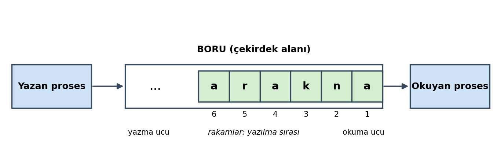

=========================
Proseslerarası Haberleşme
=========================

Bu bölümde UNIX/Linux sistemlerinde *proseslerarası haberleşme (interprocess communication)* konusunu ele
alacağız. Proseslerarası haberleşme oldukça önemli ve ayrıntılı bir konudur.

Proseslerarası Haberleşme Nedir?
================================

İşletim sistemleri dünyasında bir prosesin başka bir prosese bilgi göndermesi ve başka bir prosesten bilgi
almasına *proseslerarası haberleşme (interprocess communication (IPC))* denilmektedir. Burada bilgi gönderip
almadan kastedilen şey bir grup byte'ın gönderilip alınmasıdır. Proseslerarası haberleşme önemli bir konudur.
Çünkü sayfa tabloları yoluyla birbirinden izole edilmiş proseslerin başka yöntemlerle birbirleriyle
haberleşmesi gerekebilmektedir. Bir program başka bir programa bir şeyler gönderebilir, o program da bunları
işleyebilir. Proseslerarası haberleşmenin en bariz örneği *client-server* sistemlerdir. Bu sistemlerde client
program server programa bir istek gönderir. Server program da bu isteği yerine getirip sonuçları client
programa iletir. Client-server tarzda haberleşmenin sağlanabilmesi için proseslerarası haberleşme denilen
mekanizmanın kullanılması gerekir. Benzer biçimde *dağıtık sistemlerde (distributed systems)* de esas olarak
proseslerarası haberleşme mekanizmaları kullanılmaktadır.

Proseslerarası haberleşme mekanizmaları iki bölümde ele alınıp incelenmektedir:

1) Aynı makinenin prosesleri arasında haberleşme

2) Farklı makinelerin prosesleri arasında haberleşme

Aynı makinenin prosesleri arasında haberleşme işletim sisteminin sağladığı özel yöntemlerle
gerçekleştirilmektedir. Farklı makinelerin prosesleri arasında haberleşme için ortak uyulması gereken bazı
kuralların belirlenmiş olması gerekir. Bu ortak kurallara *protokol (protocol)* denilmektedir. Farklı
makinelerin prosesleri arasında haberleşme için çeşitli protokol aileleri oluşturulmuştur. Ancak bunlardan en
yaygın kullanılanı *IP (Internet Protocol)* isimli protokol ailesidir. Biz kursumuzda önce aynı makinenin
prosesleri arasındaki haberleşme yöntemlerini inceleyeceğiz daha sonra başka bir bölümde farklı makinelerin
prosesleri arasındaki haberleşme yöntemleri üzerinde duracağız. O bölümde IP protokol ailesini ve TCP/UDP
haberleşmelerini ayrıntılı bir biçimde ele alacağız.

Aynı makinenin prosesleri arasındaki haberleşmeler işletim sistemine bağlı bir biçimde yani işletim sistemine
özgü bir biçimde yürütülmektedir. Ancak aynı makinenin prosesleri arasındaki haberleşmeler için işletim
sistemlerinde birbirine benzer yöntemler kullanılmaktadır. Örneğin *boru (pipe)* haberleşmesi yöntemi
UNIX/Linux sistemleriyle Windows sistemleri arasında benzer biçimde yürütülmektedir. *Paylaşılan bellek
alanları (shared memory)* denilen haberleşme yöntemi de yine UNIX/Linux sistemleriyle Windows sistemlerinde
benzer biçimde uygulanmaktadır. Ancak bazı işletim sistemlerinde o sisteme özgü özel yöntemler de
bulunabilmektedir. Tabii biz kursumuzda UNIX/Linux sistemlerindeki proseslerarası haberleşme yöntemleri
üzerinde duracağız.

Proseslerarası haberleşme mekanizmasının iki yönü vardır. Birincisi iki prosesin haberleşeceği bir ortamın
oluşturulmasıdır. İkincisi ise bu ortamın senkronize bir biçimde kullanılmasıdır. Yani proseslerarası
haberleşme bir senkronizasyon sağlanarak gerçekleştirilmelidir. Biz bu bölümde sürecin senkronizasyon kısmı
üzerinde durmayacağız. Thread senkronizasyonu thread'lerin anlatıldığı kısımda ele alınacaktır.

Boru (Pipe) Haberleşmesi
------------------------

En yaygın kullanılan proseslerarası haberleşme yöntemi *boru (pipe)* haberleşmesi denilen yöntemdir. Boru
haberleşmesi hem bir ortam sunarken hem de senkronizasyonu kendi içerisinde sağlamaktadır. Bu nedenle boru
haberleşmesi kolay kullanılabilen bir IPC yöntemidir. Boru haberleşmeleri *isimsiz boru haberleşmeleri* ve
*isimli boru haberleşmeleri* olmak üzere ikiye ayrılmaktadır. İsimsiz boru haberleşmelerine İngilizce *unnamed
pipe* ya da *anonymous pipe*, isimli boru haberleşmelerine ise *named pipe* ya da *fifo* denilmektedir. Bu
kursumuzda önce *isimsiz boru haberleşmesini*, sonra da *isimli boru haberleşmesini* anlatacağız.

Peki boru nedir? Boru aslında FIFO tarzında çalışan bir kuyruk sistemidir. Bu kuyruk sistemi çekirdek
tarafından çekirdek alanı içerisinde oluşturulmaktadır. Bir proses boruya yazma yapar, diğeri de borudan
yazılanları okur. Boruya yazılan byte'lar FIFO prensibine göre yazılırlar, böylece borudan okuyan taraf
olanları yazıldığı sırada okur. Örneğin boruya yazan taraf *ankara* yazısının karakterlerini boruya yazmış
olsun. Şimdi okuyan taraf önce 'a' byte'ını sonra da sırasıyla 'n', 'k', 'a', 'r' ve 'a' byte'larını borudan
okur.

UNIX/Linux sistemlerinde borular birer dosya gibi ele alınmaktadır. Dolayısıyla boruya yazma işlemi *write*
fonksiyonu ile borudan okuma işlemi ise *read* fonksiyonu ile yapılmaktadır.

Boruların belli bir uzunlukları vardır. Eskiden BSD ve Linux sistemlerinde boru uzunlukları 4096 byte (bir
sayfa) büyüklüğündeydi. Linux daha sonra default boru uzunluğunu 64K'ya (65536 byte'a (16 sayfaya))
yükseltmiştir.

UNIX/Linux sistemlerinde borular tek yönlüdür. Bu nedenle proseslerden biri boruya yazma yaparken diğeri
borudan okuma yapar. (Halbuki örneğin Windows sistemlerinde borular çift yönlüdür.) Borunun tek yönlü olması
demek iki prosesin de yazdıklarının aynı boruya yazılması demektir. P1 prosesi boruya yazma yapıp yine P1
prosesi borudan okuma yaparsa kendi yazdığını okur. Bunun da bir anlamı olmaz. Halbuki çift yönlü borularda
borudan hem okuma hem yazma yapılabilmektedir. Borudan okuma yapıldığında karşı tarafın yazdığı okunur. Ancak
UNIX/Linux sistemlerindeki yukarıda da belirttiğimiz gibi borular tek yönlüdür. Dolayısıyla haberleşmede bir
taraf yazma yaparken diğer taraf okuma yapmalıdır. Eğer borularla karşılıklı okuma yazma yapılmak isteniyorsa
iki boru kullanılmalıdır.

İsimsiz Boru Haberleşmesi (Unnamed Pipe)
========================================

Boruya Yazma ve Borudan Okuma
-----------------------------

Boruya Yazma (write)
~~~~~~~~~~~~~~~~~~~~

Borular dosyalar gibi kullanılmaktadır. Borulardan okuma read fonksiyonu ile borulara yazma da write
fonksiyonu ile yapılmaktadır. Borulara write fonksiyonu ile yazma yapılırken yazılmak istenen byte kadar
boruda boş yer yoksa write işlemi blokeye yol açar ve boruda yazılmak istenen miktar kadar boş alan oluşana
kadar ilgili thread blokede bekletilir. Örneğin biz boruya 50 byte yazmak isteyelim. Eğer boruda en az 50
byte'lık boş yer varsa biz bloke olmadan bu işlemi yaparız ve write fonksiyonu 50 değeri ile geri döner. Ancak
boruda örneğin 40 byte boş yer varsa bu durumda write fonksiyonu boruda 50 byte'lık yer açılana kadar blokede
bekler. Boruda 50 byte'lık yer açıldığında bu 50 byte'ı boruya yazar ve 50 değeri ile geri döner. Böylece bir
proses sürekli boruya yazma yapar ancak karşı taraf borudan okuma yapmazsa boru dolar en sonunda write
fonksiyonu blokede bekler. Karşı taraf borudan okuma yaptığında boruda yer açılmaktadır.

Borulara yazma işlemi atomik düzeyde yapılmaktadır. Atomik yazma demekle *sanki yazma işleminin tek hamlede
araya hiçbir akış girmeden yapılması* kastedilmektedir. Örneğin write fonksiyonu ile boruya 50 byte yazılmak
istendiğinde bu 50 byte tek hamlede araya kimse girmeden yazılmaktadır. Atomik işlemlerde dıştaki gözlemci bir
olayı ya olmamış görür ya da olmuş görür. Olayı bir süreç içerisinde gerçekleşiyormuş gibi görmez. Bu
atomiklikten dolayı farklı prosesler aynı boruya aynı anda yazma yapsalar bile bu yazılanlar iç içe
geçmemektedir. Ancak borularda PIPE_BUF denilen bir sembolik sabit değeri vardır. Eğer iki prosesten en az
biri bu PIPE_BUF değerinden daha yüksek miktarda byte'ı boruya yazmak isterse bu durumda iç içe geçme
oluşabilir. Yani PIPE_BUF değerinden daha fazla bir değerin boruya yazılması atomik değildir. Birden fazla
prosesin aynı boruya aynı zamanda yazma yapması durumunda iç içe geçmenin olmaması için yazılanların PIPE_BUF
sembolik sabitinden daha küçük ya da ona eşit olması gerekir. PIPE_BUF pek çok sistemde (Linux'ta da böyle)
4096 değerindedir. Burada önemli bir nokta şudur: Biz PIPE_BUF değerinden daha fazla byte'ı boruya yazmak
istediğimizde yine tüm bilgi boruya yazılana kadar bloke oluşmaktadır. Ancak bu durumda iç içe geçmeme garanti
edilememektedir. PIPE_BUF değerinin borunun uzunluğunu belirtmediğine, atomik yazma için bir sınır değer
belirttiğine dikkat ediniz. Yazan taraf borunun uzunluğundan fazla bilgiyi boruya yazmaya çalışabilir. Bu
durum geçerlidir, yine tüm bilgi boruya yazılana kadar bloke oluşmaktadır.

Normal olarak borulara yazma yaparken write fonksiyonu tüm byte'lar yazılana kadar bloke oluşturduğuna göre
write fonksiyonunun yazılmak istenen byte sayısı ile geri dönmesi beklenir. Gerçekten de hemen her zaman böyle
olmaktadır. Ancak write fonksiyonu ile boruya yazma yapılırken bir sinyal oluşursa bu durumda POSIX
standartları kısmi yazma yapılabileceğini söylemektedir. Ancak Linux sistemlerinde kısmi yazma yapılmamaktadır
bu durumda write fonksiyonu boruya hiçbir şey yazmadan başarısız olur ve -1 değeri ile geri döner. errno
değişkeni de EINTR değeriyle set edilir. Linux sistemlerinde yine write fonksiyonu boruda yeterince yer yoksa
ve blokeye yol açmışsa sinyal oluştuğunda boruya bir şey yazmadan -1 ile geri dönmektedir. (Yani blokeli boru
yazımlarında POSIX standartlarına göre kısmi yazım söz konusu olabilirse de Linux sistemlerinde *kısmi yazım
(partial write)* işlemi yapılmamaktadır.)

Boruya 0 byte yazılmak istenirse bu durum POSIX standartlarında *belirsiz (unspecified)* bırakılmıştır. Ancak
pek çok UNIX türevi sistem (Linux'ta da böyle) 0 byte yazma durumunda boruya bir şey yazmamakta basit bazı
kontroller yapıp write fonksiyonunu sonlandırmaktadır. Eğer bu kontrollerde bir sorun yoksa write fonksiyonu 0
ile geri dönmektedir.

Borudan Okuma (read)
~~~~~~~~~~~~~~~~~~~~

read fonksiyonu ile borudan okuma yapılırken read fonksiyonu eğer boru tamamen boşsa en az 1 byte boruda olana
kadar blokeye yol açar. Ancak boruda en az 1 byte bilgi varsa read fonksiyonu okuyabildiği kadar byte'ı okur,
blokeye yol açmadan hemen okuyabildiği byte sayısı ile geri döner. Yani read tüm byte'lar okunana kadar değil,
en az bir byte okunana kadar beklemeye yol açmaktadır. Bu bakımdan write fonksiyonu gibi davranmamaktadır.
Örneğin biz borudan 50 byte okumak isteyelim. Ancak boruda 10 byte bulunuyor olsun. read fonksiyonu 50 byte
okunana kadar beklemez. O 10 byte'ı okur, 10 değeri ile geri döner. Ancak boru tamamen boşsa read fonksiyonu
en az 1 byte boruya yazılana kadar blokede bekleyecektir. Örneğin biz borudan 50 byte okumak isteyelim. Ancak
boruda hiç byte olmasın. Bu durumda read fonksiyonu blokede bekler. O sırada bir proses boruya 10 byte yazmış
olsun. Şimdi read fonksiyonu bu 10 byte'ı alarak işlemini sonlandırır ve 10 değeri ile geri döner. read
fonksiyonu ile borudan okuma yapılırken sinyal oluştuğunda POSIX standartları boruda okunmak istenen byte
kadar bilgi olsa bile POSIX standartları kısmi okuma (partial read) yapılabileceğini belirtmektedir. Ancak
Linux gibi pek çok UNIX türevi sistemde bu tür durumlarda kısmi okuma yapılmamaktadır. (Yani çekirdek sinyali
okuma işleminden sonra devreye sokmaktadır.)

Boru Haberleşmesinin Sonlandırılması
------------------------------------

Peki boru haberleşmesi nasıl sonlandırılmaktadır? Boruyu kesinlikle önce yazan tarafın kapatması gerekir. Bu
durumda okuyan taraf önce boruda kalanları okur. Artık boruda okunacak bir şey kalmamışsa ve yazan taraf da
boruyu kapatmışsa read fonksiyonu 0 değeri ile geri döner. Yukarıda da belirttiğimiz gibi normalde read
fonksiyonu boruda hiç bilgi yoksa blokede beklemektedir. Ancak eğer boruya yazma potansiyelinde olan hiçbir
betimleyici kalmadıysa bu durumda read fonksiyonu bloke olmadan 0 ile geri döner. O halde sonlandırma şöyle
yapılmalıdır: Önce yazan taraf boruyu kapatır. Sonra okuyan taraf boruda kalanları okur ve read fonksiyonu 0
ile geri döndüğünde okuyan taraf da boruyu kapatır.

Boru haberleşmesinde eğer boruyu yanlış bir biçimde önce okuyan taraf kapatırsa yazan taraf boruya yazma
yaptığında SIGPIPE isimli bir sinyal oluşmaktadır. Bu sinyal de prosesin sonlanmasına yol açacaktır. Yani
okuma tarafı kapatılmış bir boruya yazma yapmak normal bir durum değildir. Ancak yazma tarafı kapatılmış bir
borudan okuma yapmaya çalışmak normal bir durumdur. Yukarıda da belirttiğimiz gibi bu durumda read fonksiyonu
boruda bir şey kalmadıysa 0 ile geri dönecektir.

İsimsiz Boru Haberleşmesinin Aşamaları
--------------------------------------

İsimsiz boru haberleşmesi yalnızca üst ve alt proseslerarasında yapılabilen bir haberleşmedir. İsimsiz boru
haberleşmesi tipik olarak şu aşamalardan geçilerek gerçekleştirilir:

1) Üst proses henüz fork ile alt prosesi yaratmadan önce pipe isimli POSIX fonksiyonu ile isimsiz boruyu
   yaratmalıdır. pipe fonksiyonunun prototipi şöyledir:

   .. code-block:: c

      #include <unistd.h>

      int pipe(int pipefd[2]);

   pipe fonksiyonu int türden bir dizinin başlangıç adresini parametre olarak alır. (Prototipteki dekleratör
   bir gösterici dekleratörüdür. Bunun bu biçimde belirtilmesinin nedeni fonksiyonun iki elemanlı int bir
   dizinin başlangıç adresini aldığını vurgulamak içindir.) pipe fonksiyonu boruyu yaratır. Borudan okuma
   yapmak ve boruya yazma yapmak için iki dosya betimleyicisi oluşturur. O betimleyicilerin numaralarını da
   bizim fonksiyona geçirdiğimiz iki elemanlı int diziye yerleştirir. Dizinin ilk elemanına borudan okuma
   yapmak için kullanılacak betimleyiciyi, ikinci elemanına ise boruya yazma yapmak için kullanılacak
   betimleyiciyi yerleştirmektedir. Tabii bu betimleyiciler dosya betimleyici tablosunda tahsis edilmiş
   durumdadır. Bu betimleyicilerin gösterdiği dosya nesneleri boruya erişmek için gereken bilgileri
   tutmaktadır. Bize verilen dizinin ilk elemanına yerleştirilen betimleyici read-only, dizinin ikinci
   elemanına yerleştirilen betimleyici ise write-only bir betimleyicidir. Yani biz ilk betimleyici ile
   yalnızca read işlemi ikinci betimleyici ile yalnızca write işlemi yapabiliriz. pipe fonksiyonunun dosya
   betimleyici tablosundaki en düşük numaralı boş betimleyicileri vereceği POSIX standartlarında garanti
   edilmiştir. Ancak pipe fonksiyonunun verdiği iki betimleyicinin hangisinin düşük numaralı betimleyici
   olacağının bir garantisi yoktur. Örneğin:

   .. code-block:: c

      int pipefds[2];
       /* ... */

      if (pipe(pipefds) == -1)
          exit_sys("pipe");

   Oluşan durumu aşağıdaki şekille betimleyebiliriz:

   .. image:: _static/ders44-pipe-sonrasi.png
      :alt: pipe fonksiyonu çağrıldıktan sonra dosya betimleyici tablosu, dosya nesneleri ve boru
      :align: center
      :width: 80%

2) Boru yaratıldıktan sonra üst prosesin fork işlemi ile alt prosesi yaratması gerekir. Anımsanacağı gibi fork
   işlemiyle birlikte üst prosesteki tüm betimleyiciler alt proseste de aynı değerlerle aynı dosya nesnelerini
   gösterir biçimde oluşturulmaktadır. Yani artık üst ve alt prosesler aynı numaralı betimleyicilerle boruya
   erişebilir durumda olur. Örneğin:

   .. code-block:: c

      int pipefds[2];
      pid_t pid;
      /* ... */

      if (pipe(pipefds) == -1)
          exit_sys("pipe");

      if ((pid = fork()) == -1)
          exit_sys("fork");

      if (pid != 0) {         /* parent process */
          /* ... */
      }
      else  {                 /* child process */
          /* ... */
      }

   Oluşan durumu aşağıdaki şekille betimleyebiliriz:

   .. image:: _static/ders44-fork-sonrasi.png
      :alt: fork işleminden sonra üst ve alt prosesin betimleyicilerinin aynı dosya nesnelerini göstermesi
      :align: center
      :width: 100%

3) Artık üst ve alt prosesler arasında haberleşme için bir karar verilmelidir. Kim yazacak kim okuyacaktır?
   Bundan sonra boruya yazma ve okuma potansiyelinde olan birer betimleyici bırakılmalıdır. Yani yazan taraf
   okuma betimleyicisini, okuyan taraf yazma betimleyicisini kapatmalıdır. Örneğin üst proses boruya yazma
   yapacak olsun, alt proses borudan okuma yapacak olsun:

   .. code-block:: c

      int pipefds[2];
      pid_t pid;
      /* ... */

      if (pipe(pipefds) == -1)
          exit_sys("pipe");

      if ((pid = fork()) == -1)
          exit_sys("fork");

      if (pid != 0) {         /* parent process */
          close(pipefds[0]);
          /* ... */
      }
      else  {                 /* child process */
          close(pipefds[1]);
          /* ... */*/
      }

   Görüldüğü gibi üst proses okuma betimleyicisini, alt proses de yazma betimleyicisini kapatmıştır. Artık
   borudan okuma yapma potansiyelinde ve boruya yazma potansiyelinde tek bir betimleyici vardır. Oluşan durumu
   aşağıdaki şekille betimleyebiliriz:

   .. image:: _static/ders44-kapatma-sonrasi.png
      :alt: Üst proses okuma, alt proses yazma betimleyicisini kapattıktan sonraki durum
      :align: center
      :width: 100%

4) Artık okuma ve yazma işlemleri read ve write fonksiyonlarıyla gerçekleştirilebilir. Örneğin:

5) Haberleşmeyi sonlandırmak için yazan taraf boruyu kapatır. Okuyan taraf önce boruda kalanları okur, sonra
   read fonksiyonu 0 ile geri döner. Böylece okuyan taraf da boruyu kapatır. Örneğin:

   .. code-block:: c

      int pipefds[2];
      pid_t pid;
      /* ... */

      if (pipe(pipefds) == -1)
          exit_sys("pipe");

      if ((pid = fork()) == -1)
          exit_sys("fork");

      if (pid != 0) {         /* parent process */
          close(pipefds[0]);

          for (int i = 0; i < 100000; ++i)
              if (write(pipefds[1], &i, sizeof(int)) == -1)
                  exit_sys("write");
          close(pipefds[1]);
          if (wait(NULL) == -1)
              exit_sys("wait");
      }
      else  {                 /* child process */
          int val;

          close(pipefds[1]);
          for (int i = 0; i < 100000; ++i) {
              if (read(pipefds[0], &val, sizeof(int)) == -1)
                  exit_sys("read");
              printf("%d\n", val);
          }
          close(pipefds[0]);
      }

   Program bir bütün olarak aşağıda verilmiştir.

.. code-block:: c

   #include <stdio.h>
   #include <stdlib.h>
   #include <unistd.h>
   #include <sys/wait.h>

   void exit_sys(const char *msg);

   int main(void)
   {
       int pipefds[2];
       pid_t pid;

       if (pipe(pipefds) == -1)
           exit_sys("pipe");

       if ((pid = fork()) == -1)
           exit_sys("fork");

       if (pid != 0) {         /* parent process */
           close(pipefds[0]);

           for (int i = 0; i < 100000; ++i)
               if (write(pipefds[1], &i, sizeof(int)) == -1)
                   exit_sys("write");
           close(pipefds[1]);
           if (wait(NULL) == -1)
               exit_sys("wait");
       }
       else  {                 /* child process */
           int val;

           close(pipefds[1]);
           for (int i = 0; i < 100000; ++i) {
               if (read(pipefds[0], &val, sizeof(int)) == -1)
                   exit_sys("read");
               printf("%d\n", val);
           }
           close(pipefds[0]);
       }

       return 0;
   }

   void exit_sys(const char *msg)
   {
       perror(msg);
       exit(EXIT_FAILURE);
   }

Kullanılmayan Betimleyicilerin Kapatılma Nedeni
-----------------------------------------------

Peki isimsiz boru haberleşmesinde neden okuyan taraf yazma betimleyicisini, yazan taraf da okuma
betimleyicisini kapatmaktadır? İşte read fonksiyonunun 0 ile geri dönmesi için boruya yazma potansiyelinde
olan tek bir betimleyicinin bulunuyor olması gerekir. Eğer okuyan taraf yazma betimleyicisini kapatmazsa yazan
taraf yazma betimleyicisini kapatsa bile boruya hala yazma potansiyelinde olan bir betimleyici kaldığı için
read fonksiyonu 0 ile geri dönmeyecektir. Bu durumda haberleşmenin sonlandırılması sorunlu hale gelecektir.
Yazan tarafın okuma betimleyicisini kapatmasının diğer durumdaki gibi kritik bir önemi yoktur. Ancak
kullanılmayan betimleyicilerin kapatılması her zaman iyi bir tekniktir.

Üst ve Alt Prosesler Arasında Haberleşme
----------------------------------------

Üst ve alt prosesler arasında haberleşme yapmak kişilere biraz tuhaf gelebilmektedir. Çünkü fork işleminden
sonra zaten her iki kod da programı yazan kişi tarafından yazılmıştır. Ancak üst ve alt prosesler arasında
boru haberleşmelerinin gerektiği önemli durumlar vardır.

Eskiden thread'ler yokken bir işi daha hızlı yapmak için prosesler kullanılıyordu. Üst proses fork yapıp alt
prosesle koordineli bir biçimde işleri paylaşıyordu. O günlerde bu koordinasyonun sağlanması için üst ve alt
prosesler arasında haberleşme de gerekiyordu. Thread'lerden sonra artık bu tür işlemler prosesler yerine
thread'lerle yapılmaya başlanmıştır.

Üst ve alt prosesler arasında exec sonrasında da haberleşmeler yapılabilmektedir. Tabii bu durumda exec
yapılan alt prosesin exec sonrasında boru betimleyicilerinin numaralarını biliyor olması gerekir. Ancak stdin,
stdout ve stderr dosyalarının betimleyicileri sabit olduğuna göre exec sonrasında haberleşme bu betimleyiciler
yoluyla yapılabilmektedir.

Kabuğun Boru İşlemi ve mypipe Programı
--------------------------------------

Artık kabuk programının boru işlemini nasıl yaptığını anlayabiliriz. Örneğin aşağıdaki gibi bir kabuk komutu
verilmiş olsun:

.. code-block:: console

   $ ls -l | wc

Burada *ls* programının stdout dosyasına yazdıklarını *wc* programı stdin dosyasından okumaktadır. Kabuk bu
işlemi tipik olarak şöyle yapmaktadır:

1) Kabuk önce pipe fonksiyonuyla isimsiz boruyu yaratır.

2) Kabuk *ls* programını çalıştırmak için fork yapar. Böylece isimsiz boru betimleyicileri alt prosese
   geçirilmiştir. Bundan sonra kabuk alt prosesin 1 numaralı betimleyicisini yazma amaçlı boruya
   yönlendirmektedir. Bundan sonra kabuk *ls* programını çalıştırmak için exec uygular. Artık *ls* programının
   stdout dosyasına yazdıkları aslında boruya yazılacaktır.

3) Kabuk bu kez *wc* programı için fork uygular. Benzer biçimde alt prosesin bu kez 0 numaralı betimleyicisini
   boruya yönlendirir. Bundan sonra kabuk *wc* programı için exec uygular. Artık *wc* programının stdin
   dosyasından okudukları aslında borudan okunacaktır.

4) Bu süreç içerisinde kullanılmayan betimleyiciler kapatılır. Yalnızca boruya yazma ve borudan okuma
   potansiyeline sahip olan tek bir betimleyici bırakılır.

5) Boru haberleşmesinde önce yazan tarafın boruyu kapatması gerektiğini söylemiştik. Zaten *wc* programı
   sürekli stdin dosyasından okuma yaptığına göre karşı taraf boruyu kapatınca okuma döngüsünden çıkacaktır.

6) Kabuk wait fonksiyonlarıyla alt proseslerin sonlanmasını bekler.

Şimdi kabuğun yaptığı bu yönlendirmeyi yapan bir programı biz yazalım. Programımızın ismi *mypipe* olsun.
Program şöyle kullanılacaktır:

.. code-block:: console

   $ ./mypipe "prog1 arg1 arg2 ... | prog2 arg1 arg2 ..."

Program buradaki *|* sembolünün yerini bulur. Sonra bunun iki tarafını strtok ile parse ederek iki ayrı
gösterici dizisine yerleştirir. Sonra üst proses pipe fonksiyonuyla boruyu yaratır. Soldaki ve sağdaki
programlar için fork işlemi yapar. Soldaki programı henüz exec ile çalıştırmadan o alt prosesin 1 numaralı
betimleyicisini boruya yönlendirir. Benzer biçimde sağdaki programı henüz çalıştırmadan o prosesin de 0
numaralı betimleyicisini boruya yönlendirir. Sonra da exec işlemlerini uygular. Bu süreç içerisinde
kullanılmayan betimleyicileri de kapatmaktadır.

Biz aşağıdaki örneğimizde önce komut satırı argümanını parse_args fonksiyonuyla '|' karakterinden parse ettik:

.. code-block:: c

   struct pipe_args {
       char *left_args[MAX_PROG_ARGS];
       char *right_args[MAX_PROG_ARGS];
   };

   int parse_args(char *args, struct pipe_args *pargs)
   {
       char *str, *arg;
       int count;

       if ((str = strchr(args, '|')) == NULL || strchr(str + 1, '|') != NULL)
           return -1;
       *str = '\0';

       count = 0;
       for (arg = strtok(args, " \t"); arg != NULL; arg = strtok(NULL, " \t")) {
           if (count == MAX_PROG_ARGS - 1)
               return -1;
           pargs->left_args[count++] = arg;
       }
       if (count == 0)
           return -1;
       pargs->left_args[count] = NULL;

       count = 0;
       for (arg = strtok(str + 1, " \t"); arg != NULL; arg = strtok(NULL, " \t")) {
           if (count == MAX_PROG_ARGS - 1)
               return -1;
           pargs->right_args[count++] = arg;
       }
       if (count == 0)
           return -1;
       pargs->right_args[count] = NULL;

       return 0;
   }

Burada fonksiyon komut satırı argümanını '|' karakterinden parse edip onun bileşenlerini pipe_args isimli bir
yapı nesnesine yerleştirdik. Programda bundan sonra isimsiz boruyu yaratıp yukarıdaki işlemleri uyguladık:

.. code-block:: c

   struct pipe_args pargs;
   int pipefds[2];
   pid_t pid_left, pid_right;
   /* ... */

   if (pipe(pipefds) == -1)
       exit_sys("pipe");

   if ((pid_left = fork()) == -1)
       exit_sys("fork");

   if (pid_left == 0) {
       close(pipefds[0]);

       if (dup2(pipefds[1], 1) == -1)
           _exit(EXIT_FAILURE);
       close(pipefds[1]);

       if (execvp(pargs.left_args[0], &pargs.left_args[0]) == -1)
           exit_sys(pargs.right_args[1]);

       /* unreachable code */
   }

   if ((pid_right = fork()) == -1)
       exit_sys("fork");

   if (pid_right == 0) {
       close(pipefds[1]);

       if (dup2(pipefds[0], 0) == -1)
           _exit(EXIT_FAILURE);
       close(pipefds[0]);

       if (execvp(pargs.right_args[0], &pargs.right_args[0]) == -1)
           exit_sys(pargs.right_args[0]);

       /* unreachable code */
   }

   close(pipefds[0]);
   close(pipefds[1]);

Programda boruya yazma ve borudan okuma yapma potansiyelinde yalnızca birer betimleyici bırakıldığına dikkat ediniz.

.. code-block:: c

   #include <stdio.h>
   #include <stdlib.h>
   #include <ctype.h>
   #include <string.h>
   #include <unistd.h>
   #include <sys/wait.h>

   #define MAX_PROG_ARGS       256

   struct pipe_args {
       char *left_args[MAX_PROG_ARGS];
       char *right_args[MAX_PROG_ARGS];
   };

   int parse_args(char *args, struct pipe_args *pargs);
   void exit_sys(const char *msg);

   int main(int argc, char *argv[])
   {
       struct pipe_args pargs;
       int pipefds[2];
       pid_t pid_left, pid_right;

       if (argc != 2) {
           fprintf(stderr, "wrong number of arguments!..\n");
           exit(EXIT_FAILURE);
       }

       if (parse_args(argv[1], &pargs) == -1) {
           fprintf(stderr, "ivalid pipe argument!..\n");
           exit(EXIT_FAILURE);
       }

       if (pipe(pipefds) == -1)
           exit_sys("pipe");

       if ((pid_left = fork()) == -1)
           exit_sys("fork");

       if (pid_left == 0) {
           close(pipefds[0]);

           if (dup2(pipefds[1], 1) == -1)
               _exit(EXIT_FAILURE);
           close(pipefds[1]);

           if (execvp(pargs.left_args[0], &pargs.left_args[0]) == -1)
               exit_sys(pargs.right_args[1]);

           /* unreachable code */
       }

       if ((pid_right = fork()) == -1)
           exit_sys("fork");

       if (pid_right == 0) {
           close(pipefds[1]);

           if (dup2(pipefds[0], 0) == -1)
               _exit(EXIT_FAILURE);
           close(pipefds[0]);

           if (execvp(pargs.right_args[0], &pargs.right_args[0]) == -1)
               exit_sys(pargs.right_args[0]);

           /* unreachable code */
       }

       close(pipefds[0]);
       close(pipefds[1]);

       if (waitpid(pid_left, NULL, 0) == 1)
           exit_sys("waitpid");

       if (waitpid(pid_right, NULL, 0) == 1)
           exit_sys("waitpid");

       return 0;
   }

   int parse_args(char *args, struct pipe_args *pargs)
   {
       char *str, *arg;
       int count;

       if ((str = strchr(args, '|')) == NULL || strchr(str + 1, '|') != NULL)
           return -1;
       *str = '\0';

       count = 0;
       for (arg = strtok(args, " \t"); arg != NULL; arg = strtok(NULL, " \t")) {
           if (count == MAX_PROG_ARGS - 1)
               return -1;
           pargs->left_args[count++] = arg;
       }
       if (count == 0)
           return -1;
       pargs->left_args[count] = NULL;

       count = 0;
       for (arg = strtok(str + 1, " \t"); arg != NULL; arg = strtok(NULL, " \t")) {
           if (count == MAX_PROG_ARGS - 1)
               return -1;
           pargs->right_args[count++] = arg;
       }
       if (count == 0)
           return -1;
       pargs->right_args[count] = NULL;

       return 0;
   }

   void exit_sys(const char *msg)
   {
       perror(msg);
       exit(EXIT_FAILURE);
   }

