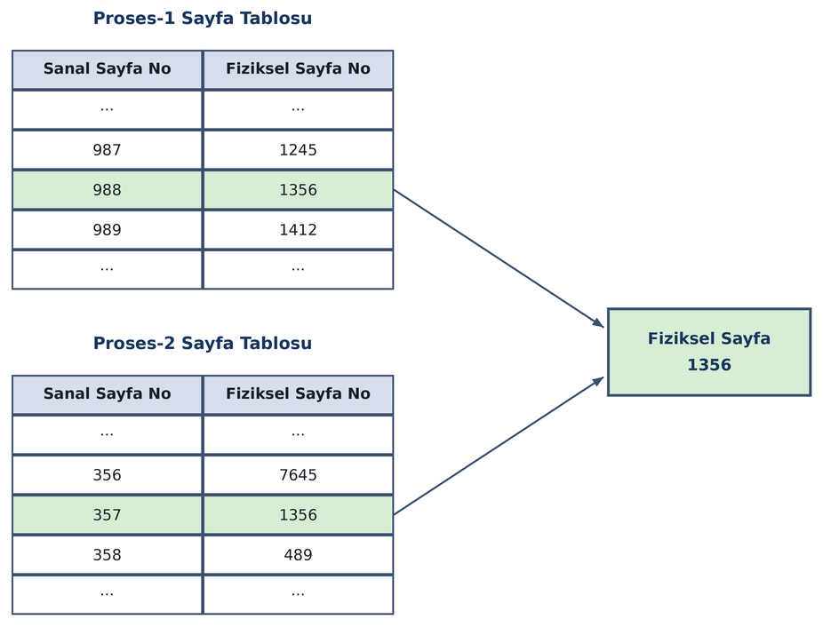
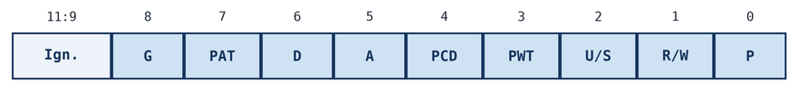
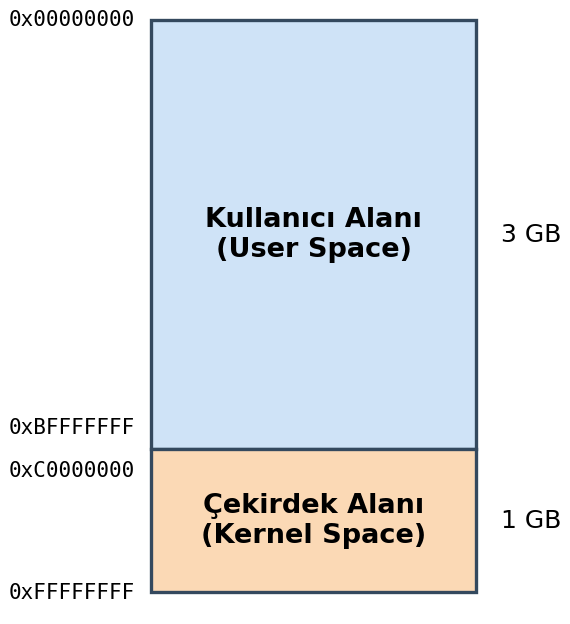
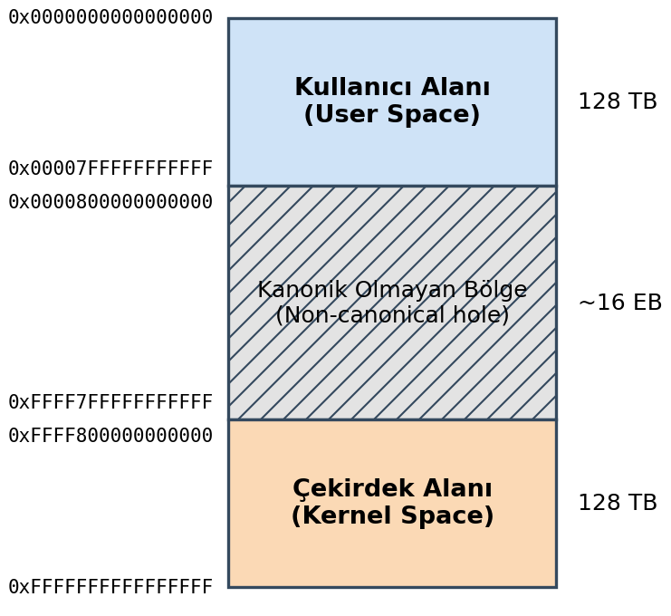

==================================================
İşlemcilerin Sayfalama Mekanizması ve Sanal Bellek
==================================================

Bu bölümde işlemcilerin sayfalama (paging) mekanizması ve *sanal bellek (virtual memory)* kavramları üzerinde duracağız.

İşlemcilerin Sayfalama Mekanizması
==================================

Masaüstü sistemlerde kullanılan güçlü işlemciler *sayfalama (paging)* denilen bir mekanizmaya sahiptir. Örneğin
Intel işlemcileri bu sayfalama mekanizmasına 80386 modelleriyle birlikte sahip olmuştur. ARM Cortex-A serisi
işlemciler de bu mekanizmaya sahiptir. Itanium, PowerPC gibi işlemcilerde de sayfalama mekanizması bulunmaktadır.
Genellikle koruma mekanizmasına sahip işlemciler sayfalama mekanizmasına da sahip olurlar. Ancak koruma
mekanizmasına sahip olduğu halde sayfalama mekanizmasına sahip olmayan işlemciler de vardır. Sayfalama mekanizması
güçlü işlemcilerde bulunan bir mekanizmadır. Mikrodenetleyicilerde genellikle sayfalama mekanizması
bulunmamaktadır. ARM'ın Cortex-M serisi mikrodenetleyicilerinde sayfalama mekanizması bulunmamaktadır. Ayrıca
işlemcilerdeki bu sayfalama mekanizması aktif ve pasif duruma getirilebilmektedir. Yani işlemci sayfalama
mekanizmasına sahip olduğu halde sistem programcısı bu mekanizmayı açmayabilir ve kullanmayabilir. İşlemciler
reset edildiğinde sayfalama mekanizması pasif durumdadır. İşletim sistemleri bazı ön hazırlıkları yaptıktan sonra
bu mekanizmayı açmaktadır.

Sayfalama mekanizmasında fiziksel bellek (RAM) aynı zamanda *sayfa (page)* denilen ardışıl mantıksal bloklara 
ayrılmaktadır. Sayfa uzunluğu işlemci ailesinden işlemci ailesine hatta aynı işlemci ailesinde işlemcinin modundan moduna
değişebilmektedir. Ancak en tipik kullanılan sayfa uzunluğu ``4096`` (``4K``) byte'tır. Gerçekten de bugün Linux,
Windows ve macOS sistemleri bazı özel durumlar dışında ``4K``'lık sayfalar kullanmaktadır. Aşağıda yaygın
işlemcilerin desteklediği sayfa uzunluklarını bir tablo halinde veriyoruz:

.. list-table:: 
   :header-rows: 1
   :widths: 18 26 20 36
   :align: center

   * - Mimari
     - Mod / Granule
     - Temel sayfa
     - Büyük sayfalar
   * - x86
     - 32-bit (PSE)
     - 4K
     - 4M
   * - x86
     - PAE
     - 4K
     - 2M
   * - x86-64
     - 4/5-level
     - 4K
     - 2M, 1G
   * - ARMv7-A
     - Short-descriptor
     - 4K
     - 64K, 1M, 16M
   * - ARMv7-A
     - LPAE
     - 4K
     - 2M, 1G
   * - ARMv8-A
     - 4K granule
     - 4K
     - 2M, 1G
   * - ARMv8-A
     - 16K granule
     - 16K
     - 32M
   * - ARMv8-A
     - 64K granule
     - 64K
     - 512M
   * - RISC-V
     - Sv32
     - 4K
     - 4M
   * - RISC-V
     - Sv39/Sv48/Sv57
     - 4K
     - 2M, 1G, 512G, 256T
   * - PowerPC64
     - Radix
     - 4K, 64K
     - 2M, 1G
   * - PowerPC64
     - Hash
     - 4K, 64K
     - 16M, 16G
   * - SPARC64
     - sun4u/sun4v
     - 8K
     - 64K – 16G
   * - MIPS
     - R4000 ve sonrası
     - 4K, 16K, 64K
     - 256M'a kadar
   * - LoongArch
     - LA64
     - 4K, 16K, 64K
     - 32M (16K ile)

Sayfalama mekanizması etkin hale getirildiğinde işlemci RAM'deki her sayfaya bir sayfa numarası karşılık
getirilir. Örneğin ilk ``4096`` byte ``0``'ıncı sayfaya, sonraki ``4096`` byte ``1``'inci sayfaya karşı gelir. Sayfalar bu
biçimde ilk sayfa ``0``'dan başlatılarak ardışıl biçimde numaralandırılmaktadır. Yani her byte aslında bir sayfa
içerisinde bulunur.

Sanal Adresler ve Sayfa Tabloları
---------------------------------

Bir program içerisinde kullanılan yani derleyicinin ürettiği adresler aslında gerçek fiziksel adresler değildir. 
Bu adreslere *sanal adresler (virtual addresses)* ya da *doğrusal adresler (linear addresses)* denilmektedir. 
Örneğin biz C'de bir nesnenin adresini alıp bir göstericiye yerleştirdiğimizde gösterici içerisindeki bu adres gerçek 
fiziksel adres değildir, sanal bir adrestir. Derleyiciler kodları sanki RAM'de program tek başına çalışacakmış gibi üretmektedir.
Örneğin ``32 bit`` işlemcilerin kullanıldığı bir Linux sisteminde (Windows ve macOS sistemlerinde de benzer) derleyici sanki 
program 4 GB'lik RAM'de belli bir adresten itibaren tek başına yüklenecekmiş gibi kod üretmektedir. (Bu konunun çeşitli 
ayrıntıları vardır.) Her program derlendiğinde aynı biçimde kod üretilmektedir. Çünkü derleyicinin ürettiği bu adresler 
sanal adreslerdir. Peki her program aynı biçimde örneğin RAM'in ``4 MB``'sinden itibaren ardışıl bir biçimde yüklenecekmiş 
gibi bir koda sahipse bu programlar nasıl çalışmaktadır?

İşte sayfalama mekanizmasına sahip olan işlemciler aslında *sayfa tablosu (page table)* denilen bir tabloya
başvurarak çalışırlar. Sayfa tablosu sanal sayfa numaralarını fiziksel sayfa numaralarına eşleyen bir
tablodur. Sayfa tablosunun basitleştirilmiş görünümü aşağıdaki gibidir:

.. list-table:: S
   :header-rows: 1
   :widths: 50 50
   :align: center

   * - Sanal Sayfa No
     - Fiziksel Sayfa No
   * - ...
     - ...
   * - 4562
     - 17456
   * - 4563
     - 18987
   * - 4564
     - 12976
   * - ...
     - ...

Şimdi ``32 bit`` Intel işlemcisinin aşağıdaki gibi bir makine kodunu çalıştırdığını düşünelim:

.. code-block:: text

   MOV EAX, [05C34782]

Burada makine komutu bellekte ``0x05C34782`` numaralı adresten başlayan ``4`` byte'a erişmek istemektedir. İşlemci
önce bu adres değerinin kaçıncı sanal sayfaya karşılık geldiğini hesaplar. Bu hesap işlemci tarafından oldukça
kolay bir biçimde yapılır. Sayı ``12`` kere sağa ötelenirse (başka bir deyişle sayının sağındaki ``3`` hex digit
atılırsa) bu sanal adresin kaçıncı sanal sayfaya karşılık geldiği bulunabilir:

.. code-block:: text

   05C34782 >> 12 = 05C34 (sanal sayfa no, decimal 23604)

Artık işlemci sayfa tablosunda ``0x5C34`` yani decimal ``23604`` numaralı girişe bakar. Sayfa tablosunun ilgili kısmı
şöyle olsun:

.. list-table:: Sayfa tablosunun ilgili kısmı
   :header-rows: 1
   :widths: 50 50
   :align: center

   * - Sanal Sayfa No
     - Fiziksel Sayfa No
   * - ...
     - ...
   * - 23603 (5C33)
     - 47324 (B8DC)
   * - 23604 (5C34)
     - 52689 (CDD1)
   * - 23605 (5C35)
     - 29671 (73E7)
   * - ...
     - ...

Burada ``23604 (0x5C34)`` numaralı sanal sayfa ``52689 (0xCDD1)`` fiziksel sayfasına yönlendirilmiştir. Peki işlemci
hangi fiziksel adrese erişecektir? İşte bizim sanal adresimiz 05C34782 idi. Bu adres iki kısma
ayrıştırılabilir:

.. code-block:: text

   05C34   Sanal sayfa no (hex)
   782     Sayfa offset'i (hex)

Bu durumda işlemci aslında fiziksel RAM'de ``52689 (0xCDD1)``'uncu fiziksel sayfanın ``1922 (0x782)`` byte'ına
erişecektir. O zaman gerçek bellekteki erişim adresi ``52689 (0xCDD1) * 4096 (0x1000) + 1922 (0x782)`` olacaktır.
Bu adresin ``0xCDD1782`` olduğuna dikkat ediniz. 

Burada özetle anlatılmak istenen şey şudur: İşlemci her bellek erişiminde erişilecek sanal adresi iki kısma
ayırır: *Sanal Sayfa No* ve *Sayfa Offset'i*. Sonra sayfa tablosuna giderek sanal sayfa numarasına karşı gelen
fiziksel sayfa numarasını elde eder. O fiziksel sayfanın sayfa offset'i ile belirtilen byte'ına erişir.
Örneğin şöyle bir fonksiyon çağırmış olalım:

.. code-block:: c

   foo();

Derleyicimiz de şöyle bir kod üretmiş olsun:

.. code-block:: text

   CALL 06F14678  (hex)

Burada ``0x06F14678`` adresi ``foo`` fonksiyonunun sanal bellek adresidir. Derleyici bu adresi üretmiştir. Ancak program
çalışırken işlemci bu adresi ikiye ayırır (hex sistemde devam ediyoruz):

.. code-block:: text

   06F146      Sanal Sayfa No (hex)
   678         Sayfa Offset'i (hex)

Sonra sayfa tablosuna gider ve ``0x06F146`` sayfasının hangi fiziksel sayfaya yönlendirildiğini belirler. Bu
fiziksel sayfanın hex olarak ``0x7C45`` olduğunu düşünelim. O zaman işlemcinin erişeceği fiziksel adres ``0x7C45000
+ 0x678`` hex adresi olacaktır.

Biz yukarıda sayfa tablosunu gerçekte olduğundan daha basite indirgedik. Aslında işlemciler temel mantık aynı
olmak üzere sanal adresi iki parçaya değil, üç parçaya ya da dört parçaya ayırmaktadır. Böylece sayfa
tablolarının fazla yer kaplaması engellenmektedir.

Sayfa Tablolarının Oluşturulması ve Proseslerarası Geçiş
--------------------------------------------------------

Buraya kadar şunları anladık:

- Derleyici ``32 bit`` bir sistemde sanki program ``4 GB``'lik bir fiziksel RAM'de tek başına belli bir adresten
  itibaren yüklenerek çalıştırılacakmış gibi bir kod üretmektedir.

- İşlemci kodu çalıştırırken her bellek erişiminde sayfa tablosuna başvurup aslında o sanal adresleri fiziksel
  adreslere dönüştürmektedir.

Tabii biz yukarıdaki örnekleri basit olsun diye ``32 bit`` işlemcilere yönelik verdik. ``64 bit`` işlemcilerde de
çalışma biçimi aynıdır. Yukarıda da belirttiğimiz gibi aslında işlemciler sanal adresleri iki parçaya değil üç
ya da dört parçaya bölmektedir.

Peki sayfa tablosunu kim oluşturmaktadır? Sayfa tablosu işletim sistemi tarafından proses belleğe yüklenirken
(exec fonksiyonları tarafından) oluşturulmaktadır. Sürecin işletim sistemine bağlı ayrıntıları olmakla
birlikte işlem kabaca şöyle yürütülmektedir: İşletim sisteminin yükleyicisi (loader) programı ``4K``'lık parçalara
ayırarak sanal sayfa numaraları ardışıl ancak fiziksel sayfa numaraları ardışıl olmayacak biçimde fiziksel
RAM'e yüklemektedir. Yani işletim sistemi fiziksel RAM'deki boş sayfalara bakar. Programın ``4K``'lık kısımlarını
bu fiziksel RAM'deki boş sayfalara yükler ve sayfa tablosunu buradan hareketle oluşturur. Yukarıda da
belirttiğimiz gibi bu sürecin aslında ayrıntıları vardır. Biz burada basit bir model eşliğinde konuyu
açıklamaya çalışıyoruz. Örneğin Linux sistemlerinde ``exec`` işlemi sonrasında başlangıçta sayfa tablosu boş
gibidir. Sayfa tablosunun doldurulması izleyen paragraflarda açıklayacağımız *sayfalama hataları (page faults)*
eşiliğinde yapılmaktadır.

Sayfalama mekanizmasında bir noktaya dikkatinizi çekmek istiyoruz. Bir program fiziksel RAM'de ardışıl bir
biçimde bulunmak zorunda değildir. Yani örneğin programın ``4K``'lık bir sayfası ile sonraki ``4K``'lık sayfası
fiziksel RAM'de ardışıl olmak zorunda değildir. Zaten programın parçalarının fiziksel RAM'e ardışıl yüklenme
zorunluluğunun ortadan kaldırılması sayfalama mekanizmasının asıl amaçladığı şeydir. Programın sanal adres
alanı ardışıldır, program parçaları fiziksel RAM'de ardışıl değildir.

Sayfa tablosu toplamda bir tane değildir. İşletim sistemi her proses için ayrı bir sayfa tablosu
oluşturmaktadır. İşlemciler sayfa tablolarını belli bir yazmacın gösterdiği yerde ararlar (Örneğin Intel
işlemcilerinde sayfa tablosu ``CR3`` yazmacının gösterdiği yerdedir.) İşletim sistemi bağlamsal geçiş (*context
switch*) yapıldığında çalışmasına ara verilen thread ile yeni geçilen thread'in aynı prosesin thread'leri olup
olmadığına bakar. Eğer yeni geçilen thread ile çalışmasına ara verilen thread aynı prosese ilişkinse sayfa
tablosu değiştirilmez. Çünkü aynı prosesin thread'leri aynı sanal bellek alanını kullanmaktadır. Ancak yeni
geçilen thread kesilen thread'le farklı proseslere ilişkinse işletim sistemi işlemcinin gördüğü sayfa
tablosunu da değiştirmektedir. Böylece aslında bir prosesin thread'i çalışırken işlemci o prosesin sayfa
tablosunu gösterir durumda olur. Örneğin:

.. list-table:: P1 Prosesinin Sayfa Tablosu
   :header-rows: 1
   :widths: 50 50
   :align: center

   * - Sanal Sayfa No
     - Fiziksel Sayfa No
   * - ...
     - ...
   * - 6172
     - 9817
   * - 6173
     - 7432
   * - ...
     - ...

.. list-table:: P2 Prosesinin Sayfa Tablosu
   :header-rows: 1
   :widths: 50 50
   :align: center

   * - Sanal Sayfa No
     - Fiziksel Sayfa No
   * - ...
     - ...
   * - 6172
     - 3819
   * - 6173
     - 4627
   * - ...
     - ...

Görüldüğü gibi farklı proseslerde aynı sanal adresler aslında fiziksel RAM'de aynı adresi belirtmemektedir.
İşletim sistemi fiziksel sayfa numaralarını çakıştırmadığından dolayı bir sorun oluşmayacaktır.

Örneğin aynı programı iki kez çalıştıralım. Bu durumda bu iki proses için işletim sistemi iki farklı sayfa
tablosu kullanıp aynı sanal adresleri farklı fiziksel sayfalara yönlendirecektir. Böylece aslında aynı sanal
adreslere sahip olan programlar farklı fiziksel adresleri kullanacaktır.

Konu ile ilgili sorular ve özet yanıtları şöyledir:

**Soru:** Bir programı debugger ile inceliyorum. Orada bir nesnenin adresini görüyorum. Bu adres nasıl bir adrestir?

**Yanıt:** Bu adres sanal bir adrestir. İşlemci bu adrese erişmek istediğinde aslında sayfa tablosu yoluyla
fiziksel RAM'de başka bir adrese erişecektir.

**Soru:** İki farklı programda aynı sanal 0x5FC120 adresi kullanılıyorsa bunlar fiziksel RAM'de aynı yeri mi gösteriyordur?

**Yanıt:** Hayır, çünkü işletim sistemi her proses için farklı bir sayfa tablosu oluşturmaktadır. Bir thread
çalışırken işlemci o thread'e ilişkin prosesin sayfa tablosunu kullanıyor durumdadır. Dolayısıyla bu iki
farklı proseste işletim sistemi sayfa tablolarının ilgili sayfalarını aslında farklı fiziksel sayfalara
yönlendirmiş durumdadır.

**Soru:** İşlemci sayfa tablosunun yerini nereden bilmektedir?

**Yanıt:** İşlemciler sayfa tablosunu özel bir yazmacın gösterdiği yerde arayacak biçimde tasarlanmıştır.
Dolayısıyla bağlamsal geçiş sırasında aslında işletim sistemi bu yazmacın değerini değiştirmektedir. Yani
işletim sistemi aslında tüm proseslerin sayfa tablolarını fiziksel RAM'da oluşturur. Bağlamsal geçiş sırasında
yalnızca sayfa tablosunun yerini belirten ilgili yazmacın değerini değiştirir.

**Soru:** Sayfalama mekanizması işlemcinin çalışmasını yavaşlatmaz mı? Ne de olsa her sanal adres önce
fiziksel adrese dönüştürülmek zorundadır.

**Yanıt:** Teorik olarak sayfalama mekanizması işlemcinin çalışmasını yavaşlatabilir. Ancak donanımsal 
olarak sayfalama mekanizması iyi bir biçimde oluşturulduğu için buradaki hız kaybı önemsenecek ölçüde değildir. 
Ayrıca işlemciler sayfa tablosuna erişimi azaltmak için zaten onun bazı bölümlerini kendi içlerindeki bir önbellek (*cache*) 
sisteminde tutabilmektedir. Ayrıca sayfa girişlerine hızlı erişim için işlemciler *TLB (Translation Lookaside Buffer)* 
denilen bir önbellek mekanizmasını da kullanmaktadır.

**Soru:** Sayfalama mekanizmasına ne gerek vardır?

**Yanıt:** Bu durum izleyen başlıklarda ele alınacaktır.

Proseslerin Bellek Alanlarının İzole Edilmesi
---------------------------------------------

İşletim sistemi her proses için ayrı bir sayfa tablosu oluşturduğu için ve bu sayfa tablosunda aynı sanal
sayfa numaralarını zaten farklı fiziksel sayfalara yönlendirdiği için aslında hiçbir proses diğerinin fiziksel
bellek alanına erişemez. Yani proseslerin birbirlerinin alanlarına erişmesi zaten sayfalama mekanizmasıyla
engellenmiş olmaktadır. Bu duruma *sayfalama mekanizması ile proseslerin fiziksel bellek alanlarının izole
edilmesi* denilmektedir. Örneğin aşağıdaki gibi iki prosesin sayfa tablosu söz konusu olsun:

.. list-table:: P1 Prosesinin Sayfa Tablosu
   :header-rows: 1
   :widths: 50 50
   :align: center

   * - Sanal Sayfa No
     - Fiziksel Sayfa No
   * - ...
     - ...
   * - 23603
     - 47324
   * - 23604
     - 52689
   * - 23605
     - 29671
   * - ...
     - ...

.. list-table:: P2 Prosesinin Sayfa Tablosu
   :header-rows: 1
   :widths: 50 50
   :align: center

   * - Sanal Sayfa No
     - Fiziksel Sayfa No
   * - ...
     - ...
   * - 23603
     - 84523
   * - 23604
     - 62981
   * - 23605
     - 42398
   * - ...
     - ...

İki prosesin sayfa tablosunda fiziksel sayfa numaraları birbirinden ayrıldığında zaten bu iki proses asla
birbirlerinin alanlarına erişemeyecektir. Sayfa tabloları yoluyla proseslerin fiziksel bellek alanlarının
birbirinden izole edilmesi çok sağlam bir koruma oluşturmaktadır.

Sayfa Tabloları Ne Kadar Yer Kaplar?
------------------------------------

Peki sayfa tabloları ne kadar yer kaplamaktadır? ``32 bit`` mimarilerde fiziksel RAM en fazla ``4 GB`` olabilir.
Proseslerin sanal bellek alanları da ``4 GB``'dir. O halde toplam sayfa sayısı ``4GB/4K = 2^32/2^12 = 2^20 = 1 MB``
olur. Her sayfa tablosu girişi Intel mimarisinde ``4 byte``'tır. Dolayısıyla yukarıdaki basitleştirilmiş anlatıma
göre bir prosesin sayfa tablosu ``4 MB`` yer kaplar. Bu alan sayfa tablosu için çok büyüktür. Bu nedenle
işlemcileri tasarlayanlar sayfa tablolarının kapladığı alanı küçültmek için sanal adresleri iki parçaya değil,
üç ya da dört parçaya ayırma yoluna gitmişlerdir. Gerçekten de örneğin Intel'in ``32 bit`` mimarisinde bir sanal
adres üç parçaya, 64 bit mimarisinde ise dört parçaya ayrılmaktadır. Bu ayrıntı kitabımızın konusu dışındadır
**Linux Kernel - İşletim Sistemlerinin Tasarımı ve Gerçekleştirilmesi** kitabında ve **80X86 ve ARM İşlemcileride 
Sembolik Makine Dilleri** kurs notlarında ele alınmaktadır. Biz kitabımızdaki çeşitli gösterimlerde ana fikri 
basitleştirmek için sanal adresleri iki kısma ayıracağız.

64 Bit Sistemlerde Sayfalama
----------------------------

Biz yukarıda ``32 bit`` sistemler için örnekler verdik. Peki ``64 bit`` sistemlerde durum nasıldır? ``64 bit``
sistemlerde fiziksel RAM'in teorik büyüklüğü ``2^64 = 16 EB`` olmaktadır. Dolayısıyla proseslerin teorik sanal
bellek alanı da bu kadar olacaktır. Burada eğer sanal adres iki parçaya ayrılırsa sayfa tablolarının aşırı
büyük yer kaplaması kaçınılmazdır. Bu nedenle ``64 bit`` sistemlerde genellikle işlemcileri tasarlayanlar sanal
adresleri dört parçaya ayırmaktadır. Bu konu yine kursumuzun kapsamı dışındadır. Ancak ``64 bit`` sistemlerde
değişen bir şey yoktur. Program yine çok geniş bir sanal belleğe sanki tek başına yüklenecekmiş gibi
derlenmektedir. Yine işletim sistemi proses için sayfa tablosu oluşturarak sanal sayfa numaralarını gerçek
fiziksel sayfa numaralarına yönlendirmektedir. Tabii pek çok işletim sistemi ``16 EB`` sanal bellek alanı çok
büyük olduğu için bunu kısıtlama yoluna da gitmektedir. Örneğin ``64 bit`` Linux yalnızca ``256 TB`` alanı kullanmaktadır.
``64 bit`` Windows eskiden yalnızca ``16 TB`` alan kullanıyordu, 8.1 versiyonuyla ``64 bit`` Windows da tıpkı ``64 bit`` Linux 
gibi ``256 TB`` alan kullanır hale gelmiştir. Bu alanlar bile bugün için çok büyüktür. Ayrıca ``64 bit`` 
işlemcilerin çoğu ``16 EB`` çok büyük bir değer olduğu için ``64 bit`` fiziksel adres alanını desteklememektedir. 
Aşağıda ``64 bit`` Intel işlemcilerinin gerçekte desteklediği fiziksel RAM miktarı bir tablo halinde verilmiştir:

.. list-table:: 
   :header-rows: 1
   :widths: 56 22 22
   :align: center

   * - İşlemci / Seviye
     - Fiziksel bit
     - Kapasite
   * - x86-64 mimari üst sınırı
     - 52
     - 4 PiB
   * - Intel istemci (Skylake-Comet Lake)
     - 39
     - 512 GiB
   * - Intel istemci (Alder Lake ve sonrası)
     - 46
     - 64 TiB
   * - Intel Xeon (Haswell-EP - Ice Lake-SP)
     - 46
     - 64 TiB
   * - Intel Xeon (Sapphire Rapids ve sonrası)
     - 52
     - 4 PiB
   * - AMD Zen 1-3 (Ryzen / EPYC)
     - 48
     - 256 TiB
   * - AMD EPYC Zen 4 (Genoa) ve sonrası
     - 52
     - 4 PiB

``64 bit`` ARM işlemcilerinin desteklediği fiziksel RAM miktarları da şöyledir:

.. list-table:: 
   :header-rows: 1
   :widths: 56 22 22
   :align: center

   * - İşlemci / Seviye
     - Fiziksel bit
     - Kapasite
   * - AArch64 mimari üst sınırı (FEAT_D128)
     - 56
     - 64 PiB
   * - ARMv8.2 FEAT_LPA (64KB granule)
     - 52
     - 4 PiB
   * - ARMv8.7 FEAT_LPA2 (4KB/16KB granule)
     - 52
     - 4 PiB
   * - ARMv8.0 temel üst sınırı
     - 48
     - 256 TiB
   * - Cortex-A53 / A55
     - 40
     - 1 TiB
   * - Cortex-A57 / A72
     - 44
     - 16 TiB
   * - Cortex-A76 / A78 / X1
     - 40
     - 1 TiB
   * - Neoverse N1 / V1 / N2
     - 48
     - 256 TiB

Sayfalama Mekanizmasının Sağladığı Faydalar Nelerdir?
-----------------------------------------------------

Peki o halde sayfalama (paging) mekanizmasının ne faydası vardır? İşte sayfalama mekanizması iki önemli işfayda sağlamaktadı:

| **1.** Sayfalama mekanizması programların fiziksel RAM'e ardışıl yüklenme zorunluluğunu ortadan kaldırmaktadır.
   Böylece *bölünme (fragmentation)* denilen olgunun olumsuz etkisi azaltılır.

| **2.** Sayfalama mekanizması *sanal bellek (virtual memory)* denilen olgunun gerçekleştirini mümkün kılmaktadır.

Bölünme (fragmentation) bellek yönetimi konusunda önemli bir problemdir. Bir nesnenin belleğe yüklenmesi
ardışıl bir biçimde yapılırsa zamanla yükleme boşaltma işlemlerinin sonucunda bellekte çok sayıda küçük alan
oluşmaktadır. Bu küçük alanlar ardışıl olmadığı için genellikle bir işe yazaraazlar. Küçük alanların
toplamı oldukça büyük miktarlara varabilmekte ve toplam belleğin önemli miktarını kaplayabilmektedir.
Bölünmenin engellenmesi için ardışıl yükleme zorunluluğunun ortadan kaldırılması gerekir. Bu durumda bellek
bloklara ayrılır. Yüklenecek öğeler bloklara bölünerek ardışıl olmayacak biçimde boş bloklara atanır. Ancak
nesnenin hangi parçasının hangi bloklarda olduğu da bir biçimde kaydedilir. Bu teknik hem RAM yönetiminde hem
de disk yönetiminde benzer biçimde kullanılmaktadır. Ancak bloklama yöntemiyle bölünme ortadan kaldırılmaya
çalışıldığında bu sefer başka bir problem ortaya çıkmaktadır. Nesnelerin son bloklarında kullanılmayan alanlar
kalabilmektedir. Bu da bir çeşit bölünmedir. Bu bölünme durumuna *içsel bölünme (internal fragmentation)*
denilmektedir. İçsel bölünmede yapılabilecek bir şey yoktur. Ancak içsel bölünmenin olumsuz etkisi diğerine 
göre daha düşük olmaktadır.

Sayfalama Mekanizması Eşliğinde Paylaşılan Bellek Alanlarının Oluşturulması 
---------------------------------------------------------------------------

Yukarıda da açıkladığımız gibi işletim sistemi sayfa tabloları yoluyla proseslerin bellek alanlarını tam
olarak birbirinden izole etmektedir. Dolayısıyla bir proses istese de başka bir prosesin bellek alanına
erişememektedir. Ancak ismine *paylaşılan bellek alanları (shared memory)* denilen bir teknik ile işletim
sistemi farklı proseslerin aynı fiziksel sayfaya erişimini sağlayabilmektedir. Şöyle ki: İşletim sistemi iki
prosesin sayfa tablosunda farklı sanal sayfaları aynı fiziksel sayfaya eşlerse bu iki proses farklı sanal
adreslerle aslında aynı fiziksel sayfayı görüyor durumda olur. Örneğin:

Görüldüğü gibi birinci prosesin 988'inci sanal sayfa numarası ikinci prosesin 357'nci sanal sayfa numarasıyla
aynı fiziksel adrese yönlendirilmiştir. Bu iki proses farklı sanal adreslerle aslında aynı fiziksel sayfaya
erişecektir.

Sayfa Özellikleri
-----------------

Aslında sayfa tablolarında her bir sayfanın ayrıca bir de *özellik bilgisi (attribute)* bilgisine sahiptir. Yani sayfa
tablolarındaki girişlerin (page table entry) daha gerçekçi bir formatı şöyledir:

.. list-table:: 
   :header-rows: 1
   :widths: 50 50
   :align: center

   * - Sanal Sayfa No
     - Sayfa Özelliği
   * - ...
     - ...

Aslında sayfa tablolarında sanal sayfa numarası tutulmamaktadır. Sayfa girişleri eşit uzunlukta olduğu için 
zaten sanal sayfa numaralarına indeksten hareketle erişilebilmeketedir.

Bir fiziksel sayfanın erişim bilgisi (yani sayfanın *read-only* mi, *read-write* mı, *executable* mı olduğu
bilgisi) sayfa özelliğine ilişkin kısımda tutulmaktadır. Ayrıca bir fiziksel sayfa *kullanıcı modu (user
mode)* ya da *çekirdek modu (kernel mode)* olarak da belirlenebilmektedir. İşletim sistemi prosesin tüm
fiziksel sayfalarını *kullanıcı modu sayfası* olarak ancak çekirdeğin tüm sayfalarını *çekirdek modu sayfası*
olarak ayarlamaktadır. Kullanıcı modundaki bir proses yalnızca kullanıcı modu sayfalarına erişebilmektedir.
Çekirdek modu sayfalarına erişememektedir. Eğer kullanıcı modundaki bir proses çekirdek modu sayfasına erişmek
isterse işlemci bir *içsel kesme (fault)* oluşturmakta ve işletim sistemi devreye girerek prosesi
sonlandırmaktadır. Ancak çekirdek modunda çalışan bir kod hem çekirdek modu sayfalarına hem de kullanıcı modu
sayfalarına erişebilmektedir. Bizim prosesimiz kullanıcı modunda çalışmaktadır. Kullanıcı modundaki prosesler
bir kullanıcı modundaki sayfaya erişirken işlemci erişim biçimine bakar ve duruma göre yine içsel kesme
oluşturur. Örneğin kullanıcı modundaki bir proses kullanıcı modu sayfasına yazma yapmak istesin, ancak bu
sayfa *read-only* işaretlenmiş olsun. İşte bu durumda bir içsel kesme (page fault) oluşturulmaktadır. Bu içsel
kesme ile işletim sistemi prosesi cezalandırarak sonlandırma yoluna gitmektedir. Ayrıca pek çok işlemci
ailesinde bir kodun bir fiziksel sayfada çalışabilmesi için o kodun *execute* özelliğine sahip bir fiziksel
sayfada bulunması gerekmektedir. Bu mekanizma altında örneğin bir proses *execute* olmayan bir fiziksel
sayfadaki fonksiyonu çağırmak isterse yine işlemci içsel kesme (page fault) oluşturmaktadır. Örneğin C
derleyicileri string'leri ELF formatında özel bir bölüme (section) yerleştirirler ve işletim sisteminin
yükleyicisi de (UNIX/Linux sistemlerindeki exec fonksiyonları) bu sayfaları sayfa tablosunda oluştururken bu
sayfaların özelliklerini *read-only* yaparlar. Böylece biz bir string'i değiştirmek istediğimizde koruma
mekanizması yüzünden prosesimiz sonlandırılır. Zaten C'de string'lerin güncellenmesi *tanımsız davranış
(undefined behavior)* kabul edilmektedir. Benzer biçimde derleyiciler genellikle global const nesneleri de
yine *read-only* bölümlere (sections) yerleştirmektedir. (Ancak yerel const nesneler stack'te olduğu için
read-only yerleştirilememektedir.) C'de const nesnelerin de güncellenmesinin tanımsız davranış oluşturduğunu
anımsayınız.

Aşağıdaki programı derleyerek çalıştırmayı deneyiniz. Program çalıştırıldığında *page fault* oluşacak ve
program sonlandırılacaktır.

.. code-block:: c

   #include <stdio.h>

   const int x = 10;

   int main(void)
   {
       char *str = "ankara";

       *str = 'a';     /* program çökecek */
       puts(s);

       return 0;
   }

Aşağıda kafanızda bir fikir oluşsun diye 32 bit Intel işlemcilerindeki bir sayfa girişinin gerçek formatını
veriyoruz:

Buradaki bitlerin anlamlarını da aşağıdaki tabloda özetliyoruz:

.. list-table::
   :widths: 10 12 78
   :header-rows: 1

   * - Bit
     - Alan
     - Açıklama
   * - 0
     - ``P``
     - Present: ``1`` ise sayfa bellekte, ``0`` ise erişimde ``#PF``
   * - 1
     - ``R/W``
     - ``0`` ise yazma yasak, ``1`` ise yazılabilir (*)
   * - 2
     - ``U/S``
     - ``0`` ise yalnızca çekirdek, ``1`` ise kullanıcılar da erişebilir
   * - 3
     - ``PWT``
     - Page-level Write-Through (önbellek türü seçimi)
   * - 4
     - ``PCD``
     - Page-level Cache Disable (önbellek türü seçimi)
   * - 5
     - ``A``
     - Accessed: erişimde işlemci tarafından ``1`` yapılır
   * - 6
     - ``D``
     - Dirty: yazmada işlemci tarafından ``1`` yapılır
   * - 7
     - ``PAT``
     - PAT indeksinin bir biti; PAT desteklenmiyorsa rezerve (``0``)
   * - 8
     - ``G``
     - Global: ``CR4.PGE=1`` ise ``CR3`` yüklemesinde TLB'den atılmaz
   * - 11:9
     - ``Ign.``
     - İşlemci tarafından yok sayılır (sistem yazılımına açık)
   * - 31:12
     - Adres
     - 4 KB'lik sayfa çerçevesinin fiziksel adresi

Sanal Bellek Mekanizması
========================

Şimdi de *sanal bellek (virtual memory)* kavramı üzerinde duralım.

Sanal bellek (virtual memory) bir programın tamamının değil belli kısımlarının belleğe yüklenerek disk ile fiziksel RAM
arasında yer değiştirmeli bir biçimde çalıştırılmasına yönelik bir mekanizmadır. Bu mekanizma sayesinde
örneğin ``100 MB``'lik bir programın başlangıçta yalnızca örneğin ``64K``'lık kısmı fiziksel RAM'e yüklenebilir. 
Sonra program çalışmaya başlar. Çalışma sırasında programın fiziksel bellekte olmayan bir kısmına erişildiğinde işletim
sistemi programın fiziksel bellekte olmayan kısmını diskte bulur ve diskten fiziksel belleğe yükler ve çalışma
kesintisiz devam ettirilir.

Sanal bellek kullanımı sayfalama mekanizması sayesinde gerçekleştirilmektedir. (Segment temelinde başka
gerçekleştirimleri de vardır.) Bu mekanizmada işletim sistemi RAM'in hangi sayfasının hangi programın neresini
tuttuğunu bir biçimde oluşturduğu veri yapılarıyla bilir duruma gelir. Bir programın RAM'de olmayan bir
sayfasının diskten RAM'e yüklenmesine *swap-in* denilmektedir. Ancak zamanla RAM'deki tüm fiziksel sayfalar
dolu duruma da gelebilir. Bu durumda işletim sistemi ilgili programın bir sayfasını RAM'e çekebilmek için
RAM'deki bir sayfayı da RAM'dan atmak durumunda kalır. Bu işleme ise *swap-out* denilmektedir. Tabii işletim
sistemi hangi programın RAM'deki hangi sayfasının boşaltılacağı konusunda iyi bir karar vermek durumundadır.
İşletim sistemine göre *gelecekte kullanılma olasılığı en düşük olan sayfanın* RAM'den atılması en iyi
stratejidir.

Bu durumda bir program çalışırken aslında sürekli bir biçimde disk ile fiziksel RAM arasında yer değiştirmeler
yapılmaktadır. Bu yer değiştirmelere genel olarak işletim sistemi dünyasında *takas (swap)* işlemi
denilmektedir. Şüphesiz takas işlemi yavaş bir işlemdir ve işletim sisteminin toplam performansı üzerinde en 
önemli zayıflatıcı etkilerden birini oluşturmaktadır. Takas işlemlerinin olumsuz etkisini azaltmak için ilk akla 
gelen önlem fiziksel RAM'i büyütmektir. Tabii fiziksel RAM'in büyütülmesi maliyet de oluşturmaktadır. Bugünkü 
SSD'ler hard disklere göre oldukça iyi performans göstermektedir. Dolayısıyla bilgisayarımızda hard disk yerine 
SSD varsa takas işlemleri daha hızlı yürütülecektir. Fakat performans üzerindeki en önemli unsur aslında hangi 
sayfaların fiziksel RAM'de tutulacağı hangi sayfaların fiziksel RAM'den atılacağına ilişkin kullanılan algoritmalardır. 
Bunlara *sayfa yer değiştirme (page replacement) algoritmaları* denilmektedir. Tabii bugünkü işletim sistemleri 
bilinen en iyi algoritmaları zaten kullanmaktadır.

Güncel Linux çekirdeklerinde oldukça karmaşık ve sofistike bir bellek yönetim sistemi kullanılmaktadır. Uygulanan bu
yöntemde fiziksel belleğe çekilmiş olan sayfalar bellek baskısı oluşmadıkça bellekten atılmamaktadır. Bellek baskısı
oluştuğunda arka planda *kswapd* isimli thread'ler uyandırılarak son zamanlarda en az kullanılan fiziksel sayfaları
bellekten atarak (ve gerekirse diske geri yazarak) fiziksel RAM'de yer açmaktadır. Ancak sistemin işleyişinin pek
çok ayrıntısı vardır.

Takas Dosyaları
---------------

İşletim sistemi programın RAM'de olmayan bir sayfasını fiziksel RAM'e yüklemek istesin (swap-in). RAM'in de 
tıka basa dolu olduğunu düşünelim. Bu durumda işletim sistemi RAM'den bazı sayfaları atacaktır. RAM'den sayfa 
atılacağı zaman ya atılacak sayfa üzerinde daha önce yazma işlemleri yapıldıysa ne olacaktır? İşte içeriği
değiştirilmiş olan bir sayfanın RAM'den atılması sırasında mecburen o sayfanın diskte saklanması gerekir.
İşletim sistemleri bu işlemler için diskte ismine *takas dosyası (swap file)* denilen dosyalar
bulundurmaktadır. Değiştirilmiş olan sayfaları bu dosyalara yazmaktadır. 

Linux işletim sisteminde takas alanı olarak ayrı bir disk bölümü ya da sıradan disk dosyaları kullanılabilmektedir. 
Ancak herhangi bir dosya da takas dosyası olarak kullanılabilmektedir. Diskte kullanılacak takas alanlarının 
toplamı bazen önemli olabilir. Çünkü sistemin toplam sanal bellek kapasitesi bu takas alanlarının kapasitesiyle 
ilgilidir. Linux sistemlerinde o andaki toplam takas alanları ``/proc/swaps`` dosyasından elde edilebilir. Örneğin:

.. code-block:: console

   $ cat /proc/swaps
   Filename                Type            Size            Used    Priority
   /swapfile               file            3991548         218768  -2

Buradaki değer kilo byte cinsindendir. Yani bu sistemde kök dizinde ``swapfile`` isimli bir dosya takas
dosyası olarak kullanılmaktadır. Bu dosyanın boyutu da yaklaşık 4 GB'dir:

.. code-block:: console

   $ ls -l /swapfile
   -rw------- 1 root root 4087349248 Nis 21 13:17 /swapfile

Diskteki takas alanlarını görmek için "*swapon -s*" komutu da kullanılabilmektedir:

.. code-block:: console

   $ swapon -s
   Filename                Type            Size            Used            Priority
   /swapfile               file            3991548         218768          -2

Bu komut da zaten bilgiyi yine ``/proc/swaps`` dosyasından elde etmektedir.

Peki sistemin kullandığı takas alanı dolarsa ne olur? İşte bu durumda sistemin sanal bellek alanı dolmuş kabul
edilir. Yapılacak şey sisteme yeni takas alanları eklemektir. Bunun Linux'ta nasıl yapılacağını ilgili
kaynaklardan öğrenebilirsiniz.

Peki işletim sistemi programı belleğe yüklerken baştan kaç sayfayı yüklemektedir? İşte buna *minimum working
set* denilmektedir. İşletim sistemleri genel olarak bir program için en az yüklenebilecek sayfa sayısını
belirlemiş durumdadır. Böylece yüklenmiş her programın en azından *minimum working set* kadar sayfası fizikel RAM'de
bulunmak zorundadır. Linux sistemleri *minimum working set* gibi bir kavramı kullanmamaktadır. Bir program
neredeyse boş bir sayfa tablosuyla yüklenmektedir. İzleyen paragrafta açıklayacağımız gibi sayfalar gerektikçe
diskten yüklenmektedir.

Sanal Bellek Mekanizmasının Gerçekleştirilmesi
----------------------------------------------

Peki sanal bellek mekanizması nasıl gerçekleştirilmektedir? İşte işlemciler sanal bellek mekanizmasının 
işletilebilmesi için özel bir biçimde tasarlanmıştır. İşlemci sanal adresi fiziksel adrese dönüştürmek için
sayfa tablosuna başvurduğunda, eğer sayfa tablosunda o sanal adrese bir fiziksel sayfa karşılık getirilmemişse
ismine *sayfa hatası (page fault)* denilen bir içsel kesme oluşturmaktadır. Örneğin:

.. list-table:: Sayfa Tablosu
   :header-rows: 1
   :widths: 50 50
   :align: center

   * - Sanal Sayfa No
     - Fiziksel Sayfa No
   * - ...
     - ...
   * - 23603
     - 84523
   * - 23604
     - \-
   * - 23605
     - 42398
   * - 23606
     - \-
   * - 23607
     - 73245
   * - ...
     - ...

Burada Fiziksel Sayfa Numarasındaki ``-`` sembolleri o sanal sayfaya bir fiziksel sayfanın karşı getirilmediğini 
belirtmektedir. Dolayısıyla örneğin işlemci 23604 numaralı, 23606 numaralı sanal sayfalar için
dönüştürme yapmak istediğinde *sayfa hatası (page fault)* oluşturacaktır. İşte *sayfa hatası (page fault)* denilen 
bu kesme oluştuğunda işletim sisteminin kesme kodu devreye girer. (Buna İnilizce *page fault handler* denilmektedir.) 
Bütün takas mekanizması işletim sisteminin bu kesme kodu tarafından yürütülmektedir. İşletim sisteminin bu kesme 
kodu (page fault handler) önce hangi prosesin hangi sayfaya erişmek istediğini tespit eder. Sonra onun diskteki 
karşılığını bulur ve yer değiştirme işlemini yapar. Tabii bu kesme kodu yer değiştirme işlemini yaptıktan sonra 
artık sayfa tablosunu da güncellemektedir. İşletim sisteminin kesme kodu bittiğinde kesmeye yol açan makine 
komutu yeniden çalıştırılarak akış devam ettirilmektedir. Bu komut yeniden çalıştırıldığında artık sayfa tablosu 
düzeltildiği için *sayfa hatası (page fault)* oluşmayacaktır. Bu durumda bir program çalıştırılmak istendiğinde 
işletim sistemi aslında programın az sayıda sayfasını fiziksel RAM'e yükleyip sayfa tablosunun o sayfalar dışındaki 
fiziksel ssayfalarının P bitini 0 yapar. Böylece yukarıda açıklanan mekanizma eşliğinde kesiksiz çalışma sağlanır.
Biz burada sayfa tablosunda fiziksel eşleştirme yapılmamış olan girişleri ``-`` ile temsil ettik. Genellikle bu
bilgi sayfa özelliklerinde tek bir bitle tutulmaktadır ve bu bite *P (present)* biti denilmektedir.

Peki ya erişilmek istenen sanal adres geçerli bir adres değilse ne olacaktır? Örneğin biz bir göstericiye
rastgele bir adres atayıp oraya erişmek isteyelim. Bu durumda ne olacaktır? Çünkü bu adresin aslında
çalıştırılabilir dosya da ya da takas dosyasında bir karşılığı yoktur. İşte işletim sisteminin *sayfa hatası*
kesme kodu öncelikle erişilmek istenen adresin o proses için geçerli bir adres olup olmadığına bakmaktadır. 
Eğer erişilmek istenen adres geçerli bir adres değilse artık hiç takas işlemi yapılmadan proses cezalandırılarak 
sonlandırılır. Örneğin Linux çekirdekleri her prosesin kullandığı sanal adres alanlarını proses kontrol bloğunda
*maple ağacı* denilen bir ver yapısı içerisinde kaydetmektedir. Böylece bir *sayfa hatası* oluştuğunda erişilmek istenen
adresin geçerli bir adres olup olmadığını çekirdek hızlı bir biçimde tespit edebilmektedir.

O halde sanal bellek mekanizması tipik işlemci ve işletim sistemi tarafından tipik olarak şöyle gerçekleştirilmektedir:

| **1.** Proses bir sanal adrese erişmeye çalışır.
| **2.** İşlemci sanal adresi parçalarına ayırır ve sayfa tablosuna başvurur.
| **3.** Sayfa tablosunda ilgili sayfaya bir fiziksel sayfa karşı getirilmişse sorun oluşmaz çalışma normal olarak
   devam eder. Ancak sanal sayfaya bir fiziksel adres karşı getirilmemişse (şekilde onu ``-`` ile gösterdik)
   bu durumda işlemci *sayfa hatası (page fault)* denilen içsel kesmeyi oluşturur.
| **4.** Sayfa hatası kesmesi için kesme kodunu işletim sistemini yazanlar bulundurmuştur. Bu kod önce erişilmek
   istenen adresin geçerli bir adres olup olmadığına bakar. Eğer erişilmek istenen adres geçerli bir adres
   değilse proses sonlandırılır. Eğer erişilmek istenen adres geçerli bir adresse *sayfa hatası* kesme kodu
   *takas mekanizması* ile programın ilgili kısmını fiziksel RAM'e yükler, sayfa tablosunu günceller ve kesme kodundan
   çıkar. Artık işlemci sayfa hatası oluşturan makine komutuyla çalışmasına devam eder. Ancak sayfa tablosu
   düzeltildiği için bu kez sayfa hatası oluşmayacaktır.

Peki işletim sisteminin *bellek yönetimi (memory management)* kısmını yazanlar hangi bilgileri tutmak
zorundadır? İşte işletim sistemleri tipik olarak bu mekanizma için çekirdek alanı içerisinde şu bilgileri
oluşturmak zorundadır:

| **1.** Fiziksel RAM'deki tüm sayfaların tahsisat durumunu tutan bir veri yapısı.
| **2.** Bir fiziksel sayfa eğer tahsis edilmişse onun hangi proses tarafından kullanıldığı bilgisi.
| **3.**  Takas dosyalarının yerleri ve organizasyonu.
| **4.**  Hangi proseslerin hangi sayfalarının o anda fiziksel RAM'de hangi fiziksel sayfalarda bulunduğu bilgisi.
| **5.**  Diğer başka gerekli bilgiler.

Bellek yönetimi (memory management) bir işletim sisteminin en önemli ve en karmaşık alt sistemlerinden biridir.

Sanal Bellek Mekanizmasının Sağladığı Faydalar
----------------------------------------------

Peki sanal bellek mekanizması toplamda bize hangi faydaları sağlamaktadır? Sanal bellek mekanizması sayesinde 
fiziksel bellekte yeterli yer olmasa bile çok sayıda büyük program birlikte çalıştırılabilmektedir. Çünkü programların 
hepsinin fiziksel belleğe yüklenmesi gerekmemektedir. Örneğin bizim elimizde ``8 GB`` RAM olsa bile biz onlarca büyük programı
çalışır durumda tutabiliriz. Ancak yukarıda da belirttiğimiz gibi işletim sistemleri takas takas alanı bulundurmaktadır. 
Eğer bu takas alanları dolarsa gerçekten bu sefer *out of memory* durumu oluşabilmektedir. Bu nedenle eğer programlar 
çok fazla bellek kullanıyorsa bu takas alanlarının büyütülmesi gerekir. 

Linux gibi modern işletim sistemleri fiziksel RAM'deki sayfaları sürekli izlemekte, boş sayfa sayısı belli bir 
eşiğin altına düştüğünde program dosyalarından geri alınamayacak olan sayfaları takas dosyalarına yazmaktadır. 
İşte bu yazım sırasında takas dosyaları da dolarsa bu durumda sistemde gerçekten sanal bellek alanı limitine 
ulaşılmaktadır. Bu tür durumlarda yapılacak şey takas dosyalarını büyütmektir.

Prosslerin Sanal Adres Alanları
-------------------------------

Sayfalama ve sanal bellek mekanizmasında işletim sistemi de o anda sanal bellek alanı içerisinde bulunmak
zorundadır. Peki işletim sisteminin kodları sayfa tablosunda sanal belleğin neresindedir? İşte genellikle
işletim sistemi tasarımcıları sanal bellek alanını *kullanıcı alanı (user space)* ve *çekirdek alanı (kernel
space)* biçiminde ikiye ayırmaktadır. *Kullanıcı alanı* genellikle sanal bellek alanının düşük anlamlı
kısmında, çekirdek alanı ise yüksek anlamlı kısmında bulundurulur. Örneğin ``32 bit`` Linux sistemleri `4 GB``'lik
sanal bellek alanını şöyle ayırmıştır:

Bu durumda ``32 bit`` Linux sistemlerinde bir programın kullanabileceği maksimum sanal bellek ``3 GB``'dir.
(Windows'ta ``2 GB`` kullanıcı alanı için, ``2 GB`` da çekirdek space için ayrılmaktadır.) ``64 bit`` Linux sistemlerinde
ise prosesin sanal bellek alanı şöyle organize edilmiştir:

Görüldüğü gibi 64 bit sistemlerde teorik sanal bellek ``16 EB`` olduğu halde ``64 bit`` Linux sistemleri yalnızca ``256
TB`` sanal belleğe izin vermektedir.

Proseslerin sayfa tablolarında çekirdek alanının içeriği hep aynıdır. Yani bağlamsal geçiş yapılsa bile
çekirdek kodları hep aynı sanal adreslerde bulunmaktadır. Böylece proses çalışırken bir sistem fonksiyonu
çağrıldığında sistem fonksiyonu her proseste hep aynı sanal adreste bulunur.

Peki biz bir program içerisinde yüksek miktarda dinamik tahsisat yaptığımızda ne olur? Linux sistemlerinde
``malloc`` fonksiyonu ``brk`` ya da ``sbrk`` denilen sistem fonksiyonunu çağırabilmektedir. Eğer tahsis edilen alan ``128
MB``'den büyükse ``malloc`` fonksiyonu doğrudan ``mmap`` fonksiyonunu çağırmaktadır. Ancak arka planda sanal bellek
bakımından şunlar gerçekleşir:

- İşletim sistemi malloc ile tahsis edilen alanı sayfa tablosunda oluşturur. Oluştururken de tahsis edilen
  alanın toplam takas (swap) alanından küçük olduğunu garanti etmeye çalışır. Çünkü ``malloc`` ile tahsis edilen
  alan eninde sonunda takas dosyası içerisinde bulundurulacaktır.

- İşletim sistemi takas dosyasının boyutu yeterliyse tahsisatı kabul etmektedir. Ancak sistemden sisteme
  değişebilecek biçimde bu sırada takas dosyasında tahsisat yapılabilir ya da yapılmayabilir. Eğer takas
  dosyasında o anda tahsisat yapılırsa bu durumda takas alanı ciddi biçimde azalacak ve belki de başka
  prosesler artık aynı tahsisatı yapamayacaktır. Ancak işletim sistemi takas dosyasında tahsisatı henüz
  yapmayabilir. Bu işlemi dinamik alan kullanıldığında yapabilir. Linux sistemleri bu yola başvurmaktadır.
  Diinamik alan için takas dosyasında baştan yer ayrılmasına işletim sistemleri dünyasında *alanın commit edilmesi*
  denilmektedir.

Aşağıdaki ``3 GB`` RAM olan ``2 GB`` takas alanına sahip ``64 bit`` Linux sisteminde ``5 GB`` alan dinamik olarak tahsis
edilmek istenmiştir. Burada tahsisat başarılı gibi gözükse de tahsis edilen alan kullanılırken takas alanı
yetersiz kalacak ve proses sonlandırılacaktır. Bu süreçlerin ayrıntıları **Linux Kernel - İşletim Sistmlerinin Tasarımı ve
Gerçekleştirilmesi** kitabımızda ele alınmaktadır.

O halde ``64 bit`` Linux sistemlerinde biz teorik olarak her biri ``128 TB`` olan onlarca programı bir arada
çalıştırabiliriz. Ancak bunun için takas alanımızın da yeterli büyüklükte diskte oluşturulmuş olması gerekir.
Takas alanının yetersizliği durumunda bir sinyal ile proses sonlandırılmaktadır.

.. code-block:: c

   #include <stdio.h>
   #include <stdlib.h>

   int main(void)
   {
       char *pc;

       pc = (char *)malloc(5000000000);
       if (pc == NULL) {
           fprintf(stderr, "cannot allocate memory!...\n");
           exit(EXIT_FAILURE);
       }

       for (long i = 0; i < 5000000000; ++i)
           pc[i] = 0;

       printf("ok\n");

       getchar();

       free(pc);

       return 0;
   }

Linux'ta Takas Alanlarının Büyütülmesi
--------------------------------------

Peki Linux'ta takas alanını nasıl büyütebiliriz? Linux'ta disk bölümleri (disk partitions) de normal dosyalar
da takas alanı olarak kullanılabilmektedir. Bir dosyayı takas alanına dahil etmek için sırasıyla şu işlemler
yapılmalıdır:

| **1.** Önce dosya içi sıfırlarla dolu bir biçimde oluşturulmalıdır. Dosyanın kök dizide oluşturulması, kullanıcı
   ID'sinin ve grup ID'sinin root yapılması güvenli bir durumdur. Ayrıca yalnızca sahibinin (yani ``root`` prosesinin)
   dosyadan okuma ve yazma yapmasına izin verilmelidir. Boş bir dosya kabuk üzerinde *dd* komutuyla ya da
   *fallocate* komutuyla oluşturulabilir. Örneğin:

   .. code-block:: console

      $ sudo fallocate -l 4G /extra-swapfile

   Ya da örneğin:

   .. code-block:: console

      $ sudo dd if=/dev/zero of=/extra-swapfile bs=1K count=4M

   *fallocate* komutu bir kopyalama yapmadığı için daha hızlı çalışmaktadır. *dd* komutu ise daha geneldir.

   Biz dosyayı *sudo* ile yarattığımız için zaten dosyanın kullanıcı ID'si ve grup ID'si root olmaktadır:

   .. code-block:: console

      $ ls -l /extra-swapfile
      -rw-r--r-- 1 root root 4294967296 Eki 20 11:46 /extra-swapfile

  Dosyanın erişim haklarını şöyle değiştirebiliriz:

   .. code-block:: console

      $ sudo chmod 600 /extra-swapfile
      $ ls -l /extra-swapfile
      -rw------- 1 root root 4294967296 Eki 20 11:46 /extra-swapfile

| **2.** Takas dosyalarının başında bir başlık dosyasının bulunması gerekir. Bu başlık dosyası *mkswap* programı
   tarafından oluşturulmaktadır:

   .. code-block:: console

      $ sudo mkswap /extra-swapfile

| **3.** Artık dosyayı çekirdeğin kullanabilmesi için onu sisteme dahil etmemiz gerekir. Bu işlem *swapon* programıyla
   yapılmaktadır:

   .. code-block:: console

      $ sudo swapon /extra-swapfile

Artık biz ``/proc/swaps`` dosyasına baktığımızda ya da "*swapon -s*" komutunu kullandığımızda yeni eklediğimiz
dosyayı da takas dosyası olarak görürüz:

.. code-block:: console

   $ cat /proc/swaps
   Filename                Type            Size            Used    Priority
   /swapfile               file            3991548         968880  -2
   /extra-swapfile         file            4194300         0       -3

Linux dağıtımları kurulum sırasında zaten bir takas alanını sizin için oluşturmaktadır. Eğer siz kurulum
sırasında bir *takas disk bölümü* oluşturursanız kurulum bu disk bölümünü de takas alanı olarak kullanmaktadır. 
Bazı dağıtımlarda bu soru kurulumu yapan kişiye açıkça da sorulabilmektedir. Tabii daha sonra bir takas
disk bölümü oluşturursanız onu da yukarıdakine benzer bir biçimde takas alanlarına dahil edebilirsiniz.
Örneğin *fdisk* komutu ile diskte ``/dev/sda2`` aygıtı altında bir takas disk bölümü oluşturduğumuzu
düşünelim. İşlemler sırasıyla şöyle yürütülür:

| **1.** Yine mkswap programı ile disk bölümü sanki bir dosyaymış gibi onun başında bir başlık oluşturulur:

   .. code-block:: console

      $ sudo mkswap -L swap-part /dev/sda2

   Buradaki ``-L`` seçeneği isteğe bağlı olarak takas disk bölümüne bir etiket iliştirmek için kullanılmaktadır.

| **2.** Yine *swapon* programı ile takas disk bölümü sisteme dahil edilir:

   .. code-block:: console

      $ sudo swapon /dev/sdb2

Copy-on-Write Mekaniaması
-------------------------

``fork`` işleminden sonra üst prosesin sayfa tablosuyla alt prosesin sayfa tablosu kabaca başlangıçta aynıdır. 
Yani iki proses de aslında aynı fiziksel sayfaları kullanmaktadır. İşletim sistemi bu fiziksel sayfaları *read-only* 
olarak işaretler. Böylece proseslerden biri bu sayfaya yazma yaptığında *sayfa hatası (page fault)* oluşur. Bunun 
sonucunda işletim sistemi devreye girer ve iki fiziksel sayfayı birbirinden ayırır. Bu sürece *copy-on-write* denilmektedir. 
Görüldüğü gibi üst proses ile alt proses mümkün olduğunca aynı fiziksel sayfaları kullanmakta, ancak yazma yapıldığında 
bunlar birbirinden ayrıştırılmaktadır. Örneğin programın makine kodlarının bulunduğu kısma (*.text* bölümüne) yazma 
yapılmaz. Bu kısım hem üst proseste hem de alt proseste aynı fiziksel sayfaları kullanmaktadır. Aynı durum bir programı 
ikinci kez çalıştırdığımızda da benzer biçimde oluşmaktadır. Örneğin *sample* programını iki kez çalıştıralım. İşletim 
sistemi mümkün olduğunca bu iki programın fiziksel sayfalarını ortak kullanmaktadır. Ancak değişiklik yapıldığında 
*copy-on-write* mekanizması yoluyla bunları birbirinden ayırmaktadır. (Aynı programın birden fazla kez çalıştırılması 
durumunda aslında işletim sistemi ``mmap`` fonksiyonu ile dosya tabanlı haritalama yaptığı için bunlar ortak fiziksel 
sayfaları kullanıyor durumda olurlar.) ``Copy-on-write`` modern işletim sistemlerinde sistem performansını yükselten 
önemli bir mekanizmadır.

