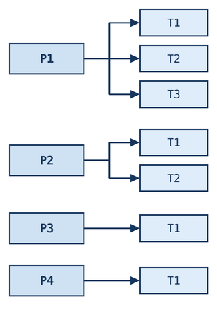
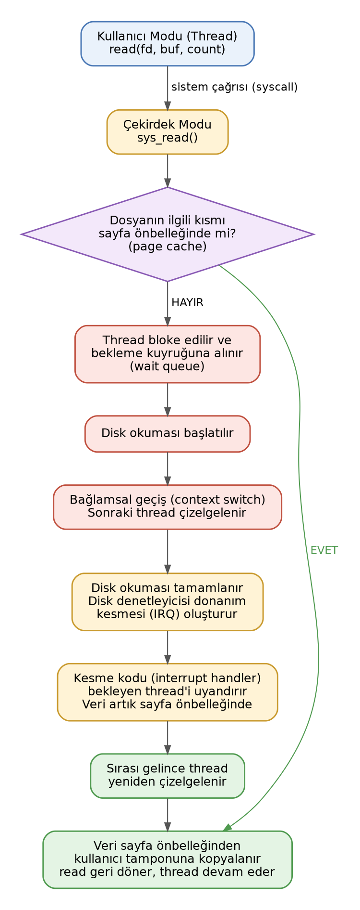
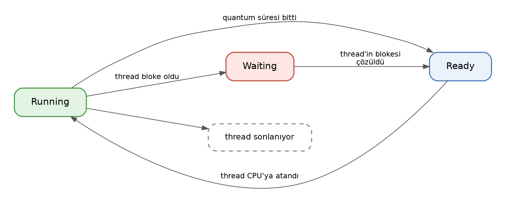

==========================================
Zaman Paylaşımlı Çalışma ve Bloke Kavramı
==========================================

Kitabımızın bu bölümünde kavramsal olarak zaman paylaşımlı çalışma ve bloke kavramı hakkında açıklamalar yapacağız. 
Bu temel kavramları izleyen konularda kullanacağız. Thread'ler kitabımızda ileride ayrı bir bölüm olarak ele alınmaktadır.

Zaman Paylaşımlı Çalışma ve Thread Kavramı
==========================================

Bugünkü masaüstü işletim sistemleri *zaman paylaşımlı (time sharing)* bir çalışma ortamı
oluşturmaktadır. Zaman paylaşımlı çalışma fikri ilk kez 1957 yılında uygulanmış ve sonra aktif bir
biçimde işletim sistemlerine sokulmuştur. Dolayısıyla bugün kullandığımız UNIX/Linux, Windows ve macOS
sistemleri zaman paylaşımlı çalışma uygulamaktadır.

Proses terimi çalışmakta olan programın bütün bilgilerini içermektedir. Örneğin onun bellek alanı, yetki
ID'leri, açmış olduğu dosyalar, çalışma dizini gibi kavramlar proses kavramının bilgilerini
oluşturmaktadır. Prosesin bağımsız çizelgelenen akışlarına ise *thread* denilmektedir. Thread denemeleri
80'li yıllarda yapılmış olsa da 90'lı yılların ortalarına doğru işletim sistemlerine sokulmuştur. Bir
proses tek bir thread'le çalışmaya başlatılır. Buna prosesin *ana thread'i (main thread)* denir. Diğer
thread'ler sistem fonksiyonlarıyla ya da sistem fonksiyonlarını çağıran kütüphane fonksiyonlarıyla
programcı tarafından yaratılmaktadır.

Zaman paylaşımlı çalışmada proseslerin thread'leri işletim sistemi tarafından CPU'ya atanır. O thread'in
CPU'da belli bir süre çalışmasına izin verilir. O süre dolduğunda thread'in çalışmasına ara verilip
başka bir thread benzer biçimde CPU'ya atanır. Tabii çalışmasına ara verilen thread'in bilgileri proses
kontrol bloğuna kaydedilmekte ve çalışma sırası yeniden o thread'e geldiğinde thread en son kesilen
noktadan çalışmasına devam etmektedir. Böylece aslında programın akışlarını oluşturan thread'ler kesiksiz
değil parçalı bir biçimde çalıştırılmaktadır. Dışarıdan bakıldığında sanki akış kesiksiz ilerliyormuş gibi bir
illüzyon oluşmaktadır. Halbuki akış kesikli bir biçimde ilerlemektedir.

Thread'li işletim sistemlerinde CPU tarafından çizelgelenen birimler prosesler değil thread'lerdir.
Örneğin proseslerin thread'leri şunlar olsun:

Burada işletim sistemi bu 7 thread'i ismine *çalışma kuyruğu (run queue)* denilen bir kuyruk sistemine
alır. Onları parçalı bir biçimde çalıştırır. İşletim sistemi gözüyle bakıldığında bu çalışma kuyruğunda
prosesler yoktur, onların thread'leri vardır.

Quantum Süresi ve Bağlamsal Geçiş
---------------------------------

Bir thread'in zaman paylaşımlı çalışma modelinde parçalı çalışma süresine *quantum süresi* ya da
İngilizce *time quantum* denilmektedir. Quantum süresinin ne kadar olacağı işletim sisteminin tasarımına
bağlıdır. Bir thread'in çalışmasına ara verilmesi ve sıradaki thread'in CPU'ya atanması sürecine ise
İngilizce *context switch* ya da *task switch* denilmektedir. Biz kitabımızda *context switch* yerine
Türkçe *bağlamsel geçiş* terimini kullanacağız.

Peki thread'lerin parçalı çalışma süresini belirten quantum süresi hangi uzunlukta olmalıdır? Eğer quantum süresi
uzun tutulursa interaktivite azalır, quantum süresi kısa tutulursa zamanın önemli kısmı bağlamsal geçiş
için harcanır, dolayısıyla *birim zamanda yapılan iş miktarı (throughput)* düşer. Quantum süresi çeşitli
faktörlere bağlı olarak değişebilmektedir. 

Zaman paylaşımlı bir sistemde kullanıcı sanki tüm proseslerin aynı anda çalıştığını sanmaktadır. Halbuki
bu bir illüzyondur. Aslında proseslerin akışlarını oluşturan thread'ler sürekli ara verilip
çalıştırılmaktadır. Bu işlem çok hızlı yapıldığı için sanki prosesler aynı anda çalışıyormuş gibi bir
algı oluşmaktadır.

Preemptive ve Cooperative Çizelgeleme
-------------------------------------

Peki bir thread CPU'ya atanmışken onun quantum süresini doldurması ve CPU'dan kopartılması nasıl
sağlanmaktadır? İşte bu işlem hemen her zaman donanım kesmeleri yoluyla yapılmaktadır. Sistem
donanımında periyodik kesme oluşturan bir mekanizma vardır. Buna *timer kesmesi* ya da UNIX/Linux
dünyasında *jiffy* denilmektedir. Eski Linux sistemlerinde makineler yavaş olduğu için timer kesme
periyodunu 10 ms. olarak ayarlamaktaydı. Ancak makineler hızlanınca artık bu periyot uzun süredir 1 ms
ya da 2.5 milisaniyeye ayarlanmaktadır. Yani tipik olarak her 1 milisaniyede bir aslında donanım kesmesi
yoluyla çekirdek kodu devreye girmektedir. Bu kesme kodu da örneğin 60 kez oluştuğunda bağlamsal geçiş
(context switch) yapmaktadır. Thread akışının bu biçimde quantum süresi dolduğunda donanım kesmesi
yoluyla zorla ara verilmesine işletim sistemleri dünyasında *preemption*, kesilmenin bu biçimde
yapıldığı işletim sistemlerine de *preemptive işletim sistemleri* denilmektedir. (*Preemption* sözcüğü
İngilizce *zorla ele geçirmek*, *zorla almak* anlamlarına gelmektedir.) Preemptive işletim
sistemlerinde thread akışı quantum süresi dolduğunda herhangi bir makine komutunda
kesilebilmektedir. UNIX/Linux, Windows ve macOS sistemleri preemptive işletim sistemleridir. Artık pek
çok işlemci ailesi bu biçimdeki donanım kesmeleri oluşturan timer devrelerini CPU'nun içerisine de dahil
etmiştir.

Preemptive sistemlerin dışında zaman paylaşımlı çalışma için *non-preemptive* ya da *cooperative
multitasking* denilen sistemler kullanılabilmektedir. Bu sistemlerde bir thread çalıştığında CPU'yu
zorla değil kendi rızası ile bırakmaktadır. Bu sistemde eğer thread CPU'yu kendi rızası ile bırakmazsa
diğer thread'ler çalışma fırsatı bulamazlar. Bu duruma *diğer thread'lerin açlıktan ölmesi (starvation)*
denilmektedir. Cooperative multitasking sistemler artık çok kısıtlı kullanılmaktadır. PalmOS, eski
Windows 3.X sistemleri ve IOS'un ilk versiyonları bu biçimde bir zaman paylaşımlı çalışma ortamı
oluşturuyordu.

Çok CPU'lu Sistemlerde Zaman Paylaşımlı Çalışma
===============================================

Peki sistemimizde birden fazla CPU (ya da çekirdek) varsa zaman paylaşımlı çalışma nasıl
yürütülmektedir? Aslında değişen bir şey yoktur. Bu durum tıpkı yemek verilen bir kurumda yemeğin birden
fazla koldan verilmesi, ya da bir süper markette bizden fazla kasanın bulunması gibidir. İşletim
sisteminin zaman paylaşımlı çalışma için oluşturduğu kuyruğa işletim sistemleri dünyasında *çalışma
kuyruğu (run queue)* denilmektedir. Bu çalışma kuyruğu çok CPU söz konusu olduğunda her CPU için
oluşturulmaktadır. Böylece her CPU yine zaman paylaşımlı bir biçimde çalıştırma kuyruğundaki thread'leri
çalıştırmaktadır. Yani yukarıda açıkladığımız temel prensip değişmemektedir. Tabii burada işletim
sisteminin bazı kararları da vermesi gerekir. Örneğin yeni bir thread (ya da proses) yaratıldığında
bunun hangi CPU'ya atanacağı gibi. Bazen işletim sistemi thread'i bir CPU'nun çalışma kuyruğuna atar.
Ancak diğer kuyruklar daha boş hale gelirse (çünkü o sırada çeşitli prosesler ve thread'ler sonlanmış
olabilir) işletim sistemi başka bir CPU'nun çalıştırma kuyruğundaki thread'i kuyruğu daha boş olan CPU'nun
çalıştırma kuyruğuna atayabilir. (Biz bir süper markette işin başında boş bir kasanın kuyruğuna girmiş
olabiliriz. Sonra başka bir kasadaki kuyruk çok azalmış duruma gelebilir. Biz de o kuyruğa geçmeyi
tercih ederiz. İşletim sistemi de buna benzer davranmaktadır.) Bu sürece işletim sistemleri dünyasında
*yük dengelemesi (load balancing)* denilmektedir. Linux işletim sistemi, Windows sistemleri ve macOS
sistemleri buna benzer bir çizelgeleme algoritması kullanmaktadır. Bir ara Linux O(1) çizelgelemesi
denilen bir yöntem denemiştir. Bu yöntemde işletim sistemi tek bir çalışma kuyruğu kullanıyordu. Hangi
CPU'daki parçalı çalışma süresi biterse bu tek kuyruktan seçme yapılıyordu. Ancak en çok tercih edilen
yöntem her CPU (ya da çekirdek) için ayrı bir çalışma kuyruğunun oluşturulmasıdır.

Çok CPU'lu zaman paylaşımlı çalışmada CPU sayısı arttırıldıkça total performans artacaktır. Çünkü CPU'lar
için düzenlenen çalıştırma kuyruklarında daha az thread bulunacaktır.

Bloke Olma (Blocking) Kavramı
=============================

Zaman paylaşımlı çalışmada en önemli kavramlardan biri de *bloke olma (blocking)* denilen kavramdır.
İşletim sistemi bir thread'i CPU'ya atadığında o thread *dışsal bir olaya ilişkin bir işlem başlattığı
zaman* uzun süre bekleme yapabileceğinden dolayı işletim sistemi o thread'i çalıştırma kuyruğundan (run
queue) çıkartır, *bekleme kuyruğu (wait queue)* denilen bir kuyruğa yerleştirir. Böylece zaten bekleyecek
olan thread boşuna CPU zamanı harcamadan pasif bir biçimde bekletilmiş olur. Örneğin bir thread
klavyeden bir şey okumak istesin. İşletim sistemi thread'i bloke ederek çalışma kuyruğundan çıkartır ve
onu bekleme kuyruğuna alır. Artık o thread çalışma kuyruğunda olmadığından zaman paylaşımlı çalışmada
işletim sistemi tarafından ele alınmaz. Beklenen dışsal olay (örneğin dosya okuması) gerçekleştiğinde
thread yeniden çalıştırma kuyruğuna yerleştirilir. Böylece çalışma aynı prensiple devam ettirilir.
İşletim sistemi bekleme kuyruklarındaki thread'lere ilişkin olayların gerçekleştiğini birkaç biçimde
anlayabilmektedir. Örneğin bir TCP/IP soket okuması yapıldığında eğer sokete henüz bilgi gelmemişse
işletim sistemi thread'i bloke eder. Sonra network kartına paket geldiğinde network kartı bir donanım
kesmesi oluşturur. İşletim sistemi devreye girer ve eğer gelen paket soketten okuma yapmak isteyen
thread'e ilişkinse bu kesme kodunda (interrupt handler) aynı zamanda o thread'i blokeden kurtarır. Ya da
örneğin proses beklerken kullanılan ``wait`` fonksiyonlarında işletim sistemi ``wait`` işlemini yapan
thread'i bloke ederek ``wait`` kuyruğuna yerleştirir. Alt proses bittiğinde ``_exit`` fonksiyonunda
(yani bunun çağırdığı sistem fonksiyonunda) bu ``wait`` kuyruklarına bu sistem fonksiyonu bakar ve
ilgili thread'in blokesini çözer. ``sleep`` gibi bir fonksiyonda ise işletim sistemi bekleme zamanını
kendisi hesaplamaktadır. Bekleme zamanı dolunca thread'in blokesini işletim sistemi çözmektedir. Genel
olarak işletim sistemleri her olay için ayrı bir bekleme kuyruğu oluşturmaktadır. Örneğin aygıt
sürücüler kendi bekleme kuyruklarını oluşturup bloke işlemlerini kendileri yapmaktadır.

Blokeye Yol Açan Tipik Durumlar
-------------------------------

Aşağıda UNIX türevi sistemlerde blokeye yol açabilen tipik durumlar bir tablo halinde verilmiştir:

.. list-table::
   :header-rows: 1
   :widths: 30 36 34

   * - Olay
     - Örnek Çağrı
     - Uyanma Koşulu
   * - Disk I/O (page cache miss)
     - ``read()``, ``write()``
     - I/O tamamlanma kesmesi
   * - Pipe/soket okuma (veri yok)
     - ``read()``, ``recv()``
     - Veri gelmesi
   * - Pipe/soket yazma (tampon dolu)
     - ``write()``, ``send()``
     - Tamponda yer açılması
   * - Terminal girişi bekleme
     - ``read()`` (tty)
     - Satır girilmesi
   * - pthread mutex bekleme
     - ``pthread_mutex_lock()``
     - Kilidin bırakılması
   * - Koşul değişkeni bekleme
     - ``pthread_cond_wait()``
     - signal/broadcast
   * - Semafor bekleme
     - ``sem_wait()``
     - ``sem_post()``
   * - Uyuma (sleep)
     - ``nanosleep()``, ``sleep()``
     - Süre dolması (hrtimer)
   * - Çoklu fd bekleme
     - ``select()``, ``poll()``, ``epoll_wait()``
     - fd hazır / timeout
   * - Alt proses bekleme
     - ``wait()``, ``waitpid()``
     - Çocuğun sonlanması
   * - Sinyal bekleme
     - ``pause()``, ``sigsuspend()``
     - Sinyal gelmesi
   * - Thread join
     - ``pthread_join()``
     - Thread'in sonlanması
   * - Major page fault
     - mmap'li dosyaya erişim
     - Sayfanın okunması
   * - Kernel mutex/rwsem
     - ``mutex_lock()``, ``down_read()``
     - Kilidin bırakılması
   * - Dosya kilidi
     - ``fcntl(F_SETLKW)``, ``flock()``
     - Kilidin bırakılması
   * - Mesaj kuyruğu okuma
     - ``mq_receive()``, ``msgrcv()``
     - Mesaj gelmesi
   * - Durdurma (stop)
     - ``SIGSTOP``, ``SIGTSTP``
     - ``SIGCONT``
   * - ptrace durdurması
     - ``ptrace()``, breakpoint
     - Tracer'ın devam ettirmesi

read Fonksiyonu Örneği
----------------------

Örneğin bir dosyadan (bir aygıttan da olabilir, zira aygıtlara da dosyalar gibi erişilmektedir) ``read``
fonksiyonuyla bir okuma yapılmak istensin. Linux sistemlerinde ``read`` fonksiyonu çekirdekteki
``sys_read`` sistem fonksiyonunu çağırmaktadır. ``sys_read`` sistem fonksiyonu önce dosyanın o kısmının
*sayfa önbelleği (page cache)* denilen RAM'deki önbellek sisteminde olup olmadığına bakmaktadır. Eğer
dosyanın o kısmı sayfa önbelleğinde bulunuyorsa okuma thread hiç bloke olmadan sayfa önbelleğinden
yapılmaktadır. Eğer dosyanın o kısmı sayfa önbelleğinde yoksa işletim sistemi thread'i bloke edip bekleme
kuyruğuna yerleştirmektedir. Bundan sonra işletim sistemi disk okumasını başlatır ve bağlamsal geçiş
yaparak sonraki thread'in çizelgelenmesini sağlar. Disk okuması bittiğinde disk denetleyicisi CPU'da bir
donanım kesmesi oluşturur. İşletim sisteminin kesme kodu devreye girerek bekleyen thread'i uyandırır.
Artık okunacak kısım sayfa önbelleği denilen önbellek içerisindedir. Thread kendisine çalışma sırası
geldiğinde bilgiyi önbellekten okuyup yoluna devam eder. Bu süreci şekilsel olarak aşağıdaki gibi
betimleyebiliriz:

Burada bir noktaya dikkat ediniz. Thread'in çalıştırma kuyruğundan çıkartılıp bekleme kuyruğuna alınması
sıradan prosesler tarafından yapılamamaktadır. Bu işlem çekirdek modunda işletim sisteminin sistem
fonksiyonları tarafından ya da aygıt sürücüler tarafından yapılmaktadır. Yani thread'in bloke olması
programın çalışması sırasında çağrılan bir sistem fonksiyonu (ya da aygıt sürücü fonksiyonu)
tarafından sağlanmaktadır.

Thread'in Yaşam Döngüsü
=======================

O halde bir thread'in yaşam döngüsünü aşağıdaki şekille özetleyebiliriz:

Burada teorik kitaplardaki terminoloji kullanılmıştır. *Running* thread'in CPU'ya atanmış olduğu ve CPU
tarafından çalıştırılmakta olduğunu belirtmektedir. *Ready* çalışma kuyruğunu temsil etmektedir. Yani
*Ready* durumunda thread çalışma kuyruğundadır ancak CPU'ya atanmamıştır. *Waiting* ise bekleme kuyruğunu
temsil etmektedir. Thread bloke olup çalışma kuyruğundan çıkartılıp bekleme kuyruğuna
yerleştirilmektedir.

IO Yoğun ve CPU Yoğun Thread'ler
================================

Thread'ler *IO yoğun (IO bound)* ve *CPU yoğun (CPU bound)* olmak üzere ikiye ayrılmaktadır. IO yoğun
thread'ler kendisine verilen quantum süresini çok az kullanıp hemen bloke olan thread'lerdir. CPU yoğun
thread'ler ise kendisine verilen quantum süresini büyük ölçüde kullanan thread'lerdir. Örneğin bir döngü
içerisinde sürekli hesap yapan bir thread CPU yoğun bir thread'tir:

.. code-block:: c

    for (int i = 1; i <= TOO_BIG_NUMBER; ++i)
        total += i;

Ancak aşağıdaki gibi bir thread IO yoğun thread'tir:

.. code-block:: c

    for (;;) {
        scanf("%d", &val);
        if (val == 0)
            break;
        printf("%d\n", val);
    }

Burada bu thread aslında çok az CPU zamanı harcamaktadır. Zamanının büyük kısmını uykuda geçirecektir. IO
yoğun ve CPU yoğun thread kavramı işletim sistemi için değil durumun insanlar tarafından anlaşılması için
uydurulmuş kavramlardır. Yani işletim sistemi thread'leri IO yoğun, CPU yoğun biçimde ayırmamaktadır. Bir
sistemde yüzlerde IO yoğun thread olsa bile bu durum CPU'lar üzerinde bir baskı oluşturmaz. Ancak çok
sayıda CPU yoğun thread CPU kullanım oranını ciddi bir biçimde yükseltip sistemin yavaşlamasına yol
açacaktır.

Zaman Ölçümü Deneyi (clock_gettime)
===================================

Bir programda iki nokta arasında geçen zaman sistemin o anki yüküne bağlı olarak değişebilmektedir.
Örneğin sistemde çok sayıda CPU yoğun thread varsa iki nokta arasındaki zaman eskisine göre uzayabilir.

Aşağıdaki programı önce bir kez çalıştırınız sonra kabuk üzerinden komut satırının sonuna ``&`` koyarak
çok sayıda çalıştırınız. Programın döngüde harcadığı gerçek zaman uzayacaktır. Biz bu programda C'nin
``clock_gettime`` fonksiyonunu kullandık. Bu fonksiyon nanosaniye temelinde çözünürlüğe sahiptir.
``clock`` isimli standart C fonksiyonu Linux sistemlerinde CPU zamanını verdiği için bu deneyde
kullanılamamaktadır. Ancak ileride zaman ölçme konusu ayrı başlık altında değerlendirilecektir.

.. code-block:: c

    #include <stdio.h>
    #include <stdlib.h>
    #include <time.h>

    void exit_sys(const char *msg);

    int main(int argc, char *argv[])
    {
        struct timespec ts1, ts2;
        long long elapsed_time;

        if (clock_gettime(CLOCK_MONOTONIC, &ts1) == -1)
            exit_sys("clock_gettime");

        for (long i = 0; i < 1000000000; ++i)
            for (int k = 0; k < 30; ++k)
                ;
        if (clock_gettime(CLOCK_MONOTONIC, &ts2) == -1)
            exit_sys("clock_gettime");

        elapsed_time = (ts2.tv_sec * 1000000000LL + ts2.tv_nsec) - (ts1.tv_sec * 1000000000LL + ts1.tv_nsec);
        printf("Elapsed Nanosecond: %lld\n", elapsed_time);
            printf("Elapsed Second: %f\n", elapsed_time / 1000000000.);

        return 0;
    }

    void exit_sys(const char *msg)
    {
        perror(msg);
        exit(EXIT_FAILURE);
    }

time Kabuk Komutu
=================

Aslında bir programın toplam çalışma zamanı ``time`` isimli kabuk komutuyla da ölçülebilmektedir. Komut
basit bir biçimde şöyle kullanılabilir:

.. code-block:: console

    $ time ./sample

``time`` komutundan şöyle bir çıktı elde edilmektedir:

.. code-block:: console

    real    1m38,360s
    user    0m18,597s
    sys     0m0,052s

Görüldüğü gibi ``time`` komutu programın hem toplam çalışma zamanını hem de çekirdek ve kullanıcı
modunda harcadığı zamanı rapor etmektedir.

