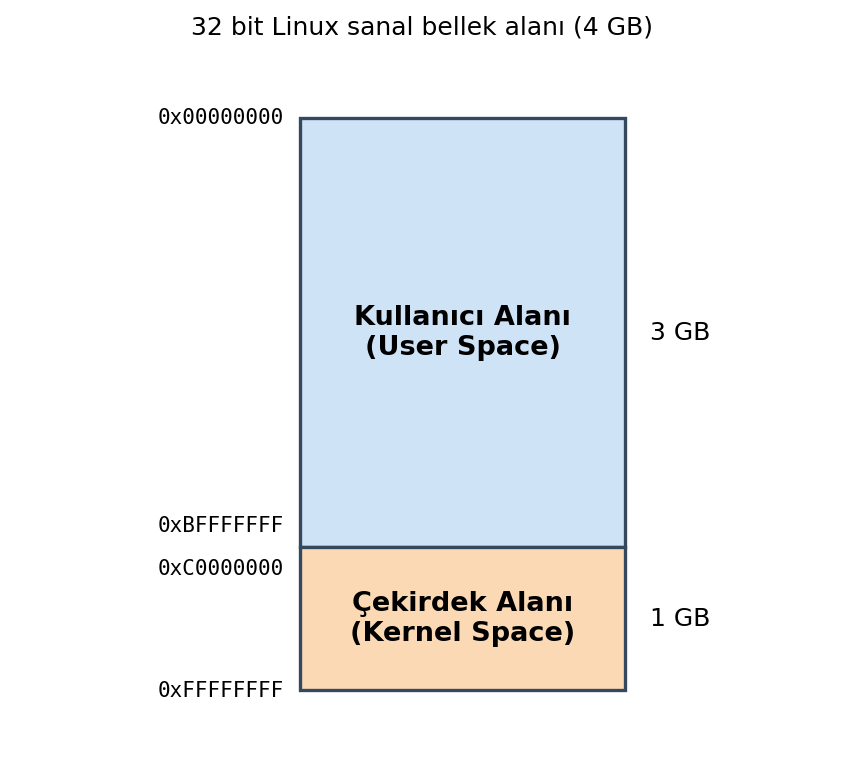
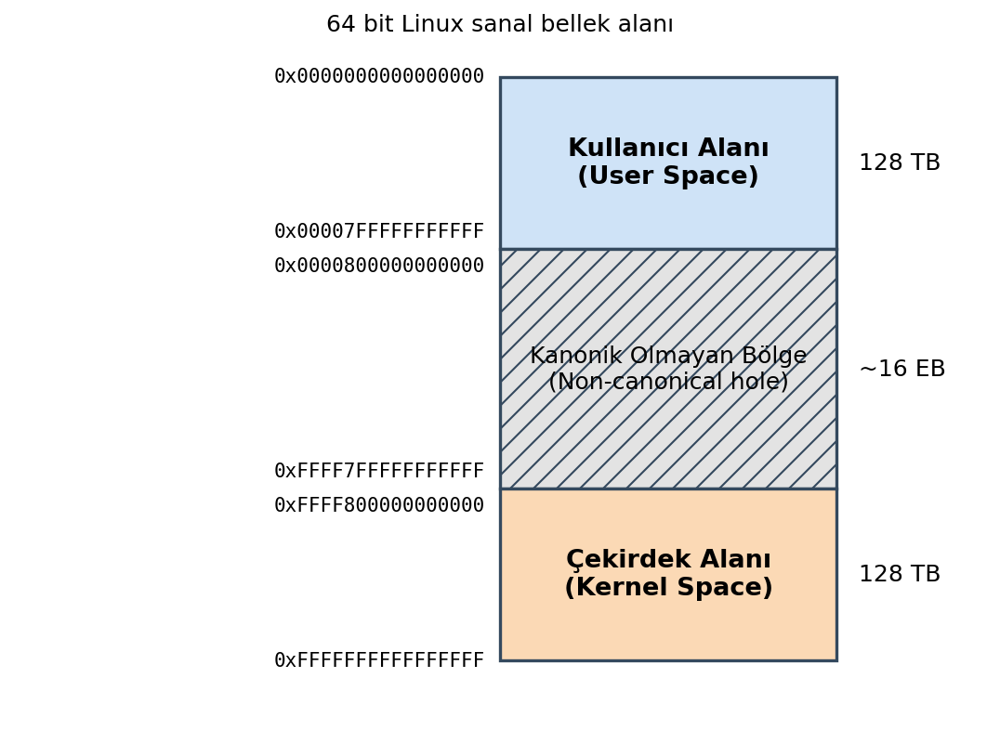
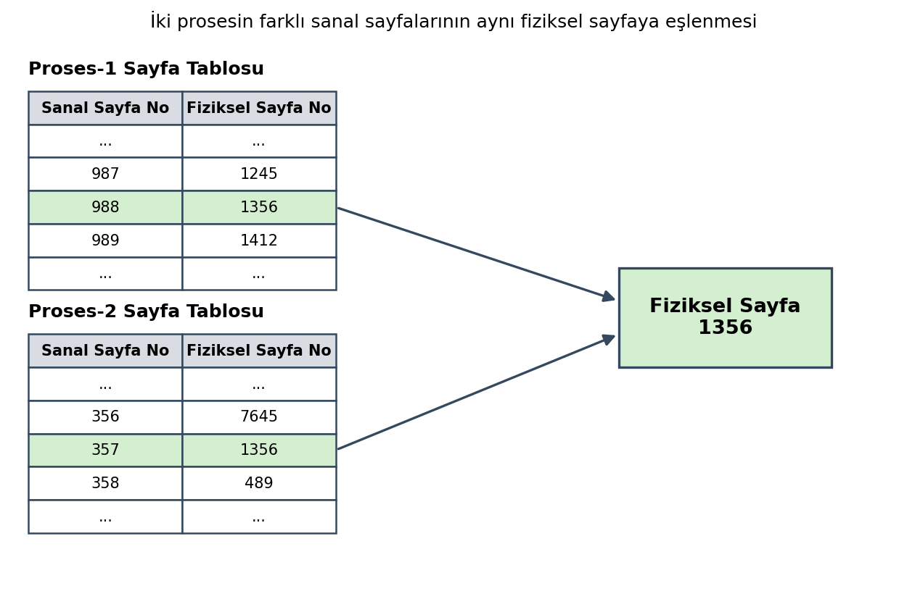
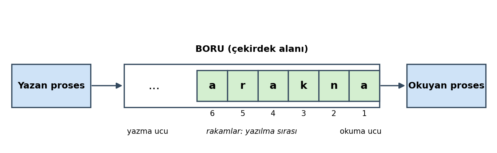

===========================================
Thread Kavramı ve Zaman Paylaşımlı Çalışma 
==========================================

Kitabımızın bu bölümünde kavramsal olarak zaman paylaşımlı çalışma ve bloke kavramı hakkında açıklamalar yapacağız. 
Bu temel kavramları izleyen konularda kullanacağız. Thread'ler kitabımızda ileride ayrı bir bölüm olarak ele alınmaktadır.

Thread Nedir?
=============

Proses terimi çalışmakta olan programın bütün bilgilerini içermektedir. Örneğin onun bellek alanı, yetki
ID'leri, açmış olduğu dosyalar, çalışma dizini gibi kavramlar proses kavramının bilgilerini
oluşturmaktadır. Prosesin bağımsız çizelgelenen akışlarına ise *thread* denilmektedir. Thread denemeleri
80'li yıllarda yapılmış olsa da 90'lı yılların ortalarına doğru işletim sistemlerine sokulmuştur. Bir
proses tek bir thread'le çalışmaya başlatılır. Buna prosesin *ana thread'i (main thread)* denir. Diğer
thread'ler sistem fonksiyonlarıyla ya da sistem fonksiyonlarını çağıran kütüphane fonksiyonlarıyla
programcı tarafından yaratılmaktadır.

Zaman Paylaşımlı Çalışma Nedir?
===============================

Bugünkü masaüstü işletim sistemleri *zaman paylaşımlı (time sharing)* bir çalışma ortamı
oluşturmaktadır. Zaman paylaşımlı çalışma fikri ilk kez 1957 yılında uygulanmış ve sonra aktif bir
biçimde işletim sistemlerine sokulmuştur. Dolayısıyla bugün kullandığımız UNIX/Linux, Windows ve macOS
sistemleri zaman paylaşımlı çalışma uygulamaktadır.

Zaman paylaşımlı çalışmada proseslerin thread'leri işletim sistemi tarafından CPU'ya atanır. O thread'in
CPU'da belli bir süre çalışmasına izin verilir. O süre dolduğunda thread'in çalışmasına ara verilip
başka bir thread benzer biçimde CPU'ya atanır. Tabii çalışmasına ara verilen thread'in bilgileri proses
kontrol bloğuna kaydedilmekte ve çalışma sırası yeniden o thread'e geldiğinde thread en son kesilen
noktadan çalışmasına devam etmektedir. Böylece aslında programın akışlarını oluşturan thread'ler kesiksiz
değil parçalı bir biçimde çalıştırılmaktadır. Dışarıdan bakıldığında sanki akış kesiksiz ilerliyormuş gibi bir
illüzyon oluşmaktadır. Halbuki akış kesikli bir biçimde ilerlemektedir.

Thread'li işletim sistemlerinde CPU tarafından çizelgelenen birimler prosesler değil thread'lerdir.
Örneğin proseslerin thread'leri şunlar olsun:

.. figure:: _static/process-threads.png
    :align: center
    :width: 22%

Burada işletim sistemi bu 7 thread'i ismine *çalışma kuyruğu (run queue)* denilen bir kuyruk sistemine
alır. Onları parçalı bir biçimde çalıştırır. İşletim sistemi gözüyle bakıldığında bu çalışma kuyruğunda
prosesler yoktur, onların thread'leri vardır.

Quantum Süresi ve Bağlamsal Geçiş
---------------------------------

Bir thread'in zaman paylaşımlı çalışma modelinde parçalı çalışma süresine *quantum süresi* ya da
İngilizce *time quantum* denilmektedir. Quantum süresinin ne kadar olacağı işletim sisteminin tasarımına
bağlıdır. Bir thread'in çalışmasına ara verilmesi ve sıradaki thread'in CPU'ya atanması sürecine ise
İngilizce *context switch* ya da *task switch* denilmektedir. Biz kitabımızda *context switch* yerine
Türkçe *bağlamsel geçiş* terimini kullanacağız.

Peki thread'lerin parçalı çalışma süresini belirten quantum süresi hangi uzunlukta olmalıdır? Eğer quantum süresi
uzun tutulursa interaktivite azalır, quantum süresi kısa tutulursa zamanın önemli kısmı bağlamsal geçiş
için harcanır, dolayısıyla *birim zamanda yapılan iş miktarı (throughput)* düşer. Quantum süresi çeşitli
faktörlere bağlı olarak değişebilmektedir. 

Zaman paylaşımlı bir sistemde kullanıcı sanki tüm proseslerin aynı anda çalıştığını sanmaktadır. Halbuki
bu bir illüzyondur. Aslında proseslerin akışlarını oluşturan thread'ler sürekli ara verilip
çalıştırılmaktadır. Bu işlem çok hızlı yapıldığı için sanki prosesler aynı anda çalışıyormuş gibi bir
algı oluşmaktadır.

Preemptive ve Cooperative Çizelgeleme
-------------------------------------

Peki bir thread CPU'ya atanmışken onun quantum süresini doldurması ve CPU'dan kopartılması nasıl
sağlanmaktadır? İşte bu işlem hemen her zaman donanım kesmeleri yoluyla yapılmaktadır. Sistem
donanımında periyodik kesme oluşturan bir mekanizma vardır. Buna *timer kesmesi* ya da UNIX/Linux
dünyasında *jiffy* denilmektedir. Eski Linux sistemlerinde makineler yavaş olduğu için timer kesme
periyodunu 10 ms. olarak ayarlamaktaydı. Ancak makineler hızlanınca artık bu periyot uzun süredir 1 ms
ya da 2.5 milisaniyeye ayarlanmaktadır. Yani tipik olarak her 1 milisaniyede bir aslında donanım kesmesi
yoluyla çekirdek kodu devreye girmektedir. Bu kesme kodu da örneğin 60 kez oluştuğunda bağlamsal geçiş
(context switch) yapmaktadır. Thread akışının bu biçimde quantum süresi dolduğunda donanım kesmesi
yoluyla zorla ara verilmesine işletim sistemleri dünyasında *preemption*, kesilmenin bu biçimde
yapıldığı işletim sistemlerine de *preemptive işletim sistemleri* denilmektedir. (*Preemption* sözcüğü
İngilizce *zorla ele geçirmek*, *zorla almak* anlamlarına gelmektedir.) Preemptive işletim
sistemlerinde thread akışı quantum süresi dolduğunda herhangi bir makine komutunda
kesilebilmektedir. UNIX/Linux, Windows ve macOS sistemleri preemptive işletim sistemleridir. Artık pek
çok işlemci ailesi bu biçimdeki donanım kesmeleri oluşturan timer devrelerini CPU'nun içerisine de dahil
etmiştir.

Preemptive sistemlerin dışında zaman paylaşımlı çalışma için *non-preemptive* ya da *cooperative
multitasking* denilen sistemler kullanılabilmektedir. Bu sistemlerde bir thread çalıştığında CPU'yu
zorla değil kendi rızası ile bırakmaktadır. Bu sistemde eğer thread CPU'yu kendi rızası ile bırakmazsa
diğer thread'ler çalışma fırsatı bulamazlar. Bu duruma *diğer thread'lerin açlıktan ölmesi (starvation)*
denilmektedir. Cooperative multitasking sistemler artık çok kısıtlı kullanılmaktadır. PalmOS, eski
Windows 3.X sistemleri ve IOS'un ilk versiyonları bu biçimde bir zaman paylaşımlı çalışma ortamı
oluşturuyordu.

Çok CPU'lu Sistemlerde Zaman Paylaşımlı Çalışma
===============================================

Peki sistemimizde birden fazla CPU (ya da çekirdek) varsa zaman paylaşımlı çalışma nasıl
yürütülmektedir? Aslında değişen bir şey yoktur. Bu durum tıpkı yemek verilen bir kurumda yemeğin birden
fazla koldan verilmesi, ya da bir süper markette bizden fazla kasanın bulunması gibidir. İşletim
sisteminin zaman paylaşımlı çalışma için oluşturduğu kuyruğa işletim sistemleri dünyasında *çalışma
kuyruğu (run queue)* denilmektedir. Bu çalışma kuyruğu çok CPU söz konusu olduğunda her CPU için
oluşturulmaktadır. Böylece her CPU yine zaman paylaşımlı bir biçimde çalıştırma kuyruğundaki thread'leri
çalıştırmaktadır. Yani yukarıda açıkladığımız temel prensip değişmemektedir. Tabii burada işletim
sisteminin bazı kararları da vermesi gerekir. Örneğin yeni bir thread (ya da proses) yaratıldığında
bunun hangi CPU'ya atanacağı gibi. Bazen işletim sistemi thread'i bir CPU'nun çalışma kuyruğuna atar.
Ancak diğer kuyruklar daha boş hale gelirse (çünkü o sırada çeşitli prosesler ve thread'ler sonlanmış
olabilir) işletim sistemi başka bir CPU'nun çalıştırma kuyruğundaki thread'i kuyruğu daha boş olan CPU'nun
çalıştırma kuyruğuna atayabilir. (Biz bir süper markette işin başında boş bir kasanın kuyruğuna girmiş
olabiliriz. Sonra başka bir kasadaki kuyruk çok azalmış duruma gelebilir. Biz de o kuyruğa geçmeyi
tercih ederiz. İşletim sistemi de buna benzer davranmaktadır.) Bu sürece işletim sistemleri dünyasında
*yük dengelemesi (load balancing)* denilmektedir. Linux işletim sistemi, Windows sistemleri ve macOS
sistemleri buna benzer bir çizelgeleme algoritması kullanmaktadır. Bir ara Linux O(1) çizelgelemesi
denilen bir yöntem denemiştir. Bu yöntemde işletim sistemi tek bir çalışma kuyruğu kullanıyordu. Hangi
CPU'daki parçalı çalışma süresi biterse bu tek kuyruktan seçme yapılıyordu. Ancak en çok tercih edilen
yöntem her CPU (ya da çekirdek) için ayrı bir çalışma kuyruğunun oluşturulmasıdır.

Çok CPU'lu zaman paylaşımlı çalışmada CPU sayısı arttırıldıkça total performans artacaktır. Çünkü CPU'lar
için düzenlenen çalıştırma kuyruklarında daha az thread bulunacaktır.

Bloke Olma (Blocking) Kavramı
=============================

Zaman paylaşımlı çalışmada en önemli kavramlardan biri de *bloke olma (blocking)* denilen kavramdır.
İşletim sistemi bir thread'i CPU'ya atadığında o thread *dışsal bir olaya ilişkin bir işlem başlattığı
zaman* uzun süre bekleme yapabileceğinden dolayı işletim sistemi o thread'i çalıştırma kuyruğundan (run
queue) çıkartır, *bekleme kuyruğu (wait queue)* denilen bir kuyruğa yerleştirir. Böylece zaten bekleyecek
olan thread boşuna CPU zamanı harcamadan pasif bir biçimde bekletilmiş olur. Örneğin bir thread
klavyeden bir şey okumak istesin. İşletim sistemi thread'i bloke ederek çalışma kuyruğundan çıkartır ve
onu bekleme kuyruğuna alır. Artık o thread çalışma kuyruğunda olmadığından zaman paylaşımlı çalışmada
işletim sistemi tarafından ele alınmaz. Beklenen dışsal olay (örneğin dosya okuması) gerçekleştiğinde
thread yeniden çalıştırma kuyruğuna yerleştirilir. Böylece çalışma aynı prensiple devam ettirilir.
İşletim sistemi bekleme kuyruklarındaki thread'lere ilişkin olayların gerçekleştiğini birkaç biçimde
anlayabilmektedir. Örneğin bir TCP/IP soket okuması yapıldığında eğer sokete henüz bilgi gelmemişse
işletim sistemi thread'i bloke eder. Sonra network kartına paket geldiğinde network kartı bir donanım
kesmesi oluşturur. İşletim sistemi devreye girer ve eğer gelen paket soketten okuma yapmak isteyen
thread'e ilişkinse bu kesme kodunda (interrupt handler) aynı zamanda o thread'i blokeden kurtarır. Ya da
örneğin proses beklerken kullanılan ``wait`` fonksiyonlarında işletim sistemi ``wait`` işlemini yapan
thread'i bloke ederek ``wait`` kuyruğuna yerleştirir. Alt proses bittiğinde ``_exit`` fonksiyonunda
(yani bunun çağırdığı sistem fonksiyonunda) bu ``wait`` kuyruklarına bu sistem fonksiyonu bakar ve
ilgili thread'in blokesini çözer. ``sleep`` gibi bir fonksiyonda ise işletim sistemi bekleme zamanını
kendisi hesaplamaktadır. Bekleme zamanı dolunca thread'in blokesini işletim sistemi çözmektedir. Genel
olarak işletim sistemleri her olay için ayrı bir bekleme kuyruğu oluşturmaktadır. Örneğin aygıt
sürücüler kendi bekleme kuyruklarını oluşturup bloke işlemlerini kendileri yapmaktadır.

Blokeye Yol Açan Tipik Durumlar
-------------------------------

Aşağıda UNIX türevi sistemlerde blokeye yol açabilen tipik durumlar bir tablo halinde verilmiştir:

.. list-table::
   :header-rows: 1
   :widths: 30 36 34

   * - Olay
     - Örnek Çağrı
     - Uyanma Koşulu
   * - Disk I/O (page cache miss)
     - ``read()``, ``write()``
     - I/O tamamlanma kesmesi
   * - Pipe/soket okuma (veri yok)
     - ``read()``, ``recv()``
     - Veri gelmesi
   * - Pipe/soket yazma (tampon dolu)
     - ``write()``, ``send()``
     - Tamponda yer açılması
   * - Terminal girişi bekleme
     - ``read()`` (tty)
     - Satır girilmesi
   * - pthread mutex bekleme
     - ``pthread_mutex_lock()``
     - Kilidin bırakılması
   * - Koşul değişkeni bekleme
     - ``pthread_cond_wait()``
     - signal/broadcast
   * - Semafor bekleme
     - ``sem_wait()``
     - ``sem_post()``
   * - Uyuma (sleep)
     - ``nanosleep()``, ``sleep()``
     - Süre dolması (hrtimer)
   * - Çoklu fd bekleme
     - ``select()``, ``poll()``, ``epoll_wait()``
     - fd hazır / timeout
   * - Alt proses bekleme
     - ``wait()``, ``waitpid()``
     - Çocuğun sonlanması
   * - Sinyal bekleme
     - ``pause()``, ``sigsuspend()``
     - Sinyal gelmesi
   * - Thread join
     - ``pthread_join()``
     - Thread'in sonlanması
   * - Major page fault
     - mmap'li dosyaya erişim
     - Sayfanın okunması
   * - Kernel mutex/rwsem
     - ``mutex_lock()``, ``down_read()``
     - Kilidin bırakılması
   * - Dosya kilidi
     - ``fcntl(F_SETLKW)``, ``flock()``
     - Kilidin bırakılması
   * - Mesaj kuyruğu okuma
     - ``mq_receive()``, ``msgrcv()``
     - Mesaj gelmesi
   * - Durdurma (stop)
     - ``SIGSTOP``, ``SIGTSTP``
     - ``SIGCONT``
   * - ptrace durdurması
     - ``ptrace()``, breakpoint
     - Tracer'ın devam ettirmesi

read Fonksiyonu Örneği
----------------------

Örneğin bir dosyadan (bir aygıttan da olabilir, zira aygıtlara da dosyalar gibi erişilmektedir) ``read``
fonksiyonuyla bir okuma yapılmak istensin. Linux sistemlerinde ``read`` fonksiyonu çekirdekteki
``sys_read`` sistem fonksiyonunu çağırmaktadır. ``sys_read`` sistem fonksiyonu önce dosyanın o kısmının
*sayfa önbelleği (page cache)* denilen RAM'deki önbellek sisteminde olup olmadığına bakmaktadır. Eğer
dosyanın o kısmı sayfa önbelleğinde bulunuyorsa okuma thread hiç bloke olmadan sayfa önbelleğinden
yapılmaktadır. Eğer dosyanın o kısmı sayfa önbelleğinde yoksa işletim sistemi thread'i bloke edip bekleme
kuyruğuna yerleştirmektedir. Bundan sonra işletim sistemi disk okumasını başlatır ve bağlamsal geçiş
yaparak sonraki thread'in çizelgelenmesini sağlar. Disk okuması bittiğinde disk denetleyicisi CPU'da bir
donanım kesmesi oluşturur. İşletim sisteminin kesme kodu devreye girerek bekleyen thread'i uyandırır.
Artık okunacak kısım sayfa önbelleği denilen önbellek içerisindedir. Thread kendisine çalışma sırası
geldiğinde bilgiyi önbellekten okuyup yoluna devam eder. Bu süreci şekilsel olarak aşağıdaki gibi
betimleyebiliriz:

.. image:: _static/ders41-read-bloke-akisi.png
   :alt: read fonksiyonunun sayfa önbelleği, bloke olma ve kesme ile uyanma akışı
   :align: center
   :width: 40%

Burada bir noktaya dikkat ediniz. Thread'in çalıştırma kuyruğundan çıkartılıp bekleme kuyruğuna alınması
sıradan prosesler tarafından yapılamamaktadır. Bu işlem çekirdek modunda işletim sisteminin sistem
fonksiyonları tarafından ya da aygıt sürücüler tarafından yapılmaktadır. Yani thread'in bloke olması
programın çalışması sırasında çağrılan bir sistem fonksiyonu (ya da aygıt sürücü fonksiyonu)
tarafından sağlanmaktadır.

Thread'in Yaşam Döngüsü
=======================

O halde bir thread'in yaşam döngüsünü aşağıdaki şekille özetleyebiliriz:

.. image:: _static/ders41-thread-durumlari.png
   :alt: Thread durum diyagramı: Running, Ready ve Waiting durumları arasındaki geçişler
   :align: center
   :width: 80%

Burada teorik kitaplardaki terminoloji kullanılmıştır. *Running* thread'in CPU'ya atanmış olduğu ve CPU
tarafından çalıştırılmakta olduğunu belirtmektedir. *Ready* çalışma kuyruğunu temsil etmektedir. Yani
*Ready* durumunda thread çalışma kuyruğundadır ancak CPU'ya atanmamıştır. *Waiting* ise bekleme kuyruğunu
temsil etmektedir. Thread bloke olup çalışma kuyruğundan çıkartılıp bekleme kuyruğuna
yerleştirilmektedir.

IO Yoğun ve CPU Yoğun Thread'ler
================================

Thread'ler *IO yoğun (IO bound)* ve *CPU yoğun (CPU bound)* olmak üzere ikiye ayrılmaktadır. IO yoğun
thread'ler kendisine verilen quantum süresini çok az kullanıp hemen bloke olan thread'lerdir. CPU yoğun
thread'ler ise kendisine verilen quantum süresini büyük ölçüde kullanan thread'lerdir. Örneğin bir döngü
içerisinde sürekli hesap yapan bir thread CPU yoğun bir thread'tir:

.. code-block:: c

    for (int i = 1; i <= TOO_BIG_NUMBER; ++i)
        total += i;

Ancak aşağıdaki gibi bir thread IO yoğun thread'tir:

.. code-block:: c

    for (;;) {
        scanf("%d", &val);
        if (val == 0)
            break;
        printf("%d\n", val);
    }

Burada bu thread aslında çok az CPU zamanı harcamaktadır. Zamanının büyük kısmını uykuda geçirecektir. IO
yoğun ve CPU yoğun thread kavramı işletim sistemi için değil durumun insanlar tarafından anlaşılması için
uydurulmuş kavramlardır. Yani işletim sistemi thread'leri IO yoğun, CPU yoğun biçimde ayırmamaktadır. Bir
sistemde yüzlerde IO yoğun thread olsa bile bu durum CPU'lar üzerinde bir baskı oluşturmaz. Ancak çok
sayıda CPU yoğun thread CPU kullanım oranını ciddi bir biçimde yükseltip sistemin yavaşlamasına yol
açacaktır.

Zaman Ölçümü Deneyi (clock_gettime)
===================================

Bir programda iki nokta arasında geçen zaman sistemin o anki yüküne bağlı olarak değişebilmektedir.
Örneğin sistemde çok sayıda CPU yoğun thread varsa iki nokta arasındaki zaman eskisine göre uzayabilir.

Aşağıdaki programı önce bir kez çalıştırınız sonra kabuk üzerinden komut satırının sonuna ``&`` koyarak
çok sayıda çalıştırınız. Programın döngüde harcadığı gerçek zaman uzayacaktır. Biz bu programda C'nin
``clock_gettime`` fonksiyonunu kullandık. Bu fonksiyon nanosaniye temelinde çözünürlüğe sahiptir.
``clock`` isimli standart C fonksiyonu Linux sistemlerinde CPU zamanını verdiği için bu deneyde
kullanılamamaktadır. Ancak ileride zaman ölçme konusu ayrı başlık altında değerlendirilecektir.

.. code-block:: c

    #include <stdio.h>
    #include <stdlib.h>
    #include <time.h>

    void exit_sys(const char *msg);

    int main(int argc, char *argv[])
    {
        struct timespec ts1, ts2;
        long long elapsed_time;

        if (clock_gettime(CLOCK_MONOTONIC, &ts1) == -1)
            exit_sys("clock_gettime");

        for (long i = 0; i < 1000000000; ++i)
            for (int k = 0; k < 30; ++k)
                ;
        if (clock_gettime(CLOCK_MONOTONIC, &ts2) == -1)
            exit_sys("clock_gettime");

        elapsed_time = (ts2.tv_sec * 1000000000LL + ts2.tv_nsec) - (ts1.tv_sec * 1000000000LL + ts1.tv_nsec);
        printf("Elapsed Nanosecond: %lld\n", elapsed_time);
            printf("Elapsed Second: %f\n", elapsed_time / 1000000000.);

        return 0;
    }

    void exit_sys(const char *msg)
    {
        perror(msg);
        exit(EXIT_FAILURE);
    }

time Kabuk Komutu
=================

Aslında bir programın toplam çalışma zamanı ``time`` isimli kabuk komutuyla da ölçülebilmektedir. Komut
basit bir biçimde şöyle kullanılabilir:

.. code-block:: console

    $ time ./sample

``time`` komutundan şöyle bir çıktı elde edilmektedir:

.. code-block:: console

    real    1m38,360s
    user    0m18,597s
    sys     0m0,052s

Görüldüğü gibi ``time`` komutu programın hem toplam çalışma zamanını hem de çekirdek ve kullanıcı
modunda harcadığı zamanı rapor etmektedir.

Sayfalama (Paging) Mekanizması ve Sanal Bellek
==============================================

Şimdi de işlemcilerin sayfalama (paging) mekanizması ve *sanal bellek (virtual memory)* kavramları üzerinde duracağız.

Sayfalama Mekanizması
---------------------

Modern kapasiteli mikroişlemcilerde *sayfalama (paging)* denilen önemli bir mekanizma vardır. Örneğin Intel
işlemcileri bu sayfalama mekanizmasına 80386 modelleriyle birlikte sahip olmuştur. ARM Cortex A serisi
işlemcilerin de bu mekanizmaları vardır. Itanium, PowerPC gibi işlemcilerde de sayfalama mekanizması
bulunmaktadır. Genellikle koruma mekanizmasına sahip işlemciler sayfalama mekanizmasına da sahip olurlar.
Ancak koruma mekanizmasına sahip olduğu halde sayfalama mekanizmasına sahip olmayan işlemciler de vardır.
Sayfalama mekanizması güçlü işlemcilerde bulunan bir mekanizmadır. Genel olarak mikrodenetleyiciler bu
mekanizmaya sahip olmazlar. Örneğin ARM'ın Cortex M serisi mikrodenetleyicilerinde sayfalama mekanizması
bulunmamaktadır. Ayrıca işlemcilerdeki bu sayfalama mekanizması aktif ve pasif duruma getirilebilmektedir.
Yani işlemci sayfalama mekanizmasına sahip olduğu halde sistem programcısı bu mekanizmayı açmayabilir ve
kullanmayabilir. İşlemciler reset edildiğinde sayfalama mekanizması pasif durumdadır. İşletim sistemleri bazı
ön hazırlıkları yaptıktan sonra bu mekanizmayı açmaktadır.

Sayfalama mekanizmasında fiziksel RAM aynı zamanda *sayfa (page)* denilen ardışıl mantıksal bloklara ayrılır.
Sayfa uzunluğu işlemci ailesinden işlemci ailesine hatta aynı işlemci ailesinde işlemcinin modundan moduna
değişebilir. Ancak en tipik kullanılan sayfa uzunluğu 4096 (4K) byte'tır. Gerçekten de bugün Linux, Windows ve
macOS sistemleri 4K'lık sayfalar kullanmaktadır. Aşağıda yaygın işlemcilerin desteklediği sayfa uzunlukları
bir tablo halinde veriyoruz:

.. list-table:: Yaygın işlemcilerin desteklediği sayfa uzunlukları
   :header-rows: 1
   :widths: 18 26 20 36
   :align: center

   * - Mimari
     - Mod / Granule
     - Temel sayfa
     - Büyük sayfalar
   * - x86
     - 32-bit (PSE)
     - 4K
     - 4M
   * - x86
     - PAE
     - 4K
     - 2M
   * - x86-64
     - 4/5-level
     - 4K
     - 2M, 1G
   * - ARMv7-A
     - Short-descriptor
     - 4K
     - 64K, 1M, 16M
   * - ARMv7-A
     - LPAE
     - 4K
     - 2M, 1G
   * - ARMv8-A
     - 4K granule
     - 4K
     - 2M, 1G
   * - ARMv8-A
     - 16K granule
     - 16K
     - 32M
   * - ARMv8-A
     - 64K granule
     - 64K
     - 512M
   * - RISC-V
     - Sv32
     - 4K
     - 4M
   * - RISC-V
     - Sv39/Sv48/Sv57
     - 4K
     - 2M, 1G, 512G, 256T
   * - PowerPC64
     - Radix
     - 4K, 64K
     - 2M, 1G
   * - PowerPC64
     - Hash
     - 4K, 64K
     - 16M, 16G
   * - SPARC64
     - sun4u/sun4v
     - 8K
     - 64K – 16G
   * - MIPS
     - R4000 ve sonrası
     - 4K, 16K, 64K
     - 256M'a kadar
   * - LoongArch
     - LA64
     - 4K, 16K, 64K
     - 32M (16K ile)

Sayfalama mekanizması etkin hale getirildiğinde işlemci RAM'deki her sayfaya bir sayfa numarası karşılık
getirir. Örneğin ilk 4096 byte 0'ıncı sayfaya, sonraki 4096 byte 1'inci sayfaya karşı gelir. Sayfalar bu
biçimde ilk sayfa 0'dan başlatılarak ardışıl biçimde numaralandırılmaktadır. Yani her byte aslında bir sayfa
içerisinde bulunur.

Sanal Adresler ve Sayfa Tablosu
-------------------------------

Bir program içerisinde kullanılan yani derleyicinin ürettiği adresler aslında gerçek fiziksel adresler
değildir. Bu adreslere *sanal adresler (virtual addresses)* denilmektedir. Örneğin biz C'de bir nesnenin
adresini alıp bir göstericiye yerleştirdiğimizde gösterici içerisindeki bu adres gerçek fiziksel adres
değildir, sanal adrestir. Derleyiciler kodları sanki RAM'de program tek başına çalışacakmış gibi üretmektedir.
Örneğin 32 bit işlemcilerin kullanıldığı bir Linux sisteminde (Windows ve macOS sistemlerinde de benzer)
derleyici sanki program 4 GB'lik RAM'de tek başına 4 MB'den itibaren (duruma göre değişebilmektedir)
yüklenecekmiş gibi kod üretmektedir. Her program derlendiğinde aynı biçimde kod üretilmektedir. Çünkü
derleyicinin ürettiği bu adresler sanal adreslerdir. Peki her program aynı biçimde örneğin RAM'in 4 MB'sinden
itibaren ardışıl bir biçimde yüklenecekmiş gibi bir koda sahipse bu programlar nasıl çalışmaktadır?

İşte sayfalama mekanizmasına sahip olan işlemciler aslında *sayfa tablosu (page table)* denilen bir tabloya
başvurarak çalışırlar. Sayfa tablosu sanal sayfa numaralarını fiziksel sayfa numaralarına eşleyen bir
tablodur. Sayfa tablosunun basitleştirilmiş görünümü aşağıdaki gibidir:

.. list-table:: Sayfa tablosu
   :header-rows: 1
   :widths: 50 50
   :align: center

   * - Sanal Sayfa No
     - Fiziksel Sayfa No
   * - ...
     - ...
   * - 4562
     - 17456
   * - 4563
     - 18987
   * - 4564
     - 12976
   * - ...
     - ...

Şimdi Intel işlemcisinin aşağıdaki gibi bir makine kodunu çalıştırdığını düşünelim:

.. code-block:: text

   MOV EAX, [05C34782]

Burada makine komutu bellekte 0x05C34782 numaralı adresten başlayan 4 byte'a erişmek istemektedir. İşlemci
önce bu adres değerinin kaçıncı sanal sayfaya karşılık geldiğini hesaplar. Bu hesap işlemci tarafından oldukça
kolay bir biçimde yapılır. Sayı 12 kere sağa ötelenirse (başka bir deyişle sayının sağındaki 3 hex digit
atılırsa) bu sanal adresin kaçıncı sanal sayfaya karşılık geldiği bulunabilir:

.. code-block:: text

   05C34782 >> 12 = 05C34 (sanal sayfa no, decimal 23604)

Artık işlemci sayfa tablosunda 0x5C34 yani decimal 23604 numaralı girişe bakar. Sayfa tablosunun ilgili kısmı
şöyle olsun:

.. list-table:: Sayfa tablosunun ilgili kısmı
   :header-rows: 1
   :widths: 50 50
   :align: center

   * - Sanal Sayfa No
     - Fiziksel Sayfa No
   * - ...
     - ...
   * - 23603 (5C33)
     - 47324 (B8DC)
   * - 23604 (5C34)
     - 52689 (CDD1)
   * - 23605 (5C35)
     - 29671 (73E7)
   * - ...
     - ...

Burada 23604 (0x5C34) numaralı sanal sayfa 52689 (0xCDD1) fiziksel sayfasına yönlendirilmiştir. Peki işlemci
hangi fiziksel adrese erişecektir? İşte bizim sanal adresimiz 05C34782 idi. Bu adres iki kısma
ayrıştırılabilir:

.. code-block:: text

   05C34   Sanal sayfa no (hex)
   782     Sayfa offset'i (hex)

Bu durumda işlemci aslında fiziksel RAM'de 52689 (0xCDD1)'uncu fiziksel sayfanın 1922 (0x782) byte'ına
erişecektir. O zaman gerçek bellekteki erişim adresi 52689 (0xCDD1) * 4096 (0x1000) + 1922 (0x782) olacaktır.

Burada özetle anlatılmak istenen şey şudur: İşlemci her bellek erişiminde erişilecek sanal adresi iki kısma
ayırır: *Sanal Sayfa No* ve *Sayfa Offset'i*. Sonra sayfa tablosuna giderek sanal sayfa numarasına karşı gelen
fiziksel sayfa numarasını elde eder. O fiziksel sayfanın sayfa offset'i ile belirtilen byte'ına erişir.
Örneğin şöyle bir fonksiyon çağırmış olalım:

.. code-block:: c

   foo();

Derleyicimiz de şöyle bir kod üretmiş olsun:

.. code-block:: text

   CALL 06F14678  (hex)

Burada 0x06F14678 foo fonksiyonunun sanal bellek adresidir. Derleyici bu adresi üretmiştir. Ancak program
çalışırken işlemci bu adresi ikiye ayırır (hex olarak konuşacağız):

.. code-block:: text

   06F146      Sanal Sayfa No (hex)
   678         Sayfa Offset'i (hex)

Sonra sayfa tablosuna gider ve 0x06F146 sayfasının hangi fiziksel sayfaya yönlendirildiğini tespit eder. Bu
fiziksel sayfanın hex olarak 0x7C45 olduğunu düşünelim. O zaman işlemcinin erişeceği fiziksel adres 0x7C45000
+ 0x678 hex adresi olacaktır.

Biz yukarıda sayfa tablosunu gerçekte olduğundan daha basite indirgedik. Aslında işlemciler temel mantık aynı
olmak üzere sanal adresi iki parçaya değil, üç parçaya ya da dört parçaya ayırmaktadır. Böylece sayfa
tablolarının fazla yer kaplaması engellenmektedir.

Sayfa Tablolarının Oluşturulması ve Prosesler Arası Geçiş
---------------------------------------------------------

Buraya kadar şunları anladık:

- Derleyici 32 bit bir sistemde sanki program 4 GB'lik bir RAM'de tek başına program belli bir adresten
  itibaren yüklenerek çalıştırılacakmış gibi bir kod üretmektedir.

- İşlemci kodu çalıştırırken her bellek erişiminde sayfa tablosuna başvurup aslında o sanal adresleri fiziksel
  adreslere dönüştürmektedir.

Tabii biz yukarıdaki örnekleri basit olsun diye 32 bit işlemcilere yönelik verdik. 64 bit işlemcilerde de
çalışma biçimi aynıdır. Yukarıda da belirttiğimiz gibi aslında işlemciler sanal adresleri iki parçaya değil üç
ya da dört parçaya bölmektedir.

Peki sayfa tablosunu kim oluşturmaktadır? Sayfa tablosu işletim sistemi tarafından proses belleğe yüklenirken
(exec fonksiyonları tarafından) oluşturulmaktadır. Sürecin işletim sistemine bağlı ayrıntıları olmakla
birlikte işlem kabaca şöyle yürütülmektedir: İşletim sisteminin yükleyicisi (loader) programı 4K'lık parçalara
ayırarak sanal sayfa numaraları ardışıl ancak fiziksel sayfa numaraları ardışıl olmayacak biçimde fiziksel
RAM'e yüklemektedir. Yani işletim sistemi fiziksel RAM'deki boş sayfalara bakar. Programın 4K'lık kısımlarını
bu fiziksel RAM'deki boş sayfalara yükler ve sayfa tablosunu buradan hareketle oluşturur. Yukarıda da
belirttiğimiz gibi bu sürecin aslında ayrıntıları vardır. Biz burada basit bir model eşliğinde konuyu
açıklamaya çalışıyoruz. Örneğin Linux sistemlerinde exec işlemi sonrasında başlangıçta sayfa tablosu boş
gibidir. Sayfa tablosunun doldurulması izleyen paragraflarda açıklayacağımız sayfalama hataları (page faults)
eşiliğinde yapılmaktadır.

Sayfalama mekanizmasında bir noktaya dikkatinizi çekmek istiyoruz. Bir program fiziksel RAM'de ardışıl bir
biçimde bulunmak zorunda değildir. Yani örneğin programın 4K'lık bir sayfası ile sonraki 4K'lık sayfası
fiziksel RAM'de ardışıl olmak zorunda değildir. Zaten *programın parçalarının fiziksel RAM'e ardışıl yüklenme
zorunluluğunun ortadan kaldırılması* sayfalama mekanizmasının asıl amaçladığı şeydir. Programın sanal adres
alanı ardışıldır, program parçaları fiziksel RAM'de ardışıl değildir.

Sayfa tablosu toplamda bir tane değildir. İşletim sistemi her proses için ayrı bir sayfa tablosu
oluşturmaktadır. İşlemciler sayfa tablolarını belli bir yazmacın gösterdiği yerde ararlar (Örneğin Intel
işlemcilerinde sayfa tablosu CR3 yazmacının gösterdiği yerdedir.) İşletim sistemi bağlamsal geçiş (context
switch) yapıldığında çalışmasına ara verilen thread ile yeni geçilen thread'in aynı prosesin thread'leri olup
olmadığına bakar. Eğer yeni geçilen thread ile çalışmasına ara verilen thread aynı prosese ilişkinse sayfa
tablosu değiştirilmez. Çünkü aynı prosesin thread'leri aynı sanal bellek alanını kullanmaktadır. Ancak yeni
geçilen thread kesilen thread'le farklı proseslere ilişkinse işletim sistemi işlemcinin gördüğü sayfa
tablosunu da değiştirmektedir. Böylece aslında bir prosesin thread'i çalışırken işlemci o prosesin sayfa
tablosunu gösterir durumda olur. Örneğin:

.. list-table:: P1 Prosesinin Sayfa Tablosu
   :header-rows: 1
   :widths: 50 50
   :align: center

   * - Sanal Sayfa No
     - Fiziksel Sayfa No
   * - ...
     - ...
   * - 6172
     - 9817
   * - 6173
     - 7432
   * - ...
     - ...

.. list-table:: P2 Prosesinin Sayfa Tablosu
   :header-rows: 1
   :widths: 50 50
   :align: center

   * - Sanal Sayfa No
     - Fiziksel Sayfa No
   * - ...
     - ...
   * - 6172
     - 3819
   * - 6173
     - 4627
   * - ...
     - ...

Görüldüğü gibi farklı proseslerde aynı sanal adresler aslında fiziksel RAM'de aynı adresi belirtmemektedir.
İşletim sistemi fiziksel sayfa numaralarını çakıştırmadığından dolayı bir sorun oluşmayacaktır.

Örneğin aynı programı iki kez çalıştıralım. Bu durumda bu iki proses için işletim sistemi iki farklı sayfa
tablosu kullanıp aynı sanal adresleri farklı fiziksel sayfalara yönlendirecektir. Böylece aslında aynı sanal
adreslere sahip olan programlar farklı fiziksel adresleri kullanacaktır.

Sık Sorulan Sorular
-------------------

Konu ile ilgili sorular ve özet yanıtları şöyledir:

**Soru:** Bir programı debugger ile inceliyorum. Orada bir nesnenin adresini görüyorum. Bu adres nasıl bir adrestir?

**Yanıt:** Bu adres sanal bir adrestir. İşlemci bu adrese erişmek istediğinde aslında sayfa tablosu yoluyla
fiziksel olan başka bir adrese erişecektir.

**Soru:** İki farklı programda sanal 0x5FC120 adresi kullanılıyorsa bunlar fiziksel RAM'de aynı yeri mi gösteriyordur?

**Yanıt:** Hayır, çünkü işletim sistemi her proses için farklı bir sayfa tablosu oluşturmaktadır. Bir thread
çalışırken işlemci o thread'e ilişkin prosesin sayfa tablosunu kullanıyor durumdadır. Dolayısıyla bu iki
farklı proseste işletim sistemi sayfa tablolarının ilgili sayfalarını aslında farklı fiziksel sayfalara
yönlendirmiş durumdadır.

**Soru:** İşlemci sayfa tablosunun yerini nereden bilmektedir?

**Yanıt:** İşlemciler sayfa tablosunu özel bir yazmacın gösterdiği yerde arayacak biçimde tasarlanmıştır.
Dolayısıyla bağlamsal geçiş sırasında aslında işletim sistemi bu yazmacın değerini değiştirmektedir. Yani
işletim sistemi aslında tüm proseslerin sayfa tablolarını fiziksel RAM'da oluşturur. Bağlamsal geçiş sırasında
yalnızca sayfa tablosunun yerini belirten ilgili yazmacın değerini değiştirir.

**Soru:** Sayfalama mekanizması işlemcinin çalışmasını yavaşlatmaz mı? Ne de olsa her sanal adres önce
fiziksel adrese dönüştürülmek zorunda.

**Yanıt:** Teorik olarak sayfalama mekanizması işlemcinin çalışmasını yavaşlatabilir. Ancak bugünkü
işlemcilerin çalışma hızları zaten bu sayfalama mekanizmasının aktif olduğu durumla belirlenmektedir.
Dolayısıyla donanımsal olarak sayfalama mekanizması iyi bir biçimde oluşturulduğu için buradaki hız kaybı
önemsenecek ölçüde değildir. Ayrıca işlemciler sayfa tablosuna erişimi azaltmak için zaten onun bazı
bölümlerini kendi içlerindeki bir önbellek (cache) sisteminde tutabilmektedir. Ayrıca sayfa girişlerine hızlı
erişim için işlemciler TLB (Translation Lookaside Buffer) denilen bir önbellek mekanizmasını da
kullanmaktadır.

**Soru:** Sayfalama mekanizmasına ne gerek vardır?

**Yanıt:** Bu durum izleyen paragraflarda ele alınacaktır.

Proseslerin Bellek Alanlarının İzole Edilmesi
---------------------------------------------

İşletim sistemi her proses için ayrı bir sayfa tablosu oluşturduğu için ve bu sayfa tablosunda aynı sanal
sayfa numaralarını zaten farklı fiziksel sayfalara yönlendirdiği için aslında hiçbir proses diğerinin fiziksel
bellek alanına erişemez. Yani proseslerin birbirlerinin alanlarına erişmesi zaten sayfalama mekanizmasıyla
engellenmiş olmaktadır. Bu duruma *sayfalama mekanizması ile proseslerin fiziksel bellek alanlarının izole
edilmesi* denilmektedir. Örneğin aşağıdaki gibi iki prosesin sayfa tablosu söz konusu olsun:

.. list-table:: P1 Prosesinin Sayfa Tablosu
   :header-rows: 1
   :widths: 50 50
   :align: center

   * - Sanal Sayfa No
     - Fiziksel Sayfa No
   * - ...
     - ...
   * - 23603
     - 47324
   * - 23604
     - 52689
   * - 23605
     - 29671
   * - ...
     - ...

.. list-table:: P2 Prosesinin Sayfa Tablosu
   :header-rows: 1
   :widths: 50 50
   :align: center

   * - Sanal Sayfa No
     - Fiziksel Sayfa No
   * - ...
     - ...
   * - 23603
     - 84523
   * - 23604
     - 62981
   * - 23605
     - 42398
   * - ...
     - ...

İki prosesin sayfa tablosunda fiziksel sayfa numaraları birbirinden ayrıldığında zaten bu iki proses asla
birbirlerinin alanlarına erişemeyecektir. Sayfa tabloları yoluyla proseslerin fiziksel bellek alanlarının
birbirinden izole edilmesi çok sağlam bir koruma oluşturmaktadır.

Sayfa Tablolarının Kapladığı Alan
---------------------------------

Peki sayfa tabloları ne kadar yer kaplamaktadır? 32 bit mimarilerde fiziksel RAM en fazla 4 GB olabilir.
Proseslerin sanal bellek alanları da 4 GB'dir. O halde toplam sayfa sayısı 4GB/4K = 2^32/2^12 = 2^20 = 1 MB
olur. Her sayfa tablosu girişi Intel mimarisinde 4 byte'tır. Dolayısıyla yukarıdaki basitleştirilmiş anlatıma
göre bir prosesin sayfa tablosu 4 MB yer kaplar. Bu alan sayfa tablosu için çok büyüktür. Bu nedenle
işlemcileri tasarlayanlar sayfa tablolarının kapladığı alanı küçültmek için sanal adresleri iki parçaya değil,
üç ya da dört parçaya ayırma yoluna gitmişlerdir. Gerçekten de örneğin Intel'in 32 bit mimarisinde bir sanal
adres üç parçaya, 64 bit mimarisinde ise dört parçaya ayrılmaktadır. Bu ayrıntı kursumuzun konusu dışındadır
ve Derneğimizde *80x86 ve ARM Sembolik Makine Dilleri* kursunda ele alınmaktadır. Biz bu kursumuzda çeşitli
gösterimlerde sanal adresleri ikiye ayıracağız.

64 Bit Sistemlerde Sayfalama
----------------------------

Biz yukarıda 32 bit sistemlere göre örnekler verdik. Peki 64 bit sistemlerde durum nasıldır? 64 bit
sistemlerde fiziksel RAM'in teorik büyüklüğü 2^64 = 16 exabyte olmaktadır. Dolayısıyla proseslerin sanal
bellek alanı da bu kadar olacaktır. Burada eğer sanal adres iki parçaya ayrılırsa sayfa tablolarının aşırı
büyük yer kaplaması kaçınılmazdır. Bu nedenle 64 bit sistemlerde genellikle işlemcileri tasarlayanlar sanal
adresleri dört parçaya ayırmaktadır. Bu konu yine kursumuzun kapsamı dışındadır. Ancak 64 bit sistemlerde
değişen bir şey yoktur. Program yine çok geniş bir sanal belleğe sanki tek başına yüklenecekmiş gibi
derlenmektedir. Yine işletim sistemi proses için sayfa tablosu oluşturarak sanal sayfa numaralarını gerçek
fiziksel sayfa numaralarına yönlendirmektedir. Tabii pek çok işletim sistemi 16 exabyte sanal bellek alanı çok
büyük olduğu için bunu kısıtlama yoluna da gitmektedir. Örneğin Linux yalnızca 256 TB alanı kullanmaktadır.
Windows ise yalnızca 16 TB alan kullanır. Bu alanlar bile bugün için çok büyüktür. Ayrıca 64 bit işlemcilerin
çoğu 16 EB çok büyük bir değer olduğu için 64 bit fiziksel adres alanını desteklememektedir. Aşağıda 64 bit
Intel işlemcilerinin gerçekte desteklediği fiziksel RAM miktarı bir tablo halinde verilmiştir:

.. list-table:: 64 bit Intel ve AMD işlemcilerinin desteklediği fiziksel RAM miktarı
   :header-rows: 1
   :widths: 56 22 22
   :align: center

   * - İşlemci / Seviye
     - Fiziksel bit
     - Kapasite
   * - x86-64 mimari üst sınırı
     - 52
     - 4 PiB
   * - Intel istemci (Skylake-Comet Lake)
     - 39
     - 512 GiB
   * - Intel istemci (Alder Lake ve sonrası)
     - 46
     - 64 TiB
   * - Intel Xeon (Haswell-EP - Ice Lake-SP)
     - 46
     - 64 TiB
   * - Intel Xeon (Sapphire Rapids ve sonrası)
     - 52
     - 4 PiB
   * - AMD Zen 1-3 (Ryzen / EPYC)
     - 48
     - 256 TiB
   * - AMD EPYC Zen 4 (Genoa) ve sonrası
     - 52
     - 4 PiB

64 bit ARM işlemcilerinin desteklediği fiziksel RAM miktarları da şöyledir:

.. list-table:: 64 bit ARM işlemcilerinin desteklediği fiziksel RAM miktarı
   :header-rows: 1
   :widths: 56 22 22
   :align: center

   * - İşlemci / Seviye
     - Fiziksel bit
     - Kapasite
   * - AArch64 mimari üst sınırı (FEAT_D128)
     - 56
     - 64 PiB
   * - ARMv8.2 FEAT_LPA (64KB granule)
     - 52
     - 4 PiB
   * - ARMv8.7 FEAT_LPA2 (4KB/16KB granule)
     - 52
     - 4 PiB
   * - ARMv8.0 temel üst sınırı
     - 48
     - 256 TiB
   * - Cortex-A53 / A55
     - 40
     - 1 TiB
   * - Cortex-A57 / A72
     - 44
     - 16 TiB
   * - Cortex-A76 / A78 / X1
     - 40
     - 1 TiB
   * - Neoverse N1 / V1 / N2
     - 48
     - 256 TiB

Kurs dokümanlarında ``/doc/ebooks`` klasöründe Intel'in, AMD'nin ve ARM işlemcilerinin orijinal dokümanları
bulundurulmuştur. Sayfa tablolarının gerçek organizasyonu için bu dokümanlara başvurabilirsiniz.

Sayfalama Mekanizmasının Faydaları
----------------------------------

Peki sayfalama (paging) mekanizmasının ne faydası vardır? İşte sayfalama mekanizmasının iki önemli işlevi vardır:

1) Sayfalama mekanizması programların fiziksel RAM'e ardışıl yüklenme zorunluluğunu ortadan kaldırmaktadır.
   Böylece *bölünme (fragmentation)* denilen olgunun olumsuz etkisi azaltılır.

2) Sayfalama mekanizması *sanal bellek (virtual memory)* denilen olgunun gerçekleştirimi için gerekmektedir.

Bölünme (Fragmentation)
~~~~~~~~~~~~~~~~~~~~~~~

Bölünme (fragmentation) bellek yönetimi konusunda önemli bir problemdir. Bir nesnenin belleğe yüklenmesi
ardışıl bir biçimde yapılırsa zamanla yükleme boşaltma işlemlerinin sonucunda bellekte çok sayıda küçük alan
oluşmaktadır. Bu küçük alanlar ardışıl olmadığı için genellikle bir işe yaramamaktadır. Küçük alanların
toplamı oldukça büyük miktarlara varabilmekte ve toplam belleğin önemli miktarını kaplayabilmektedir.
Bölünmenin engellenmesi için ardışıl yükleme zorunluluğunun ortadan kaldırılması gerekir. Bu durumda bellek
bloklara ayrılır. Yüklenecek öğeler bloklara bölünerek ardışıl olmayacak biçimde boş bloklara atanır. Ancak
nesnenin hangi parçasının hangi bloklarda olduğu da bir biçimde kaydedilir. Bu teknik hem RAM yönetiminde hem
de disk yönetiminde benzer biçimde kullanılmaktadır. Ancak bloklama yöntemiyle bölünme ortadan kaldırılmaya
çalışıldığında bu sefer başka bir problem ortaya çıkmaktadır. Nesnelerin son bloklarında kullanılmayan alanlar
kalabilmektedir. Bu da bir çeşit bölünmedir. Bu bölünme durumuna *içsel bölünme (internal fragmentation)*
denilmektedir. İçsel bölünmede yapılabilecek bir şey yoktur. Ancak içsel bölünmenin etkisi diğerine göre daha
düşük olmaktadır.

Sanal Bellek (Virtual Memory)
-----------------------------

Şimdi de *sanal bellek (virtual memory)* kavramı üzerinde duralım.

Sanal bellek (virtual memory) bir programın tamamının değil belli kısımlarının belleğe yüklenerek disk ile RAM
arasında yer değiştirmeli bir biçimde çalıştırılmasına yönelik bir mekanizmadır. Bu mekanizma sayesinde
örneğin 100 MB'lık bir programın başlangıçta yalnızca örneğin 64K'lık kısmı RAM'e yüklenebilir. Sonra program
çalışmaya başlar. Çalışma sırasında programın fiziksel bellekte olmayan bir kısmına erişildiğinde işletim
sistemi programın fiziksel bellekte olmayan kısmını diskte bulur ve diskten fiziksel belleğe yükler ve çalışma
kesintisiz devam ettirilir.

Sanal bellek kullanımı sayfalama mekanizması sayesinde gerçekleştirilmektedir. (Segment temelinde başka
gerçekleştirimleri de vardır.) Bu mekanizmada işletim sistemi RAM'in hangi sayfasının hangi programın neresini
tuttuğunu bir biçimde oluşturduğu veri yapılarıyla bilir duruma gelir. Bir programın RAM'de olmayan bir
sayfasının diskten RAM'e yüklenmesine *swap-in* denilmektedir. Ancak zamanla RAM'deki tüm fiziksel sayfalar
dolu duruma da gelebilir. Bu durumda işletim sistemi ilgili programın bir sayfasını RAM'e çekebilmek için
RAM'deki bir sayfayı da RAM'dan atmak durumunda kalır. Bu işleme ise *swap-out* denilmektedir. Tabii işletim
sistemi hangi programın RAM'deki hangi sayfasının boşaltılacağı konusunda iyi bir karar vermek durumundadır.
İşletim sistemine göre *gelecekte kullanılma olasılığı en düşük olan sayfanın* RAM'den atılması en iyi
stratejidir.

Bu durumda bir program çalışırken aslında sürekli bir biçimde disk ile RAM arasında yer değiştirmeler
yapılmaktadır. Bu yer değiştirmelere genel olarak işletim sistemi dünyasında *takas (swap)* işlemi
denilmektedir. Şüphesiz takas işlemi yavaş bir işlemdir ve toplam performans üzerinde en önemli zayıflatıcı
etkilerden birini oluşturmaktadır. Takas işlemlerinin olumsuz etkisini azaltmak için ilk akla gelen şey
fiziksel RAM'i büyütmektir. Ancak fiziksel RAM'in büyütülmesi maliyet oluşturmaktadır. Bugünkü SSD'ler hard
disklere göre oldukça iyi performans göstermektedir. Dolayısıyla bilgisayarımızda hard disk yerine SSD varsa
takas işlemleri daha hızlı yürütülecektir. Şüphesiz en önemli unsur aslında hangi sayfaların fiziksel RAM'de
tutulacağı hangi sayfaların fiziksel RAM'den atılacağına ilişkin kullanılan algoritmalardır. Bunlara *sayfa
yer değiştirme (page replacement) algoritmaları* denilmektedir. Tabii bugünkü işletim sistemleri bilinen en
iyi algoritmaları zaten kullanmaktadır.

Takas Dosyası (Swap File)
~~~~~~~~~~~~~~~~~~~~~~~~~

İşletim sistemi programın RAM'de olmayan bir sayfasını RAM'e yüklemek istesin (swap-in). RAM'in de tıka basa
dolu olduğunu düşünelim. Bu durumda işletim sistemi RAM'den bazı sayfaları atacaktır. RAM'den sayfa atılacağı
zaman ya atılacak sayfa üzerinde daha önce yazma işlemleri (update) yapıldıysa ne olacaktır? İşte içeriği
değiştirilmiş olan bir sayfanın RAM'den atılması sırasında mecburen o sayfanın diskte saklanması gerekir.
İşletim sistemleri bu işlemler için diskte ismine *takas dosyası (swap file)* denilen dosyalar
bulundurmaktadır. Değiştirilmiş olan sayfaları bu dosyalara yazmaktadır. Linux işletim sisteminde sistem
yöneticisi takas alanı olarak genellikle ayrı bir disk bölümünü kullanmaktadır. Ancak herhangi bir dosya da
takas dosyası olarak kullanılabilmektedir. Diskte kullanılacak takas alanlarının toplamı bazen önemli
olabilir. Çünkü sistemin toplam sanal bellek kapasitesi bu takas alanlarının kapasitesiyle ilgilidir. Linux
sistemlerinde o andaki toplam takas alanları ``/proc/swaps`` dosyasından elde edilebilir. Örneğin:

.. code-block:: console

   $ cat /proc/swaps
   Filename                Type            Size            Used    Priority
   /swapfile               file            3991548         218768  -2

Buradaki değer Kilo Byte cinsindendir. Yani bu sistemde kök dizinde ``swapfile`` isimli bir dosya takas
dosyası olarak kullanılmaktadır. Bu dosyanın boyutu da yaklaşık 4GB'dir:

.. code-block:: console

   $ ls -l /swapfile
   -rw------- 1 root root 4087349248 Nis 21 13:17 /swapfile

Diskteki takas alanlarını görmek için "*swapon -s*" komutu da kullanılabilmektedir:

.. code-block:: console

   $ swapon -s
   Filename                Type            Size            Used            Priority
   /swapfile               file            3991548         218768          -2

Bu komut da zaten bilgiyi yine ``/proc/swaps`` dosyasından elde etmektedir.

Peki sistemin kullandığı swap alanı dolarsa ne olur? İşte bu durumda sistemin sanal bellek limiti dolmuş kabul
edilir. Yapılacak şey sisteme yeni swap alanları eklemektir. Bunun Linux'ta nasıl yapılacağını ilgili
kaynaklardan öğrenebilirsiniz.

Minimum Working Set
~~~~~~~~~~~~~~~~~~~

Peki işletim sistemi programı belleğe yüklerken baştan kaç sayfayı yüklemektedir? İşte buna *minimum working
set* denilmektedir. İşletim sistemleri genel olarak bir program için en az yüklenebilecek sayfa sayısını
belirlemiş durumdadır. Böylece yüklenmiş her programın en azından *minimum working set* kadar sayfası RAM'de
bulunmak zorundadır. Linux sistemleri *minimum working set* gibi bir kavramı kullanmamaktadır. Bir program
neredeyse boş bir sayfa tablosuyla yüklenmektedir. İzleyen paragrafta açıklayacağımız gibi sayfalar gerektikçe
diskten yüklenmektedir.

Sanal Bellek Mekanizmasının Gerçekleştirilmesi: Page Fault
~~~~~~~~~~~~~~~~~~~~~~~~~~~~~~~~~~~~~~~~~~~~~~~~~~~~~~~~~~

Peki sanal bellek mekanizması nasıl gerçekleştirilmektedir? İşte işlemciler sanal bellek mekanizmasını
oluşturabilmek için özel bir biçimde tasarlanmıştır. İşlemci sanal adresi fiziksel adrese dönüştürmek için
sayfa tablosuna başvurduğunda, eğer sayfa tablosunda o sanal adrese bir fiziksel sayfa karşılık getirilmemişse
ismine *page fault* denilen bir içsel kesme (interrupt) oluşturmaktadır. Örneğin:

.. list-table:: Sayfa Tablosu
   :header-rows: 1
   :widths: 50 50
   :align: center

   * - Sanal Sayfa No
     - Fiziksel Sayfa No
   * - ...
     - ...
   * - 23603
     - 84523
   * - 23604
     - \-
   * - 23605
     - 42398
   * - 23606
     - \-
   * - 23607
     - 73245
   * - ...
     - ...

Burada Fiziksel Sayfa Numarasındaki ``-`` sembolleri o sanal sayfaya bir fiziksel sayfanın karşı
getirilmediğini belirtmektedir. Dolayısıyla örneğin işlemci 23604 numaralı, 23606 numaralı sanal sayfalar için
dönüştürme yapmak istediğinde *page fault* oluşturacaktır. İşte *page fault* denilen kesme oluştuğunda işletim
sisteminin kesme kodu devreye girer. Buna *page fault handler* denilmektedir. Bütün takas mekanizması işletim
sisteminin bu kesme kodu tarafından yürütülmektedir. İşletim sisteminin bu kesme kodu (page fault handler)
önce hangi prosesin hangi sayfaya erişmek istediğini tespit eder. Sonra onun diskteki karşılığını bulur ve yer
değiştirme işlemini yapar. Tabii bu kesme kodu yer değiştirme işlemini yaptıktan sonra artık sayfa tablosunu
da güncellemektedir. İşletim sisteminin kesme kodu bittiğinde kesmeye yol açan makine komutu yeniden
çalıştırılarak akış devam ettirilmektedir. Bu komut yeniden çalıştırıldığında artık sayfa tablosu düzeltildiği
için *page fault* oluşmayacaktır. Bu durumda bir program çalıştırılmak istendiğinde işletim sistemi aslında
programın az sayıda sayfasını fiziksel RAM'e yükleyip sayfa tablosunun o sayfalar dışındaki fiziksel sayfa
numaralarını ``-`` haline getirir. Böylece yukarıda açıklanan mekanizma eşliğinde kesiksiz çalışma sağlanır.
Biz burada sayfa tablosunda fiziksel eşleştirme yapılmamış olan girişleri ``-`` ile gösterdik. Genellikle bu
bilgi tek bir bitle tutulmaktadır ve bu bite *P (present)* biti denilmektedir.

Peki ya erişilmek istenen sanal adres geçerli bir adres değilse ne olacaktır? Örneğin biz bir göstericiye
rastgele bir adres atayıp oraya erişmek isteyelim. Bu durumda ne olacaktır? Çünkü bu adresin aslında
çalıştırılabilir dosya da ya da takas dosyasında bir karşılığı yoktur. İşte işletim sisteminin *page fault*
kesme kodu (handler) öncelikle erişilmek istenen adresin o proses için legal bir adres olup olmadığına
bakmaktadır. Eğer erişilmek istenen adres legal bir adres değilse artık hiç takas işlemi yapılmadan proses
cezalandırılır ve sonlandırılır. Örneğin Linux çekirdekleri her prosesin kullandığı sanal adres alanlarını
proses kontrol bloğunda kaydetmektedir. Böylece bir *page fault* oluştuğunda erişilmek istenen adresin legal
bir adres olup olmadığını çekirdek hızlı bir biçimde tespit edebilmektedir.

O halde sanal bellek mekanizması tipik olarak işlemci ve işletim sistemi tarafından şöyle gerçekleştirilmektedir:

1) Proses bir sanal adrese erişmeye çalışır.

2) İşlemci sanal adresi parçalarına ayırır ve sayfa tablosuna başvurur.

3) Sayfa tablosunda ilgili sayfaya bir fiziksel sayfa karşı getirilmişse sorun oluşmaz çalışma normal olarak
   devam eder. Ancak sanal sayfaya bir fiziksel adres karşı getirilmemişse (şekilde onu ``-`` ile gösterdik)
   bu durumda işlemci *page fault* denilen içsel kesmeyi oluşturur.

4) Page fault kesmesi için kesme kodunu işletim sistemini yazanlar bulundurmuştur. Bu kod önce erişilmek
   istenen adresin geçerli bir adres olup olmadığına bakar. Eğer erişilmek istenen adres geçerli bir adres
   değilse proses sonlandırılır. Eğer erişilmek istenen adres geçerli bir adresse *page fault* kesme kodu
   *takas mekanizması* ile programın ilgili kısmını RAM'e yükler, sayfa tablosunu günceller ve kesme kodundan
   çıkar. Artık işlemci fault oluşturan makine komutuyla çalışmasına devam eder. Ancak sayfa tablosu
   düzeltildiği için bu kez fault oluşturmaz.

Sanal Bellek Yönetimi ve Proseslerarası Haberleşme
==================================================

İşletim Sisteminin Bellek Yönetimi
----------------------------------

Peki işletim sisteminin *bellek yönetimi (memory management)* kısmını yazanlar hangi bilgileri tutmak
zorundadır? İşte işletim sistemleri tipik olarak bu mekanizma için şu bilgileri çekirdek alanı içerisinde
oluşturmak zorundadır:

1) Fiziksel RAM'deki tüm sayfaların tahsisat durumunu tutan bir veri yapısı.

2) Bir fiziksel sayfa eğer tahsis edilmişse onun hangi proses tarafından kullanıldığı bilgisi

3) Takas (swap) dosyalarının yerleri ve organizasyonu

4) Hangi proseslerin hangi sayfalarının o anda fiziksel RAM'de hangi fiziksel sayfalarda bulunduğu bilgisi

5) Diğer başka bilgiler

Bellek yönetimi (memory management) bir işletim sisteminin en önemli ve en karmaşık alt sistemlerinden biridir.

Sanal Belleğin Sağladıkları
---------------------------

Peki sanal bellek toplamda bize ne sağlamaktadır? Sanal bellek mekanizması sayesinde fiziksel bellekte yeterli
yer olmasa bile çok sayıda büyük program birlikte çalıştırılabilmektedir. Çünkü programların hepsinin fiziksel
belleğe yüklenmesi gerekmemektedir. Örneğin bizim elimizde 8 GB RAM olsa bile biz onlarca büyük programı
çalışır durumda tutabiliriz. Ancak yukarıda da belirttiğimiz gibi işletim sistemi bir takas alanı
bulundurmaktadır. Eğer bu takas alanı dolarsa gerçekten bu sefer *out of memory* durumu oluşabilmektedir. Bu
nedenle eğer programlar çok fazla bellek kullanıyorsa bu takas alanlarının büyütülmesi gerekir. Linux gibi
modern işletim sistemleri fiziksel RAM'deki sayfaları sürekli izler, boş sayfa sayısı belli bir eşiğin altına
düştüğünde program dosyalarından geri alınamayacak olan sayfaları takas dosyalarına yazar. İşte bu yazım
sırasında takas dosyası da dolarsa bu durumda sistemde gerçekten sanal bellek alanı limitine ulaşılmaktadır.
Bu tür durumlarda yapılacak şey takas dosyalarını büyütmektir.

Kullanıcı Alanı ve Çekirdek Alanı
---------------------------------

Sayfalama ve sanal bellek mekanizmasında işletim sistemi de o anda sanal bellek alanı içerisinde bulunmak
zorundadır. Peki işletim sisteminin kodları sayfa tablosunda sanal belleğin neresindedir? İşte genellikle
işletim sistemi tasarımcıları sanal bellek alanını *kullanıcı alanı (user space)* ve *çekirdek alanı (kernel
space)* biçiminde ikiye ayırmaktadır. *Kullanıcı alanı* genellikle sanal bellek alanının düşük anlamlı
kısmında, çekirdek alanı ise yüksek anlamlı kısmında bulundurulur. Örneğin 32 bit Linux sistemleri 4 GB'lik
sanal bellek alanını şöyle ayırmıştır:

Bu durumda 32 bit Linux sistemlerinde bir programın kullanabileceği maksimum sanal bellek 3 GB'dir.
(Windows'ta 2 GB kullanıcı alanı için, 2 GB da çekirdek space için ayrılmaktadır.) 64 bit Linux sistemlerinde
ise prosesin sanal bellek alanı şöyle organize edilmiştir:

Görüldüğü gibi 64 bit sistemlerde teorik sanal bellek 16 EB olduğu halde 64 bit Linux sistemleri yalnızca 256
TB sanal belleğe izin vermektedir.

Proseslerin sayfa tablolarında çekirdek alanının içeriği hep aynıdır. Yani bağlamsal geçiş yapılsa bile
çekirdek kodları hep aynı sanal adreslerde bulunmaktadır. Böylece proses çalışırken bir sistem fonksiyonu
çağrıldığında sistem fonksiyonu her proseste hep aynı sanal adreste bulunur.

Dinamik Tahsisat ve Takas Alanı
-------------------------------

Peki biz bir program içerisinde yüksek miktarda dinamik tahsisat yaptığımızda ne olur? Linux sistemlerinde
malloc fonksiyonu brk ya da sbrk denilen sistem fonksiyonunu çağırabilmektedir. Eğer tahsis edilen alan 128
MB'tan büyükse malloc fonksiyonu doğrudan mmap fonksiyonunu çağırmaktadır. Ancak arka planda sanal bellek
bakımından şunlar gerçekleşir:

- İşletim sistemi malloc ile tahsis edilen alanı sayfa tablosunda oluşturur. Oluştururken de tahsis edilen
  alanın toplam takas (swap) alanından küçük olduğunu garanti etmeye çalışır. Çünkü malloc ile tahsis edilen
  alan eninde sonunda takas dosyası içerisinde bulundurulacaktır.

- İşletim sistemi takas dosyasının boyutu yeterliyse tahsisatı kabul etmektedir. Ancak sistemden sisteme
  değişebilecek biçimde bu sırada takas dosyasında tahsisat yapılabilir ya da yapılmayabilir. Eğer takas
  dosyasında o anda tahsisat yapılırsa bu durumda takas alanı ciddi biçimde azalacak ve belki de başka
  prosesler artık aynı tahsisatı yapamayacaktır. Ancak işletim sistemi takas dosyasında tahsisatı henüz
  yapmayabilir. Bu işlemi dinamik alan kullanıldığında yapabilir. Linux sistemleri bu yola başvurmaktadır.
  Literatürde dinamik alan için takas dosyasında baştan yer ayrılmasına *alanın commit edilmesi*
  denilmektedir.

Aşağıdaki 3 GB RAM olan 2 GB takas alanına sahip 64 bit Linux sisteminde 5 GB alan dinamik olarak tahsis
edilmek istenmiştir. Burada tahsisat başarılı gibi gözükse de tahsis edilen alan kullanılırken takas alanı
yetersiz kalacak ve proses sonlandırılacaktır.

O halde 64 bit Linux sistemlerinde biz teorik olarak her biri 128 TB olan onlarca programı bir arada
çalıştırabiliriz. Ancak bunun için takas alanımızın da yeterli büyüklükte diskte oluşturulmuş olması gerekir.
Takas alanının yetersizliği durumunda bir sinyal ile proses sonlandırılmaktadır.

.. code-block:: c

   #include <stdio.h>
   #include <stdlib.h>

   int main(void)
   {
       char *pc;

       pc = (char *)malloc(5000000000);
       if (pc == NULL) {
           fprintf(stderr, "cannot allocate memory!...\n");
           exit(EXIT_FAILURE);
       }

       for (long i = 0; i < 5000000000; ++i)
           pc[i] = 0;

       printf("ok\n");

       getchar();

       free(pc);

       return 0;
   }

Linux'ta Takas Alanının Büyütülmesi
-----------------------------------

Peki Linux'ta takas alanını nasıl büyütebiliriz? Linux'ta disk bölümleri (disk partitions) de normal dosyalar
da takas alanı olarak kullanılabilmektedir. Bir dosyayı swap alanına dahil etmek için sırasıyla şu işlemler
yapılmalıdır:

1) Önce dosya içi sıfırlarla dolu bir biçimde oluşturulmalıdır. Dosyanın kök dizide oluşturulması, kullanıcı
   ID'sinin grup ID'sinin root olması güvenli bir durumdur. Ayrıca yalnızca sahibinin (yani root prosesinin)
   dosyadan okuma ve yazma yapmasına izin verilmelidir. Boş bir dosya kabuk üzerinde *dd* komutuyla ya da
   *fallocate* komutuyla oluşturulabilir. Örneğin:

   .. code-block:: console

      $ sudo fallocate -l 4G /extra-swapfile

   Ya da örneğin:

   .. code-block:: console

      $ sudo dd if=/dev/zero of=/extra-swapfile bs=1K count=4M

   *fallocate* komutu bir kopyalama yapmadığı için daha hızlı çalışmaktadır. *dd* komutu ise daha geneldir.

   Biz dosyayı *sudo* ile yarattığımız için zaten dosyanın kullanıcı ID'si ve grup ID'si root olmaktadır:

   .. code-block:: console

      $ ls -l /extra-swapfile
      -rw-r--r-- 1 root root 4294967296 Eki 20 11:46 /extra-swapfile

   Şimdi bu dosyanın erişim haklarını bizim değiştirmemiz uygun olur:

   .. code-block:: console

      $ sudo chmod 600 /extra-swapfile
      $ ls -l /extra-swapfile
      -rw------- 1 root root 4294967296 Eki 20 11:46 /extra-swapfile

2) Takas dosyalarının başında bir başlık dosyasının bulunması gerekir. Bu başlık dosyası *mkswap* programı
   tarafından oluşturulmaktadır:

   .. code-block:: console

      $ sudo mkswap /extra-swapfile

3) Artık dosyayı çekirdeğin kullanabilmesi için sisteme dahil etmemiz gerekir. Bu işlem *swapon* programıyla
   yapılmaktadır:

   .. code-block:: console

      $ sudo swapon /extra-swapfile

Artık biz ``/proc/swaps`` dosyasına baktığımızda ya da "*swapon -s*" komutunu kullandığımızda yeni eklediğimiz
dosyayı da takas dosyası olarak görürüz:

.. code-block:: console

   $ cat /proc/swaps
   Filename                Type            Size            Used    Priority
   /swapfile               file            3991548         968880  -2
   /extra-swapfile         file            4194300         0       -3

Linux dağıtımları kurulum sırasında zaten bir takas alanını sizin için oluşturmaktadır. Eğer siz kurulum
sırasında bir *takas disk bölümü* oluşturursanız kurulum bu disk bölümünü de takas alanı olarak
kullanmaktadır. Bazı dağıtımlarda bu soru kurulumu yapan kişiye açıkça sorulmaktadır. Daha sonra bir takas
disk bölümü oluşturursanız onu da yukarıdakine benzer bir biçimde takas alanlarına dahil edebilirsiniz.
Örneğin *fdisk* komutu ile diskte ``/dev/sda2`` aygıtı altında bir takas disk bölümü oluşturduğumuzu
düşünelim. İşlemler sırasıyla şöyle yürütülür:

1) Yine mkswap programı ile disk bölümü sanki bir dosyaymış gibi onun başında bir başlık oluşturulur:

   .. code-block:: console

      $ sudo mkswap -L swap-part /dev/sda2

   Buradaki -L isteğe bağlı olarak takas disk bölümüne bir etiket iliştirmek için kullanılmaktadır.

2) Yine *swapon* programı ile takas disk bölümü sisteme dahil edilir:

   .. code-block:: console

      $ sudo swapon /dev/sdb2

Paylaşılan Bellek Alanları (Shared Memory)
------------------------------------------

Yukarıda da açıkladığımız gibi işletim sistemi sayfa tabloları yoluyla proseslerin bellek alanlarını tam
olarak birbirinden izole etmektedir. Dolayısıyla bir proses istese de başka bir prosesin bellek alanına
erişememektedir. Ancak ismine *paylaşılan bellek alanları (shared memory)* denilen bir teknik ile işletim
sistemi farklı proseslerin aynı fiziksel sayfaya erişimini sağlayabilmektedir. Şöyle ki: İşletim sistemi iki
prosesin sayfa tablosunda farklı sanal sayfaları aynı fiziksel sayfaya eşlerse bu iki proses farklı sanal
adreslerle aslında aynı fiziksel sayfayı görüyor durumda olur. Örneğin:

Görüldüğü gibi birinci prosesin 988'inci sanal sayfa numarası ikinci prosesin 357'nci sanal sayfa numarasıyla
aynı fiziksel adrese yönlendirilmiştir. Bu iki proses farklı sanal adreslerle aslında aynı fiziksel sayfaya
erişecektir.

Sayfa Özellikleri (Page Attributes)
-----------------------------------

Aslında sayfa tablolarında her bir sayfanın da ayrıca bir *özellik bilgisi (attribute)* vardır. Yani sayfa
tablolarındaki girişlerin (page table entry) daha gerçekçi bir formatı şöyledir:

.. list-table:: Sayfa tablosu girişinin daha gerçekçi formatı
   :header-rows: 1
   :widths: 34 33 33
   :align: center

   * - Sanal Sayfa No
     - Fiziksel Sayfa No
     - Sayfa Özelliği
   * - ...
     - ...
     - ...

Bir fiziksel sayfanın erişim bilgisi (yani sayfanın *read-only* mi, *read-write* mı, *executable* mı olduğu
bilgisi) sayfa özelliğine ilişkin kısımda tutulmaktadır. Ayrıca bir fiziksel sayfa *kullanıcı modu (user
mode)* ya da *çekirdek modu (kernel mode)* olarak da belirlenebilmektedir. İşletim sistemi prosesin tüm
fiziksel sayfalarını *kullanıcı modu sayfası* olarak ancak çekirdeğin tüm sayfalarını *çekirdek modu sayfası*
olarak ayarlamaktadır. Kullanıcı modundaki bir proses yalnızca kullanıcı modu sayfalarına erişebilmektedir.
Çekirdek modu sayfalarına erişememektedir. Eğer kullanıcı modundaki bir proses çekirdek modu sayfasına erişmek
isterse işlemci bir *içsel kesme (fault)* oluşturmakta ve işletim sistemi devreye girerek prosesi
sonlandırmaktadır. Ancak çekirdek modunda çalışan bir kod hem çekirdek modu sayfalarına hem de kullanıcı modu
sayfalarına erişebilmektedir. Bizim prosesimiz kullanıcı modunda çalışmaktadır. Kullanıcı modundaki prosesler
bir kullanıcı modundaki sayfaya erişirken işlemci erişim biçimine bakar ve duruma göre yine içsel kesme
oluşturur. Örneğin kullanıcı modundaki bir proses kullanıcı modu sayfasına yazma yapmak istesin, ancak bu
sayfa *read-only* işaretlenmiş olsun. İşte bu durumda bir içsel kesme (page fault) oluşturulmaktadır. Bu içsel
kesme ile işletim sistemi prosesi cezalandırarak sonlandırma yoluna gitmektedir. Ayrıca pek çok işlemci
ailesinde bir kodun bir fiziksel sayfada çalışabilmesi için o kodun *execute* özelliğine sahip bir fiziksel
sayfada bulunması gerekmektedir. Bu mekanizma altında örneğin bir proses *execute* olmayan bir fiziksel
sayfadaki fonksiyonu çağırmak isterse yine işlemci içsel kesme (page fault) oluşturmaktadır. Örneğin C
derleyicileri string'leri ELF formatında özel bir bölüme (section) yerleştirirler ve işletim sisteminin
yükleyicisi de (UNIX/Linux sistemlerindeki exec fonksiyonları) bu sayfaları sayfa tablosunda oluştururken bu
sayfaların özelliklerini *read-only* yaparlar. Böylece biz bir string'i değiştirmek istediğimizde koruma
mekanizması yüzünden prosesimiz sonlandırılır. Zaten C'de string'lerin güncellenmesi *tanımsız davranış
(undefined behavior)* kabul edilmektedir. Benzer biçimde derleyiciler genellikle global const nesneleri de
yine *read-only* bölümlere (sections) yerleştirmektedir. (Ancak yerel const nesneler stack'te olduğu için
read-only yerleştirilememektedir.) C'de const nesnelerin de güncellenmesinin tanımsız davranış oluşturduğunu
anımsayınız.

Aşağıdaki programı derleyerek çalıştırmayı deneyiniz. Program çalıştırıldığında *page fault* oluşacak ve
program sonlandırılacaktır.

.. code-block:: c

   #include <stdio.h>

   const int x = 10;

   int main(void)
   {
       char *str = "ankara";

       *str = 'a';     /* program çökecek */
       puts(s);

       return 0;
   }

Copy-on-Write
-------------

fork işleminden sonra üst prosesin sayfa tablosuyla alt prosesin sayfa tablosu başlangıçta aynıdır. (Linux'ta
bazı ayrıntılar vardır.) Yani iki proses de aslında aynı fiziksel sayfaları kullanmaktadır. İşletim sistemi bu
fiziksel sayfaları *read-only* olarak işaretler. Böylece proseslerden biri bu sayfaya yazma yaptığında *page
fault* oluşur. Bunun sonucunda işletim sistemi devreye girer ve iki fiziksel sayfayı birbirinden ayırır. Bu
sürece copy-on-write denilmektedir. Görüldüğü gibi üst proses ile alt proses mümkün olduğunca aynı fiziksel
sayfaları kullanmakta, ancak yazma yapıldığında bunlar ayrıştırılmaktadır. Örneğin programın makine kodlarının
bulunduğu kısma (*.text* bölümüne) yazma yapılmaz. Bu kısım hem üst proseste hem de alt proseste aynı fiziksel
sayfaları kullanmaktadır. Aynı durum bir programı ikinci kez çalıştırdığımızda da benzer biçimde oluşmaktadır.
Örneğin *sample* programını iki kez çalıştıralım. İşletim sistemi mümkün olduğunca bu iki programın fiziksel
sayfalarını ortak kullanmaktadır. Ancak değişiklik yapıldığında copy-on-write mekanizması yoluyla bunları
birbirinden ayırmaktadır. (Aynı programın birden fazla kez çalıştırılması durumunda aslında işletim sistemi
mmap fonksiyonu ile dosya tabanlı haritalama yaptığı için bunlar ortak fiziksel sayfaları kullanıyor durumda
olurlar.) Copy-on-write mekanizması modern işletim sistemlerinde sistem performansını yükselten önemli bir
mekanizmadır.

Proseslerarası Haberleşme (Interprocess Communication)
------------------------------------------------------

Bu bölümde UNIX/Linux sistemlerinde proseslerarası haberleşme (interprocess communication) konusunu ele
alacağız. Proseslerarası haberleşme oldukça önemli ve ayrıntılı bir konudur.

İşletim sistemleri dünyasında bir prosesin başka bir prosese bilgi göndermesi ve başka bir prosesten bilgi
almasına *proseslerarası haberleşme (interprocess communication (IPC))* denilmektedir. Burada bilgi gönderip
almadan kastedilen şey bir grup byte'ın gönderilip alınmasıdır. Proseslerarası haberleşme önemli bir konudur.
Çünkü sayfa tabloları yoluyla birbirinden izole edilmiş proseslerin başka yöntemlerle birbirleriyle
haberleşmesi gerekebilmektedir. Bir program başka bir programa bir şeyler gönderebilir, o program da bunları
işleyebilir. Proseslerarası haberleşmenin en bariz örneği *client-server* sistemlerdir. Bu sistemlerde client
program server programa bir istek gönderir. Server program da bu isteği yerine getirip sonuçları client
programa iletir. Client-server tarzda haberleşmenin sağlanabilmesi için proseslerarası haberleşme denilen
mekanizmanın kullanılması gerekir. Benzer biçimde *dağıtık sistemlerde (distributed systems)* de esas olarak
proseslerarası haberleşme mekanizmaları kullanılmaktadır.

Proseslerarası haberleşme mekanizmaları iki bölümde ele alınıp incelenmektedir:

1) Aynı makinenin prosesleri arasında haberleşme

2) Farklı makinelerin prosesleri arasında haberleşme

Aynı makinenin prosesleri arasında haberleşme işletim sisteminin sağladığı özel yöntemlerle
gerçekleştirilmektedir. Farklı makinelerin prosesleri arasında haberleşme için ortak uyulması gereken bazı
kuralların belirlenmiş olması gerekir. Bu ortak kurallara *protokol (protocol)* denilmektedir. Farklı
makinelerin prosesleri arasında haberleşme için çeşitli protokol aileleri oluşturulmuştur. Ancak bunlardan en
yaygın kullanılanı *IP (Internet Protocol)* isimli protokol ailesidir. Biz kursumuzda önce aynı makinenin
prosesleri arasındaki haberleşme yöntemlerini inceleyeceğiz daha sonra başka bir bölümde farklı makinelerin
prosesleri arasındaki haberleşme yöntemleri üzerinde duracağız. O bölümde IP protokol ailesini ve TCP/UDP
haberleşmelerini ayrıntılı bir biçimde ele alacağız.

Aynı makinenin prosesleri arasındaki haberleşmeler işletim sistemine bağlı bir biçimde yani işletim sistemine
özgü bir biçimde yürütülmektedir. Ancak aynı makinenin prosesleri arasındaki haberleşmeler için işletim
sistemlerinde birbirine benzer yöntemler kullanılmaktadır. Örneğin *boru (pipe)* haberleşmesi yöntemi
UNIX/Linux sistemleriyle Windows sistemleri arasında benzer biçimde yürütülmektedir. *Paylaşılan bellek
alanları (shared memory)* denilen haberleşme yöntemi de yine UNIX/Linux sistemleriyle Windows sistemlerinde
benzer biçimde uygulanmaktadır. Ancak bazı işletim sistemlerinde o sisteme özgü özel yöntemler de
bulunabilmektedir. Tabii biz kursumuzda UNIX/Linux sistemlerindeki proseslerarası haberleşme yöntemleri
üzerinde duracağız.

Proseslerarası haberleşme mekanizmasının iki yönü vardır. Birincisi iki prosesin haberleşeceği bir ortamın
oluşturulmasıdır. İkincisi ise bu ortamın senkronize bir biçimde kullanılmasıdır. Yani proseslerarası
haberleşme bir senkronizasyon sağlanarak gerçekleştirilmelidir. Biz bu bölümde sürecin senkronizasyon kısmı
üzerinde durmayacağız. Thread senkronizasyonu thread'lerin anlatıldığı kısımda ele alınacaktır.

Boru (Pipe) Haberleşmesi
------------------------

En yaygın kullanılan proseslerarası haberleşme yöntemi *boru (pipe)* haberleşmesi denilen yöntemdir. Boru
haberleşmesi hem bir ortam sunarken hem de senkronizasyonu kendi içerisinde sağlamaktadır. Bu nedenle boru
haberleşmesi kolay kullanılabilen bir IPC yöntemidir. Boru haberleşmeleri *isimsiz boru haberleşmeleri* ve
*isimli boru haberleşmeleri* olmak üzere ikiye ayrılmaktadır. İsimsiz boru haberleşmelerine İngilizce *unnamed
pipe* ya da *anonymous pipe*, isimli boru haberleşmelerine ise *named pipe* ya da *fifo* denilmektedir. Bu
kursumuzda önce *isimsiz boru haberleşmesini*, sonra da *isimli boru haberleşmesini* anlatacağız.

Peki boru nedir? Boru aslında FIFO tarzında çalışan bir kuyruk sistemidir. Bu kuyruk sistemi çekirdek
tarafından çekirdek alanı içerisinde oluşturulmaktadır. Bir proses boruya yazma yapar, diğeri de borudan
yazılanları okur. Boruya yazılan byte'lar FIFO prensibine göre yazılırlar, böylece borudan okuyan taraf
olanları yazıldığı sırada okur. Örneğin boruya yazan taraf *ankara* yazısının karakterlerini boruya yazmış
olsun. Şimdi okuyan taraf önce 'a' byte'ını sonra da sırasıyla 'n', 'k', 'a', 'r' ve 'a' byte'larını borudan
okur.

UNIX/Linux sistemlerinde borular birer dosya gibi ele alınmaktadır. Dolayısıyla boruya yazma işlemi *write*
fonksiyonu ile borudan okuma işlemi ise *read* fonksiyonu ile yapılmaktadır.

Boruların belli bir uzunlukları vardır. Eskiden BSD ve Linux sistemlerinde boru uzunlukları 4096 byte (bir
sayfa) büyüklüğündeydi. Linux daha sonra default boru uzunluğunu 64K'ya (65536 byte'a (16 sayfaya))
yükseltmiştir.

UNIX/Linux sistemlerinde borular tek yönlüdür. Bu nedenle proseslerden biri boruya yazma yaparken diğeri
borudan okuma yapar. (Halbuki örneğin Windows sistemlerinde borular çift yönlüdür.) Borunun tek yönlü olması
demek iki prosesin de yazdıklarının aynı boruya yazılması demektir. P1 prosesi boruya yazma yapıp yine P1
prosesi borudan okuma yaparsa kendi yazdığını okur. Bunun da bir anlamı olmaz. Halbuki çift yönlü borularda
borudan hem okuma hem yazma yapılabilmektedir. Borudan okuma yapıldığında karşı tarafın yazdığı okunur. Ancak
UNIX/Linux sistemlerindeki yukarıda da belirttiğimiz gibi borular tek yönlüdür. Dolayısıyla haberleşmede bir
taraf yazma yaparken diğer taraf okuma yapmalıdır. Eğer borularla karşılıklı okuma yazma yapılmak isteniyorsa
iki boru kullanılmalıdır.
